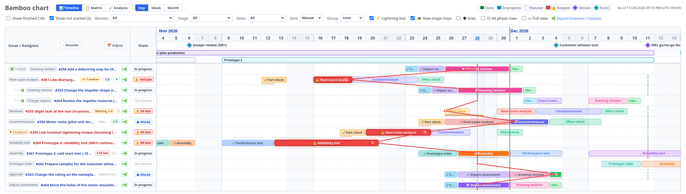
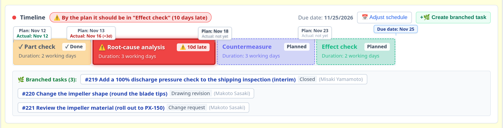
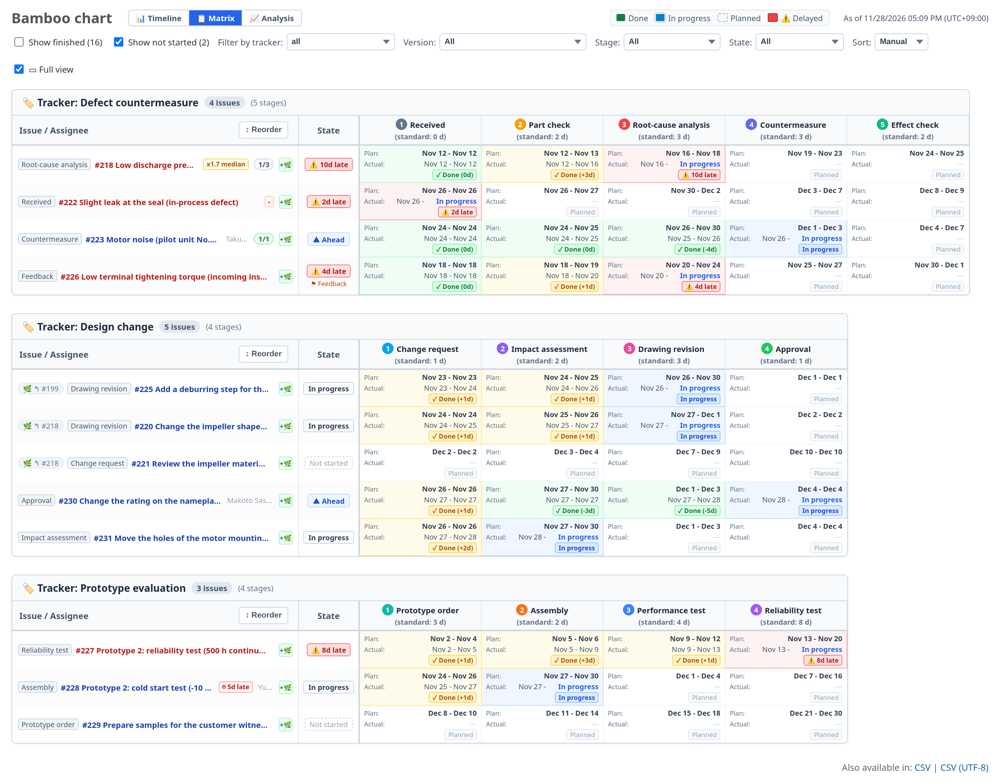

# Bamboo chart: a Redmine plugin to see the plan and the actual dates of each stage

A Redmine plugin that keeps one issue as one issue and shows the **plan and the actual dates of each stage**, such as "Received → Root-cause analysis → Countermeasure → Effect check", as a single bar. The bar is divided at each stage, and each division marks "this stage should be done by this day".

We could not find a common name for this kind of chart, so we named it a **Bamboo chart**: the bar with its divisions looks like a stalk of bamboo with its nodes. As a bamboo grows straight up, the stages go one after another. It is lighter than a Gantt chart, and you do not have to split the issue.

The plugin ID is `redmine_sequential_tasks` (Sequential Tasks).

[日本語](README.md)

> **Status**: v0.12.0 (2026-11-28). The author is still trying it out in daily use (dogfooding).



*The timeline (made-up data). Each row is the Bamboo chart of an issue (the planned and actual bars of its stages), and the lightning line joins today's line to where each issue is now.*

## What it does

A Redmine issue has only a "start date" and a "due date", so you cannot see by when the stages in between should be done, or which one is late right now. Splitting the work into child issues and chaining them is laborious, and teams do not keep it up. With this plugin you set the stages of each tracker (an order of statuses and the standard days of each) once; when an issue is created, the plan of its stages is laid out automatically, and when its status moves on, the actual dates are recorded.

- **Bamboo chart on the issue page**: the plan and the actual dates of each stage. Late stages turn red. Fix the plan by dragging a boundary of the bar or by typing the days ("Due date first" / "Days first").
- **Timeline**: the project's issues as Bamboo charts, with a lightning line that shows at a glance what is late and what is ahead. Due dates of versions, event points and phase bands too.
- **Matrix**: a table of stages × issues with the plan, the actual dates and the difference. It can be exported as CSV.
- **Analysis**: how long issues stay in each stage (mean, median, share over the plan), to see where work tends to get stuck.
- And more: branched tasks (the children keep going after the parent is closed), whether a release will be met, days spent waiting to be picked up, standard days per project, Japanese and English screens.



*The bar on the issue page: finished stages, a late stage, the stages to come, and the list of branched tasks.*



*The matrix: per tracker, the plan, the actual dates and the difference of each stage.*

See the [manual](docs/MANUAL.en.md) for the details (the screenshots show made-up data).

## Requirements

- Redmine 6.0 or later (developed and checked on 6.1.5; the author is trying it in their own work on 7.0.2)
- Checked with PostgreSQL (MySQL and SQLite are not checked)
- Checked with Chromium-based browsers (Firefox and Safari are not checked)
- No extra gems are needed

## Installation

Put the plugin in `<Redmine>/plugins/redmine_sequential_tasks/`, run the migrations and restart Redmine. Either a zip or a git clone will do.

**From a zip**: use the zip on [Releases](https://github.com/yoohey/redmine_sequential_tasks/releases) (`redmine_sequential_tasks-<version>.zip`). The zip does not include the images of the manual.

```sh
cd <Redmine>/plugins
unzip redmine_sequential_tasks-<version>.zip          # creates plugins/redmine_sequential_tasks/
```

**With git clone**: the main branch of this repository is updated only at releases. To install a given version, name its tag (the images of the manual and the git history come along, about 50 MB; the zip is 310 KB).

```sh
cd <Redmine>/plugins
git clone --branch v0.12.0 https://github.com/yoohey/redmine_sequential_tasks.git    # keep the folder name redmine_sequential_tasks
```

After either of them, run the following and restart Redmine.

```sh
cd <Redmine>
bundle exec rake redmine:plugins:migrate RAILS_ENV=production
```

**With Docker (the official `redmine` image)**: for reference. Keep the plugin on the host, show it to the container at `/usr/src/redmine/plugins/`, and set the environment variable `REDMINE_PLUGINS_MIGRATE`: the image then runs the migrations when it starts (the same setup as the author's development environment).

```sh
mkdir -p plugins
git clone --branch v0.12.0 https://github.com/yoohey/redmine_sequential_tasks.git plugins/redmine_sequential_tasks
```

```yaml
# add to the redmine service in compose.yaml
services:
  redmine:
    image: redmine:6.1.5
    environment:
      REDMINE_PLUGINS_MIGRATE: "1"    # runs redmine:plugins:migrate when the container starts
    volumes:
      - ./plugins/redmine_sequential_tasks:/usr/src/redmine/plugins/redmine_sequential_tasks
```

Recreate the container with `docker compose up -d` and it is ready (the `migrate` and the restart above are not needed). If your own Dockerfile `COPY`s the plugins in, run `docker compose build` before recreating it.

After installing, three steps get you started (chapter 2 of the manual has the details):

1. In Administration → "Sequential Tasks Settings", set the stages of a tracker (the order of statuses, the standard days and the colors)
2. In the project's Settings → Modules, switch on "Sequential tasks"
3. Create an issue of that tracker and open "Sequential Tasks" in the project menu

To update: with a zip, replace the folder with the new version; with git clone, run `git fetch --tags && git checkout v<new version>`. Then run the `migrate` above and restart. The manual (chapter 12) has the steps, removal included.

## Changelog and license

- Changelog: [CHANGELOG.en.md](CHANGELOG.en.md) ([日本語](CHANGELOG.md))
- License: GNU General Public License v2.0 or any later version (the same as Redmine). The full text is in [LICENSE](LICENSE)
