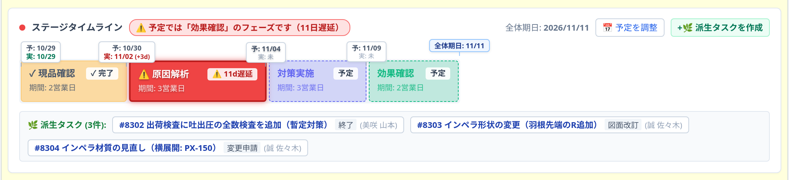
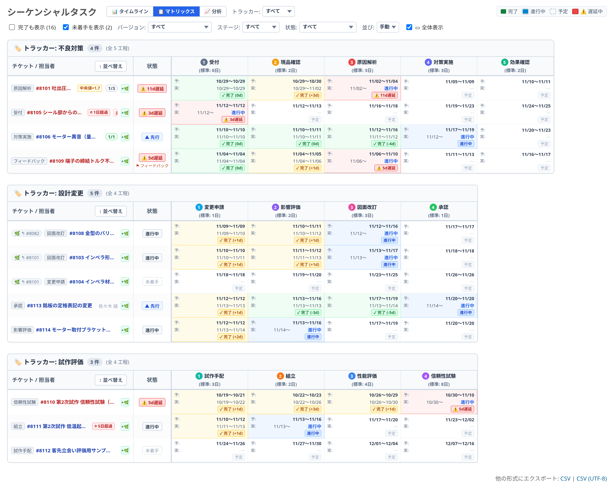

# redmine_sequential_tasks（シーケンシャルタスク）

Redmine のチケット1枚のまま、「受付 → 原因解析 → 対策 → 効果確認」のような**工程ごとの予定と実績**を帯で見せる Redmine プラグインです。

[English](README.en.md)

> **状況**: v0.10.0（2026-11-21）。作者が自分で使いながら確かめている段階（ドッグフーディング）です。


*タイムライン（架空のデータ）。行ごとに工程の予定・実績の帯、今日の線から各チケットの現在地を結ぶ稲妻線。*

## できること

Redmine のチケットは「開始日」と「期日」しか持てないので、途中の工程がいつまでに終わるべきか、今どこで遅れているかが見えません。子チケットに分けてつなぐ運用は、手間がかかって続きません。このプラグインは、トラッカーごとに工程（ステータスの順と標準日数）を決めておき、チケットを起票すると工程の予定を自動で組みます。ステータスを進めると、実績を記録します。

- **チケット詳細の帯**: 工程ごとの予定と実績。遅れは赤。帯の境目のドラッグや日数の入力で、予定を直せます（期日優先／日数優先）。
- **タイムライン**: プロジェクトのチケットを工程の帯で並べ、稲妻線で遅れと先行を一目で。バージョンの期日やイベントの点、大日程の帯も。
- **マトリックス**: 工程 × チケットの表で、予定・実績・差を一覧。CSV にも書き出せます。
- **分析**: 工程ごとの滞留日数（平均・中央値・予定オーバー率）。どこで詰まりやすいかを見ます。
- そのほか: 派生タスク（親を閉じても子は走り続ける）、リリースに間に合う見込み、受付待ちの日数、プロジェクトごとの標準日数、日本語・英語の画面。



*チケット詳細の帯。終わった工程・遅れている工程・これからの工程と、派生タスクの一覧。*



*マトリックス。トラッカーごとに、工程の予定・実績・差を並べます。*

使い方の詳細は [マニュアル](docs/MANUAL.md) にまとめています（画像は架空のデータです）。

## 動作環境

- Redmine 6.0 以上（6.1.5 で開発と確認。作者は 7.0.2 で自分の仕事で試しています）
- PostgreSQL で確認（MySQL・SQLite は未確認）
- ブラウザは Chromium 系で確認（Firefox・Safari は未確認）
- 追加の gem は要りません

## インストール

プラグインを `<Redmine>/plugins/redmine_sequential_tasks/` に置き、マイグレーションを流して、Redmine を再起動します。置き方は、zip と git clone のどちらでも構いません。

**zip で**: [Releases](https://github.com/yoohey/redmine_sequential_tasks/releases) の zip（`redmine_sequential_tasks-<版>.zip`）を使います。zip には、マニュアルの画像は入っていません。

```sh
cd <Redmine>/plugins
unzip redmine_sequential_tasks-<版>.zip          # plugins/redmine_sequential_tasks/ ができる
```

**git clone で**: このリポジトリの main は、リリースのときだけ更新します。版を決めて入れるなら、タグを指定します（マニュアルの画像と git の履歴も入るので、50MB ほどになります。zip は 310KB）。

```sh
cd <Redmine>/plugins
git clone --branch v0.10.0 https://github.com/yoohey/redmine_sequential_tasks.git    # フォルダ名は redmine_sequential_tasks のまま
```

zip・git clone のどちらのあとも、次を流して Redmine を再起動します。

```sh
cd <Redmine>
bundle exec rake redmine:plugins:migrate RAILS_ENV=production
```

**Docker（公式の `redmine` イメージ）で**: 参考です。プラグインを手元に置いてコンテナの `/usr/src/redmine/plugins/` に見せ、環境変数 `REDMINE_PLUGINS_MIGRATE` を付けると、起動のときにイメージがマイグレーションを流します（作者の開発環境と同じ形です）。

```sh
mkdir -p plugins
git clone --branch v0.10.0 https://github.com/yoohey/redmine_sequential_tasks.git plugins/redmine_sequential_tasks
```

```yaml
# compose.yaml の redmine のサービスに足す
services:
  redmine:
    image: redmine:6.1.5
    environment:
      REDMINE_PLUGINS_MIGRATE: "1"    # 起動のときに redmine:plugins:migrate を流す
    volumes:
      - ./plugins/redmine_sequential_tasks:/usr/src/redmine/plugins/redmine_sequential_tasks
```

`docker compose up -d` でコンテナを作り直せば使えます（下の `migrate` と再起動は要りません）。自前の Dockerfile でプラグインを `COPY` している場合は、`docker compose build` してから作り直します。

入れたあとは、次の3つで使い始められます（詳しくはマニュアルの第2章）。

1. 管理 → 「シーケンシャルタスク設定」で、トラッカーの工程（ステータスの順・標準日数・色）を決める
2. プロジェクトの設定 → モジュールで「シーケンシャルタスク」を有効にする
3. そのトラッカーでチケットを作り、プロジェクトメニューの「シーケンシャルタスク」を開く

更新は、zip なら新しい版でフォルダを置き換え、git clone なら `git fetch --tags && git checkout v<新しい版>` のあと、上の `migrate` を流して再起動します。取り外しを含め、手順はマニュアル（第12章）にあります。

## 変更履歴とライセンス

- 変更履歴: [CHANGELOG.md](CHANGELOG.md)
- ライセンス: GNU General Public License v2.0 またはそれ以降の版（Redmine 本体と同じ）。全文は [LICENSE](LICENSE)
