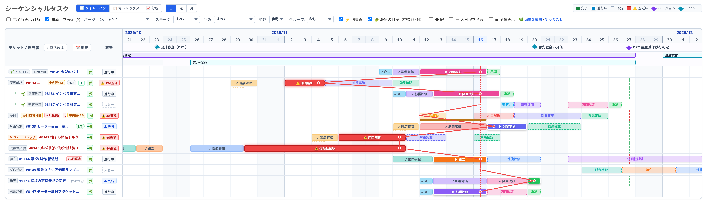

# redmine_sequential_tasks (シーケンシャルタスク)

直列（シーケンシャル）な複数ステージからなるタスクの中間進捗・予実を可視化・管理するRedmineプラグイン。

> **状況**: v0.9.0（2026-11-16。最初の公開版）。作者が自分で使いながら確かめている段階（ドッグフーディング）です。



*タイムラインの例（架空のデータ。日の表示）。日付の見出しの下に、イベントとバージョンの点（◆）と、大日程の帯。行ごとに、ステージの予定・実績のバーと、今日の線から各チケットの現在地を結ぶ稲妻線。リリースの日の緑と赤の縦の点線は、間に合う見込み。*

## このプロジェクトについて

Redmineのチケットは「開始日」と「期日」という全体の2点しか日付を持てないため、「受付 → 解析 → 検討 → 対策 → クローズ」といった多段階の業務において、**「各中間ステータスがいつまでに終わるべきか」「今どのフェーズで遅延しているか」**が把握できないという構造的課題があります。

子チケットに分割してFS（先行-後行）で数珠つなぎにする運用は管理コストが重すぎて破綻します。

本プラグインは、**「チケットは1枚（線は1本）」のまま、ステータスごとの予定期間と実績を帯グラフ（マルチステージバー）として色分け可視化**し、中間ステータスごとの予実管理とボトルネック把握を実現します。

## 動作環境

- **Redmine 6.1.5**（開発と試験に使用）。**Redmine 7.0.2**（Rails 8.1.4）でも、試験は全件通ります（画面は未確認）。要件は 6.0.0 以上としていますが、6.0 系での確認はしていません。
- **PostgreSQL 17** で試験。MySQL・SQLite は未確認です。
- **ブラウザ**: Chromium 系で確認。Firefox・Safari は未確認です（`color-mix`、固定セル、`:has()` などを使っています）。
- 追加の gem は要りません。

## 主な機能

1. **ステージの予実（チケット詳細）**: トラッカーごとに決めたステージ（ステータスの順）の予定期間と実績を、帯グラフで色分け表示。遅れは赤で警告。「予定を調整」で、帯の境目のドラッグや日数の入力で予定を直せます（**期日優先**＝期日を動かさず両隣でやり取り／**日数優先**＝後ろと期日をずらす）。開始日の変更、工程ごとの「休業日も数える」も。活動履歴に残ります。
2. **タイムライン**: 日・週・月の切り替え。日付の見出しは段（月・日／月・週／年・月）で、週と月の切れ目の線を強調。**稲妻線**（今日の線と各チケットの現在地を結ぶ）、遅れの題名は赤、担当者なしは赤い札。グループ化（トラッカー・担当者・ステータス・バージョン・カテゴリ）と折りたたみ。
3. **絞り込みと並び**: バージョン・カテゴリ・ステージ・状態（遅延／先行／進行中／リリース超過見込み／標準より遅い）、完了・未着手の表示。並びは手動・期日・遅延・更新。
4. **マイルストーンと大日程**: 日付の見出しの下に、バージョンの期日とイベント用トラッカーのチケットを点（◆）で、期間のあるもの（バージョン、イベント、FS でつながる通常チケット）をバーの帯（既定2段、最大5段）で表示。縦線の切り替え付き。
5. **リリースに間に合う見込み**: 対象バージョンの期日と、チケットの見込みの終わりを比べ、行に印（緑／赤）と超過の札。バージョン別のグループ見出しに、超過の件数。
6. **調整モード（タイムライン）**: 「📅 調整」をオンにすると、帯の右端（工程の予定終了日）・最初の帯の左端（開始日）・帯の中ほど（全体）をドラッグして予定を変えられます。離すとすぐ保存され、活動履歴に残ります。ページを開くたびにオフです。
7. **並べ替えモード**: ドラッグで兄弟の順を入れ替え。バージョン別のグループへドラッグすると、対象バージョンを付け替え（活動履歴に残る）。ページを開くたびにオフです。
8. **ゆるいブランチ（派生）**: 親から派生を起票でき、親だけ閉じても子は走り続けます。親の行に「完了/全体」（例: 2/3）、折りたたみ、親が表にないときの親番号の札。
9. **マトリックス**: 横軸＝ステージ、縦軸＝チケットの表で、予定・実績・差異を一覧。トラッカーごとに縦に並びます。画面の下から CSV に書き出せます（画面と同じ行・並び。「CSV (UTF-8)」も）。
10. **分析**: ステージごとの滞留日数（件数・平均・中央値・予定オーバー率・いま滞留中）。標準より長く滞留しているチケットに札「中央値×N」。
11. **全体表示と印刷**: スクロールの枠を外して全行・全日付を並べ、ページ全体のスクリーンショットや PDF にできます。印刷は自動でこの形になります。

12. **チケットを見ながら編集**: 行の題名（または帯のバー）をクリックすると、画面の右のバーに Redmine 標準のチケット画面が開き、タイムラインを見たまま、編集・予定の調整・派生の起票ができます。保存すると、タイムラインが自動で更新されます（Ctrl・Shift・中ボタンのクリックは、別ページで開きます）。

画面の文言は日本語と英語です（ほかの言語は英語になります）。

## インストール

[Releases](https://github.com/yoohey/redmine_sequential_tasks/releases) にある zip（`redmine_sequential_tasks-<版>.zip`）を使います。zip には、マニュアルの画像を入れていません（画像つきのマニュアルは、このリポジトリの [docs/MANUAL.md](docs/MANUAL.md) で見られます）。

```sh
cd <Redmine>/plugins
unzip redmine_sequential_tasks-<版>.zip          # plugins/redmine_sequential_tasks/ ができる
cd <Redmine>
bundle exec rake redmine:plugins:migrate RAILS_ENV=production
# Redmine を再起動する
```

- **更新**: 新しい版で`plugins/redmine_sequential_tasks/`を置き換え、上の`migrate`を流して再起動します。
- **取り外し**: 先に`bundle exec rake redmine:plugins:migrate NAME=redmine_sequential_tasks VERSION=0 RAILS_ENV=production`で、このプラグインのテーブルを消します（**記録が全部消えます**）。そのあと、フォルダを消して再起動します。

## はじめかた

1. **ステータスを用意する**: ステージにしたい工程ごとに、ステータスを作ります（例: 設計中・実装中・テスト中・リリース済み）。トラッカーのワークフローで、行き来を許可します。
2. **トラッカーのステージを決める**: 管理 → 「シーケンシャルタスク設定」で、トラッカーを有効にし、ステージ（ステータスの順、標準日数、色）を決めます。**設定は、このあとに作るチケットから効きます**（既存のチケットには反映されません）。
3. **プロジェクトで有効にする**: プロジェクトの設定 → モジュール →「シーケンシャルタスク」にチェックします。
4. **チケットを作る**: 開始日を入れると、標準日数から、各ステージの予定（稼働日ベース）と期日が自動で入ります。以後、ステータスを進めると、実績が記録されます。
5. **プラグインの設定**（管理 → プラグイン → 設定）: タブの名前（空なら「シーケンシャルタスク」。「工程」など現場の言葉にできます）、担当者名の並び順、そして「イベント用のトラッカー」（会議やレビューなど、点や帯にしたいチケットのトラッカー）。
6. プロジェクトメニューの「シーケンシャルタスク」を開きます。

権限: 表示は、モジュールを有効にしたプロジェクトで、チケットを見られる人。派生の起票は「チケットの追加」、並べ替えとバージョンの付け替えは「チケットの編集」の権限が要ります。見えるチケットは、Redmine のチケットの閲覧権限に従います。

### 使い方の例

- **スプリント開発**（固定日のリリース）: リリースごとにバージョンを作って期日を入れ、機能をチケットにして、対象バージョンを付けます。バージョン別にグループ化し、「◆ 線」とリリース判定の印を見ながら、「リリース超過見込み」のチケットを次のリリースへドラッグで付け替えます。
- **不良対策・設計変更（ものづくり）**: 不良対策なら「受付 → 現品確認 → 原因解析 → 対策実施 → 効果確認」をステージにします。不良管理の仕組みから REST API で起票すると、誰かが手に取るまでの「受付待ち」の日数も見えます。試作評価の信頼性試験のように、製品ごとに日数が違う工程は、プロジェクトごとに標準日数を変えられます。
- **不具合・解析の管理**: 不具合のチケットから、解析・対策を派生で起票し、親の「完了/全体」で進みを見ます。カテゴリ別にグループ化し、ステージで絞り、分析画面で、どの工程で詰まりやすいかを見ます。

## 知っておくこと

- ステージの進みは、**チケットのステータスの変更**で決まります。更新されないと、稲妻線や遅れの判定は意味を失います。
- 休業日は、Redmine の休業曜日の設定だけです（祝日・特別休暇は対応しません）。工程ごとに「休業日も数える」にできます。半年先まで稼働日が1日も無い設定（7曜日すべてを休業日など）では、シーケンシャルタスクのトラッカーのチケットの起票・日付の変更・予定の調整を断ります。
- チケットの開始日・期日を編集画面で直接変えると、予定も連動します（開始日は、まだどの工程も終わっていないときだけ）。連動して変わった期日も、活動履歴に残ります。
- リリースに間に合う見込みは目安です（最後のステージの終わりに、いまの遅れの日数を、カレンダーの日で足します）。
- 分析の履歴は、このプラグインを入れて記録が始まってからの分です。履歴が3件に満たないステージには、基準がありません。
- 設定したステージは、既存のチケットには反映されません。既存のチケットのトラッカーをシーケンシャルなものに変えると、開始日から工程が作られます。

## 変更履歴

版ごとの変更は [CHANGELOG.md](CHANGELOG.md) にあります。

## マニュアル

画面ごとの使い方・設定・運用の考え方は、[docs/MANUAL.md](docs/MANUAL.md) にまとめています（画像は架空のデータです）。

## ライセンス

GNU General Public License v2.0 またはそれ以降の版（Redmine 本体と同じ）。全文は [LICENSE](LICENSE)。
