# Bamboo chart (redmine_sequential_tasks): Operation and User Manual

[日本語](MANUAL.md)

This is the operation and user manual of the Redmine plugin **Bamboo chart** (its ID is `redmine_sequential_tasks`; Sequential Tasks). A Bamboo chart is one bar divided into the stages of an issue, like the nodes of a bamboo, showing the plan and the actual dates of each stage.  
It is written for everyone from the people who create issues and manage their progress every day (software developers, and also people in design, quality assurance, production engineering and so on), to the project managers (PMs / Scrum Masters) who oversee several cases, and the system administrators who set up and run the environment.

The screenshots were taken with made-up data (development and quality of a small liquid-transfer pump, PX-200; the product, the people and the defects are all made up). The data are in English, and "today" in them is one day later than in the Japanese manual, so some numbers (days late, days waiting) differ from it by one day. The release zip does not include the images and videos. To read it with the images, open [docs/MANUAL.en.md](https://github.com/yoohey/redmine_sequential_tasks/blob/main/docs/MANUAL.en.md) on GitHub.

---

## Contents

- **Part 1: Concepts and setup**
  - [Chapter 1: Overview and basic features](#chapter-1-overview-and-basic-features)
    - [1.1 Background and purpose](#11-background-and-purpose)
    - [1.2 Core concepts](#12-core-concepts)
    - [1.3 The main screens and what they are for](#13-the-main-screens-and-what-they-are-for)
  - [Chapter 2: Setup for administrators](#chapter-2-setup-for-administrators)
    - [2.1 Requirements](#21-requirements)
    - [2.2 Installation and database migration](#22-installation-and-database-migration)
    - [2.3 Tracker settings in Administration](#23-tracker-settings-in-administration)
    - [2.4 Working with the workflow (permissions)](#24-working-with-the-workflow-permissions)
    - [2.5 Following Redmine's non-working days](#25-following-redmines-non-working-days)
    - [2.6 Switching it on in a project, permissions and plugin settings](#26-switching-it-on-in-a-project-permissions-and-plugin-settings)
- **Part 2: Daily issue management (for the people doing the work)**
  - [Chapter 3: Managing stages on the issue page](#chapter-3-managing-stages-on-the-issue-page)
    - [3.1 Creating an issue and the plan of its stages](#31-creating-an-issue-and-the-plan-of-its-stages)
    - [3.2 Reading the bar (statuses and colors)](#32-reading-the-bar-statuses-and-colors)
    - [3.3 Adjusting the plan of each stage (behavior in detail)](#33-adjusting-the-plan-of-each-stage-behavior-in-detail)
    - [3.4 Using the "0-day wait (waiting to be picked up)" stage](#34-using-the-0-day-wait-waiting-to-be-picked-up-stage)
    - [3.5 Switching a stage to "Count non-working days" (calendar days)](#35-switching-a-stage-to-count-non-working-days-calendar-days)
    - [3.6 Following a change of tracker](#36-following-a-change-of-tracker)
    - [3.7 Guards against mistakes (UI and accessibility)](#37-guards-against-mistakes-ui-and-accessibility)
  - [Chapter 4: Loose branches (branched tasks)](#chapter-4-loose-branches-branched-tasks)
    - [4.1 How they differ from parent and child issues](#41-how-they-differ-from-parent-and-child-issues)
    - [4.2 Creating a branched task quickly (the `＋🌿` button)](#42-creating-a-branched-task-quickly-the--button)
    - [4.3 Checking progress on the parent (the `[2/3]` done/total badge)](#43-checking-progress-on-the-parent-the-23-donetotal-badge)
    - [4.4 "This issue and its branches" timeline on the issue page](#44-this-issue-and-its-branches-timeline-on-the-issue-page)
- **Part 3: Progress and overall coordination of the project (for leaders and PMs)**
  - [Chapter 5: The timeline (a Gantt-like calendar view)](#chapter-5-the-timeline-a-gantt-like-calendar-view)
    - [5.1 Reading the screen and basic operations](#51-reading-the-screen-and-basic-operations)
    - [5.2 ⚡ Seeing the project's tendency to fall behind with the lightning line (progress line)](#52--seeing-the-projects-tendency-to-fall-behind-with-the-lightning-line-progress-line)
    - [5.3 📅 Adjust mode (rescheduling by dragging)](#53--adjust-mode-rescheduling-by-dragging)
    - [5.4 Filtering, grouping and manual reordering](#54-filtering-grouping-and-manual-reordering)
    - [5.5 Checking and editing an issue in the side panel on the right](#55-checking-and-editing-an-issue-in-the-side-panel-on-the-right)
    - [5.6 The tree of branched tasks, and folding it](#56-the-tree-of-branched-tasks-and-folding-it)
  - [Chapter 6: Milestones, phases and sprint management](#chapter-6-milestones-phases-and-sprint-management)
    - [6.1 Milestones (◆) and event trackers](#61-milestones--and-event-trackers)
    - [6.2 Phase bands (version bands and coarse FS phases)](#62-phase-bands-version-bands-and-coarse-fs-phases)
    - [6.3 Will the release be met? (the ⏱ chip)](#63-will-the-release-be-met-the--chip)
    - [6.4 Moving issues to another version by dragging (sprint adjustment)](#64-moving-issues-to-another-version-by-dragging-sprint-adjustment)
  - [Chapter 7: The matrix view and CSV export](#chapter-7-the-matrix-view-and-csv-export)
    - [7.1 Reading the matrix](#71-reading-the-matrix)
    - [7.2 CSV export](#72-csv-export)
  - [Chapter 8: Bottleneck analysis (continuous improvement of the process)](#chapter-8-bottleneck-analysis-continuous-improvement-of-the-process)
    - [8.1 Time spent in each stage, and the median lead time](#81-time-spent-in-each-stage-and-the-median-lead-time)
    - [8.2 🚧 Finding the stage that is most stuck](#82--finding-the-stage-that-is-most-stuck)
    - [8.3 The "xN median" chip for issues stuck for long](#83-the-xn-median-chip-for-issues-stuck-for-long)
    - [8.4 Using it in retrospectives](#84-using-it-in-retrospectives)
  - [Chapter 9: Customizing per project](#chapter-9-customizing-per-project)
    - [9.1 Overriding the standard days per project](#91-overriding-the-standard-days-per-project)
    - [9.2 Full view and print layout](#92-full-view-and-print-layout)
- **Part 4: Architecture, integration and reference**
  - [Chapter 10: Internal architecture and data structure (technical notes)](#chapter-10-internal-architecture-and-data-structure-technical-notes)
    - [10.1 ER diagram and table design (non-intrusive design)](#101-er-diagram-and-table-design-non-intrusive-design)
    - [10.2 The working-day calculation](#102-the-working-day-calculation)
    - [10.3 The visit history for rework (issue_stage_visits)](#103-the-visit-history-for-rework-issue_stage_visits)
    - [10.4 Drawing performance (plain table + SVG overlay + vanilla JS)](#104-drawing-performance-plain-table--svg-overlay--vanilla-js)
  - [Chapter 11: Integration with external systems (REST API)](#chapter-11-integration-with-external-systems-rest-api)
    - [11.1 The plan of the stages for issues created through the REST API](#111-the-plan-of-the-stages-for-issues-created-through-the-rest-api)
    - [11.2 Use cases with a defect database or monitoring alerts](#112-use-cases-with-a-defect-database-or-monitoring-alerts)
  - [Chapter 12: FAQ, troubleshooting and maintenance](#chapter-12-faq-troubleshooting-and-maintenance)
    - [12.1 Working days and holidays (how other plugins fit in)](#121-working-days-and-holidays-how-other-plugins-fit-in)
    - [12.2 Checkpoints when the plan is off or cannot be saved](#122-checkpoints-when-the-plan-is-off-or-cannot-be-saved)
    - [12.3 Updating to a new version](#123-updating-to-a-new-version)
    - [12.4 Uninstalling](#124-uninstalling)
    - [12.5 Known limitations](#125-known-limitations)

---

# Part 1: Concepts and setup

## Chapter 1: Overview and basic features

### 1.1 Background and purpose

When you manage tasks that move on in sequence, such as countermeasures for defects, design changes, incident handling or feature development, a Gantt chart or child issues chained with FS (finish-to-start) relations tend to make creating and updating the issues heavy work.

This plugin therefore offers **a light way to see and manage the plan, the actual dates and the delays of each stage while keeping the work as one issue, using its statuses**, without splitting it. It aims to catch delays in the stages in between early, while keeping the extra work for the team as small as possible.

For example, a countermeasure for a manufacturing defect (Received ➔ Part check ➔ Root-cause analysis ➔ Countermeasure ➔ Effect check), a design change or the evaluation of a prototype are all work in which the stages of one case move on in sequence. The plugin is meant not only for IT development but especially for this kind of manufacturing work.

---

### 1.2 Core concepts

"Open/Closed is too coarse, a WBS in a Gantt chart is too heavy, and a Kanban card does not show its due dates." To resolve this dilemma, the plugin takes the approach of **"one issue (one line) per case, with its progress managed in several steps by its status"**. In practice it is designed and built on the following four principles.

1. **Status = the stage sequence**:
   No new concept is brought in: Redmine's own "statuses" are used as the stages in sequence. Redmine's done ratio (%) has vague rules for what to enter and varies from person to person, so the design treats "moving through the statuses" as the progress itself.
2. **The plan laid out automatically and the actual dates recorded automatically (automated plan vs. actual)**:
   Enter only the start date when you create an issue, and the planned start and end dates of each stage and the overall due date are laid out from the standard days set beforehand (skipping weekends). After that, just move the status as the work goes on, and the actual date and time of each stage are stamped and recorded automatically.
   The days here are the planned period, "this stage should be done by this day". The plugin does not estimate the effort (hours) of the work or derive a schedule from it.
3. **"Loose branches" that do not interfere with each other**:
   When branched tasks are born from an issue, the relation does not hold back the closing of the parent: the branches do not interfere with each other. This avoids the situation where "the parent has done its job, but it cannot be closed because of a constraint", which makes the rules an empty formality.
4. **A Gantt-like list screen**:
   A list showing only Open/Closed or a done ratio does not reveal a "silent delay": an issue that looks started but is in fact stuck in an early stage. The plugin therefore provides a dedicated timeline that shows at a glance how far each issue has moved through its statuses, so that a tendency of the whole project to fall behind is noticed early.

---

### 1.3 The main screens and what they are for

The plugin has the following four screens for different uses.

| Screen / component | Where | Main use |
|---|---|---|
| **Multi-stage bar** | Issue page (just below the description) | Shows the plan, the actual dates and the delays of each stage. Adjust the days of each stage; shows the wait before an issue is picked up. |
| **Timeline** | The "Bamboo chart" tab in the project menu | All issues, each stage on one calendar row. Detects delays with the ⚡ lightning line; adjusts the plan by 📅 dragging. |
| **Matrix** | Project menu ➔ submenu "Matrix" | Plan vs. actual per tracker. Check the difference in each cell; export as CSV. |
| **Bottleneck analysis** | Project menu ➔ submenu "Analysis" | Totals the median time spent in each stage, finds the 🚧 worst stage and flags issues that have stayed too long. |

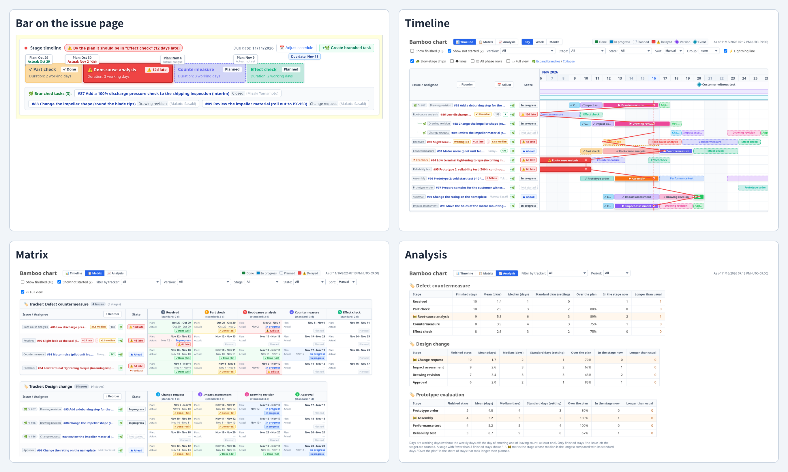
*Screen 1-1: The four main screens (the bar on the issue page, the timeline, the matrix and the analysis)*

---

## Chapter 2: Setup for administrators

### 2.1 Requirements

The plugin has passed the full automated tests and has been checked on the following.

- **Redmine**: 6.0.0 or later.
  - Checked: Redmine 6.1.5 (PostgreSQL 17) with the full automated tests and the screens; Redmine 7.0.2 with the full automated tests. The author is trying it in their own work on Redmine 7.0.2 (not every feature has been checked thoroughly).
  - Not checked: Redmine 6.0.x.
- **Database**: PostgreSQL (checked with 17). MySQL / SQLite3 are not checked, although only standard migrations are used.
- **Browser**: checked with Chromium-based browsers (Google Chrome, Edge, etc.). Firefox / Safari are not checked.
- **External dependencies**: **none** (no large external JS/CSS libraries; it is built light, with plain HTML/CSS/vanilla JS/SVG only)

---

### 2.2 Installation and database migration

Do the following on the server where Redmine runs.

#### (1) Put the plugin folder in place
Put it in Redmine's `plugins/` folder under the name `redmine_sequential_tasks`. Either a zip or a git clone will do.

**From a zip**: get the latest version (`redmine_sequential_tasks-X.X.X.zip`) from [Releases](https://github.com/yoohey/redmine_sequential_tasks/releases) on GitHub and unpack it.

```bash
cd /path/to/redmine/plugins
# unpack the release zip (check that the folder is named redmine_sequential_tasks)
unzip redmine_sequential_tasks-0.11.0.zip
ls -la redmine_sequential_tasks
```

**With git clone**: the main branch of the public repository is updated only at releases. To install a given version, name its tag (`v0.11.0`, etc.). The images of the manual and the git history come along, about 50 MB (the zip is 310 KB).

```bash
cd /path/to/redmine/plugins
git clone --branch v0.11.0 https://github.com/yoohey/redmine_sequential_tasks.git
ls -la redmine_sequential_tasks
```

**With Docker (the official `redmine` image)** (for reference): keep the plugin in a folder on the host and show it at `/usr/src/redmine/plugins/redmine_sequential_tasks` in `compose.yaml`. With the environment variable `REDMINE_PLUGINS_MIGRATE`, the image runs `redmine:plugins:migrate` when it starts, so steps (2) and (3) below come down to `docker compose up -d` (recreating the container).

```bash
mkdir -p plugins
git clone --branch v0.11.0 https://github.com/yoohey/redmine_sequential_tasks.git plugins/redmine_sequential_tasks
```

```yaml
services:
  redmine:
    image: redmine:6.1.5
    environment:
      REDMINE_PLUGINS_MIGRATE: "1"
    volumes:
      - ./plugins/redmine_sequential_tasks:/usr/src/redmine/plugins/redmine_sequential_tasks
```

If your own Dockerfile `COPY`s the plugins in, run `docker compose build` before recreating the container.

#### (2) Run the database migration
This creates the tables the plugin uses (six in all). By design, no column is added to Redmine's own tables (chapter 10 has the table structure).

```bash
cd /path/to/redmine
bundle exec rake redmine:plugins:migrate RAILS_ENV=production
```

#### (3) Restart the web server
Restart the Redmine process (Puma, Unicorn, Passenger, etc.).

```bash
# e.g. with systemd
sudo systemctl restart redmine
```

#### (4) Check the installation
Log in to Redmine as an administrator. If **`Redmine Sequential Tasks (Bamboo chart)`** is listed under **Administration ➔ Plugins**, the installation is done.

> [!NOTE]
> For updating to a later version, see **chapter 12 (section 12.3)**.

---

### 2.3 Tracker settings in Administration

Define the trackers the plugin works on, and the stage sequence each of them goes through.

1. Open **Administration ➔ "Sequential Tasks Settings"** (or the settings link in the list of plugins).
2. Choose the tracker to set up.
3. Tick **"Enable sequential management"**.
4. Choose the **bar style** (three styles, to suit taste and the workplace):
   - `Bold`: the default. Filled with the stage's color, with white text. Progress and delays stand out the most.
   - `Subtle`: a pale fill with a frame in the stage's color and a line at the left edge. For teams that prefer a calm look.
   - `Light`: almost white, with a gray frame and a line in the stage's color at the left edge. To blend into the background.
5. **Build the stage sequence**:
   - Open the list of statuses the tracker can use.
   - Tick the statuses that make up the stages.
   - **Drag and drop** them into the order the stages are passed (the flow from left to right).
   - Enter the **standard days (0-365)** of each stage (only the first stage can be 0 days).
   - Choose the **bar color** of each stage from the 12 presets or with the color picker.
6. Click **"Save"**.

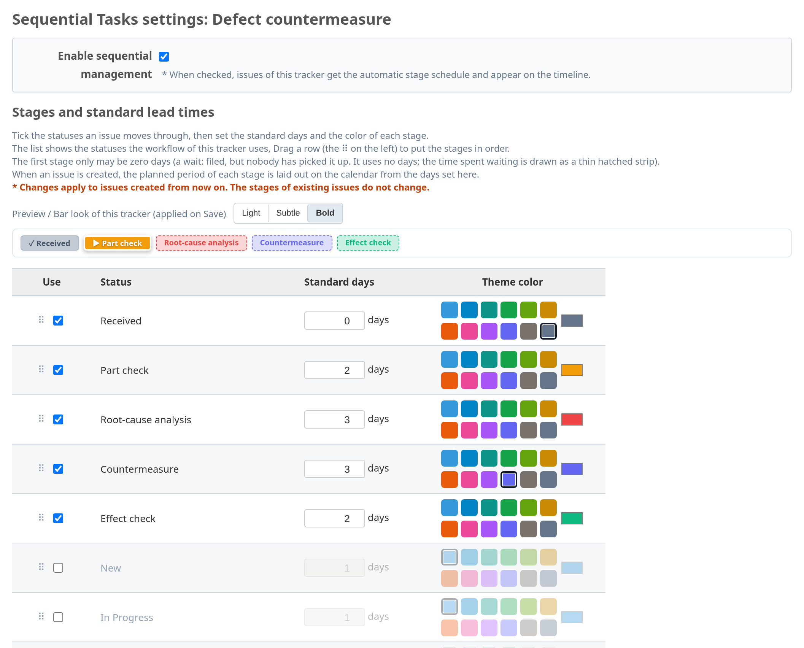
*Screen 2-1: The tracker settings (defect countermeasure). The preview of the bar look at the top; below it, the statuses used as stages, the standard days and the colors*

> [!TIP]
> **Making the first stage "0 days (waiting to be picked up)"**:  
> For work that starts only when somebody takes it on after it is filed, the first status (e.g. "New", "Received") alone can be set to 0 days. At `0` days the stage is treated as "the pool between filing and somebody picking it up": it uses no planned period, and the days spent waiting are worked out when somebody starts on it.

---

### 2.4 Working with the workflow (permissions)

The plugin follows Redmine's own status transitions (the workflow).

- **Check the transitions**:  
  In **Administration ➔ Workflow**, make sure each role can move between the statuses of the stages you defined.
- **Allow sending work back**:  
  If issues are sent back (rework), such as "Review ➔ Implementation" or "Effect check ➔ Root-cause analysis", the workflow must also allow the transition in that reverse direction.
- **Permission to edit the start and due dates**:  
  The plugin uses Redmine's own "Start date" and "Due date". So if "Fields permissions" in the workflow make the "Start date" or the "Due date" read-only for a role, the plugin does not go around that permission: it refuses to save.
  - Due date read-only: neither "Adjust schedule" nor the adjust mode of the timeline saves, in either mode.
  - Start date read-only: the start date field turns gray ("locked by the workflow"), and dragging the start date is refused when saving.
  - Note: The adjust mode of the timeline does not check this beforehand; it shows the reason when you let go of the bar and it tries to save.

---

### 2.5 Following Redmine's non-working days

So that no work is planned on weekends or other days off, the plugin follows Redmine's own setting of non-working days.

1. Open **Administration ➔ Settings ➔ the "Issue tracking" tab**.
2. Under **"Non-working days"**, check that the weekly days off of your workplace, such as Saturday and Sunday, are ticked.
3. **How it follows the setting**:
   - When an issue is created or its plan is changed, non-working days are skipped (e.g. a 3-day stage starting on Friday counts Friday, Monday and Tuesday, and ends on Tuesday).
   - On the timeline, the columns of non-working days are shaded lightly (following this setting).
   - Note: If you want to work on weekends for a given issue or stage, you can switch on "Count non-working days" on the issue page (see chapter 3).

> [!IMPORTANT]
> **Protection when there is no working day**:  
> Because the plan is laid out automatically when an issue is created, if all seven weekdays are set as non-working days, or if there is not a single working day in the next half year (for example because of an external calendar plugin), the processing is stopped safely (an error is shown) to avoid an endless loop. What stops is: creating issues of the sequential-task trackers (the REST API too), changing their start and due dates, and adjusting their plans. Issues of other trackers are not affected.

---

### 2.6 Switching it on in a project, permissions and plugin settings

#### (1) Enable the module in the project
The tracker settings alone do not show anything. In each project that uses it, tick **"Sequential tasks"** under **Settings ➔ Modules** and save. Then the "Bamboo chart" tab appears in the project menu, and the Bamboo chart is shown on the issue page.

#### (2) Permissions
| Permission | What it allows | Note |
|---|---|---|
| View sequential tasks (`view_sequential_tasks`) | See the timeline, the matrix and the analysis | Everyone by default (public) |
| Edit issues (Redmine's own `edit_issues`) | Adjust the plan, the adjust mode of the timeline, manual reordering, changing the version | |
| Add issues (Redmine's own `add_issues`) | Create branched tasks | |
| Adjust the standard days (`manage_sequential_tasks`) | Standard days per project (9.1) | Not given to any role by default |

#### (3) Plugin settings (Administration ➔ Plugins ➔ "Configure" of Sequential Tasks)
- **Tab name**: the name of the tab in the project menu and of the headings of the timeline, the matrix and the analysis. When blank, "Bamboo chart". You can use your workplace's own word, such as "Stages" (up to 30 characters; the same name in every language).
- **Order of assignee names**: follow Redmine / family name first / first name first.
- **Trackers shown as milestones**: issues of the trackers chosen here (for events, etc.) are shown under the header of the timeline as points (◆) or as phase bands (chapter 6).

---

# Part 2: Daily issue management (for the people doing the work)

## Chapter 3: Managing stages on the issue page

### 3.1 Creating an issue and the plan of its stages

When you create an issue with a tracker that has sequential tasks switched on, the plan of its stages (its Bamboo chart) is laid out automatically, with no extra setup.

1. **Create the issue as usual**:
   - Choose the project and a tracker with sequential tasks switched on (e.g. "Defect countermeasure", "Design change", "Incident").
   - Enter the subject, the description and the assignee.
   - Enter the **start date** (if it is left empty, today or the next working day is set).
   - Note: The due date may stay empty.
2. **Automatic calculation on save**:
   - When the issue is saved, the planned start and end dates of all stages are worked out one after the other from the standard days defined in Administration, skipping weekends (non-working days).
   - **The planned end of the last stage becomes the "due date" of the issue**.
3. **Actual dates recorded as the status moves on**:
   - When the issue's status moves on (e.g. "New" ➔ "Investigating"), the end date and time are stamped on the previous stage and the start date and time on the new one.
   - Nobody has to type a done ratio (%): just changing the status as the daily work goes on builds up an accurate record of the actual dates.

> [!TIP]
> **When the due date is decided before the issue is created**:  
> If both the start and the due date are entered by hand when creating the issue, the due date stays as entered and each stage gets its standard days (the days are not spread out to fit). So the end of the last stage and the due date may differ. To make them match, fix the days with "Adjust schedule" after creating the issue, or create the issue with the due date left empty.

---

### 3.2 Reading the bar (statuses and colors)

Open an issue and a bar of its stages in sequence (a progress bar) is drawn just below the description.

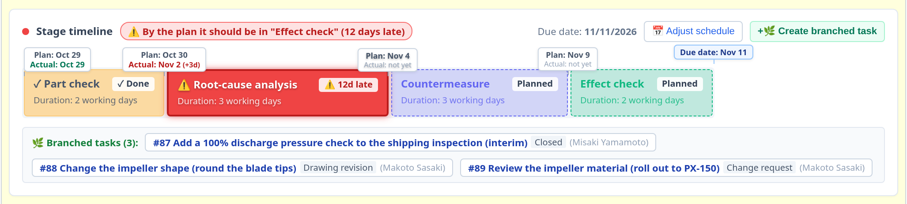
*Screen 3-1: The bar on the issue page. Finished stages (✓), the current stage that is late (red), the stages to come (dashed). Branched tasks below*

Each block of the bar is drawn differently on purpose, according to its state.

| State | Look | Intent and meaning |
| --- | --- | --- |
| **✓ Done** | **Pale color** + check mark | A stage already finished. Drawn pale and modest so that it does not add visual noise. |
| **Current** | **Vivid color** + white ring (with "Bold") | The stage being worked on now. The most vivid thing on the screen, to show at a glance who has the ball. |
| **Delayed** | **Bright red (#ef4444)** + thick red frame + `⚠️ Nd late` | A stage not finished after its planned end. The red frame and the badge make the days late stand out strongly. |
| **Future** | **Pale and translucent** + dashed frame | A stage still to come. Its planned period and the stages to pass are hinted at lightly with a pale dashed frame. |
| **Skipped** | **Gray dashed** + strikethrough | A stage passed over. Shows that it was skipped, without moving the plan. |

Note: When the issue is in a status that is not set as a stage (e.g. "Feedback"), a note "⚑ status name" appears above the bar. The plan and the actual dates of the stages stay as they are, and recording continues when the issue returns to a status of a stage.

Note: The look depends on the style chosen in the tracker settings (Bold, Subtle, Light). How the states are told apart (symbols and frames) is the same in every style.

---

### 3.3 Adjusting the plan of each stage (behavior in detail)

When "the root-cause investigation looks like it will take longer than expected" or "we want to bring the evaluation of the prototype forward", you can reschedule the stages on the screen.

When adjusting, you can choose between two modes, **"Due date first"** and **"Days first"**, which behave differently.

---

#### 3.3.1 The basic steps

1. Click the **"📅 Adjust schedule"** button to the right of the bar.
2. The bar switches to an inline editing mode, with the mode buttons (Due date first / Days first) and a field for the days of each stage.
3. Type the days of the stage to change, or drag a boundary between stages left or right with the mouse.
4. Check the planned dates of each stage and the overall due date, recalculated as you go, and click **"Save changes (recorded in the history)"**.

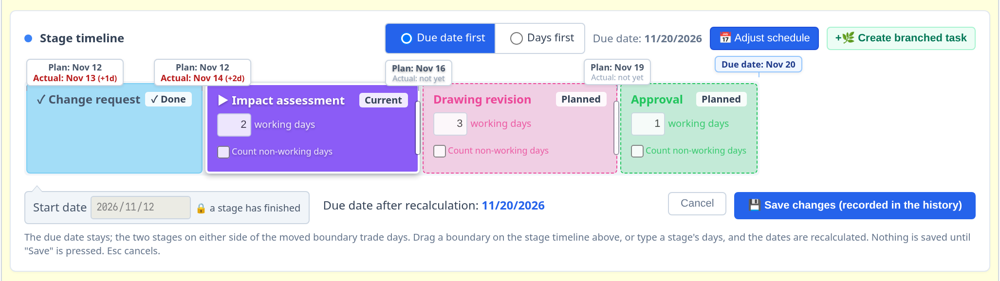
*Screen 3-2: "Adjust schedule" opened. The mode (Due date first / Days first), the days of each stage with "Count non-working days", the start date, and the due date after recalculation*

---

#### 3.3.2 Two modes: "Due date first" and "Days first"

The plan is recalculated as follows, depending on the mode chosen.

| | (1) Due date first (`fixed_due`) | (2) Days first (`push`) |
| --- | --- | --- |
| **What is kept** | **The end of the plan (the end of the last stage = the right edge of the bar)** | **The days (planned period) of each stage** |
| **Overall due date** | **Does not move** (on save, the issue's due date is set to the end of the plan) | **Extended automatically (slides)** later |
| **When a stage is lengthened** | The **next stage** after the moved boundary shrinks to absorb it | All later stages keep their days and **simply shift later** |
| **Typical use** | Firm cases whose delivery or release date cannot move | Cases where you keep each stage's period and want to see when it will end as a result |

##### What "Due date first" does
- **Behavior**: if a stage in the middle (e.g. Implementation) goes from `3 days ➔ 5 days` (+2 days), the overall due date stays and **the following stage (e.g. Testing) shrinks from `4 days ➔ 2 days` (-2 days)**. Think of the two stages on either side of the boundary trading days.
- **Which stage takes up the difference in other operations** (the rule: only the neighbor of the moved boundary changes):
  - Dragging a boundary: it stops when the next stage is down to 1 day.
  - Typing the days: the next stage takes it up. What would bring the next stage below 1 day is absorbed by the stage just before the due date.
  - Typing the days of the last stage: the stage before it takes it up.
  - Changing the start date: the first stage stretches or shrinks (its end does not move).
  - Switching "Count non-working days": the start and end of that stage stay, and its days are counted again (other stages do not move).
- **Limits and errors (does not fit)**:
  If it still does not fit by the due date, **"Does not fit into this due date"** is shown in red and the save button is disabled. This guard keeps an invalid plan that breaks through the due date from being made.

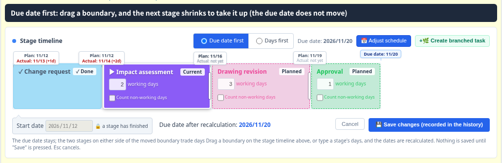
*Video 3-1a (animation): Due date first. Lengthening the impact assessment from 2 to 4 days shrinks the drawing revision from 3 days to 1, and the due date (11/20) does not move (not saved in this video)*

##### What "Days first" does
- **Behavior**: if a stage (e.g. Investigation) goes from `2 days ➔ 5 days` (+3 days), the later stages keep their days and **all of them slide later by 3 working days**.
- **The due date follows**: **the issue's overall due date (`due_date`) is recalculated and extended** by as much as the last stage moved.

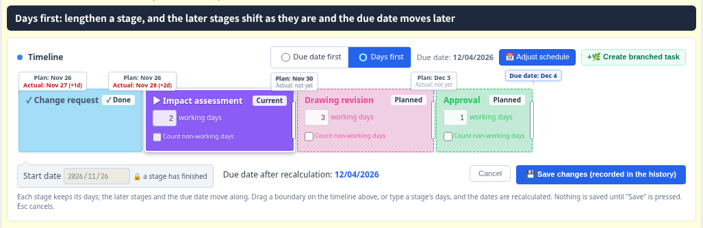
*Video 3-1b (animation): Days first. Lengthening the impact assessment from 2 to 4 days in the same way, the drawing revision keeps its 3 days and shifts later, and the due date moves from 11/20 to 11/24 (not saved in this video)*

---

#### 3.3.3 What you can and cannot do (rules and limits)

To avoid the confusion of "I want to adjust it like this, but the system won't let me", the plugin has the following guards and rules, each on purpose.

##### Possible
- **Changing the days of unfinished stages**: freely, as a whole number (1 to 365 days).
- **Dragging a stage boundary**: lengthen or shorten the days with the mouse.
- **Counting calendar days (non-working days included)**: switch on "Count non-working days" for a given stage only, to let it run by the calendar (see 3.5). By default working days are counted, so lengthening a stage that ends on Friday by one day makes it end on Monday, skipping the weekend.
- **Changing the start date**: only for issues where **no stage has finished yet**, the start date can be moved earlier or later (even while the first stage is in progress).

##### Not possible (limited on purpose)
1. **Less than a day (half a day, 0.5 days, hours) cannot be entered, on purpose**:
   - The smallest unit is a day (Date). Fractions such as "0.5 days" cannot be entered (except the 0-day waiting stage at the head).
2. **The dates and days of stages already "done" are locked**:
   - Stages such as "Basic design" or "Part check", whose status has been passed and whose actual dates are settled, cannot be edited, so that the record of the past stays accurate.
3. **The "start date" of an issue with a finished stage is locked**:
   - If even one stage has finished (including after a waiting stage was picked up), a stage was skipped, or the current stage is not the first, the start date field is locked (the screen shows the reason, such as "a stage has finished"). This keeps the plan vs. actual of finished stages from changing afterwards.
   - Note: The start date can still be changed on Redmine's own issue edit page, but then the plan of the stages does not move (the issue's start date and the plan differ).
4. **A change of the due date against the workflow permissions is refused**:
   - If Redmine's workflow makes the "Due date" read-only for the role of the logged-in user, the adjustment itself is not saved (in either mode). If the start date is read-only, its field turns gray ("locked by the workflow").

> [!IMPORTANT]
> **Details recorded in the history (journal)**:  
> When you adjust the plan and save, Redmine's history records **"which stage changed from how many days to how many"** and **"from when to when the due date moved along with it"**.

---

#### 3.3.4 Changing the start or due date directly on the issue edit page

The plan of the stages also follows when the start or due date is changed without "Adjust schedule", on Redmine's own issue edit page (including the REST API and the automatic shifting by "precedes / follows" relations).

| What changed | When no stage has finished | When a stage has finished |
|---|---|---|
| Start date only | Lays the stages out again from the new start date (the next working day if it is a non-working day), keeping their days, and sets the due date to the end of the plan | The stages do not move (only the issue's start date changes and differs from the plan) |
| Due date only | Moves the end of the stage just before the due date (the only stage, if there is one) to the new due date (the working day before it, if it is a non-working day) | The same |
| Both | Lays the stages out from the new start date; the stage just before the due date takes up the time until the new due date | The same as due date only |

- A due date changed along with it is also recorded in the history as a change of the issue.
- If the stages do not fit by the due date, the save is refused.
- If a person who may not change the due date by the workflow changes the start date and that would move the due date, the save is refused too.

---

### 3.4 Using the "0-day wait (waiting to be picked up)" stage

Usually the planned period of the first stage starts as soon as an issue is created. But in uses like the following, "it starts as soon as it is filed" does not match reality.

- **Questions and bugs waiting to be dispatched**: "After an issue is filed, we want to pool it until a leader has read it and dispatched (assigned) it to someone."
- **Defect reports and complaints waiting to be received**: "We want to see how many days a defect report from a factory or a customer sat there before someone in quality assurance received it and started checking the part."
- **Issues created automatically by monitoring systems or an API**: "We want to see exactly how long an issue created by an alert was left before the on-call engineer picked it up and the first response began."
- **Avoiding a delay before work starts**: "We don't want the planned period to be used up while nobody has touched an issue that was just filed, so that it looks 'late before it even started'."

For such uses, a tracker whose first stage has `0` standard days shows a special **"waiting"** display.

- **Right after it is filed**:
  At the time the issue is created nobody has started on it, so no planned period is used. Instead, the timeline shows the days that pass until somebody starts on it as **a thin hatched strip and a "Waiting N d" chip**.
  - Note: The bar on the issue page has no box for the 0-day stage (the same as the timeline).
  - Note: If, while it waits, the planned start of the next stage passes, it is judged "Delayed" from the next day.
- **After work starts (when the status moves on)**:
  Moving the status on from "Received" to the next stage ("Investigating", etc.) **does not move the plan automatically**. The plan stays as laid out from the day of filing; a late pick-up shows up as a delay (red) and a dent in the lightning line. To lay out the plan again, a person fixes it with "Adjust schedule". The waiting period stays as a record of the past, as a pale hatched strip.

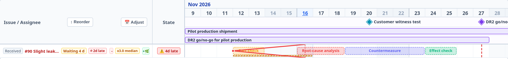
*Screen 3-3: An issue whose first stage is 0 days (timeline). The "Waiting 4 d" chip and the thin hatched strip of the waiting period*

---

### 3.5 Switching a stage to "Count non-working days" (calendar days)

Usually the plan is worked out in working days, skipping weekends. But in cases like these you may want to count calendar days (days in a row, weekends included):

- "A stage where the team worked on the weekend to catch up"
- "A stage where the days pass regardless of weekends, such as a review by an outside body or a batch process"

For these, the **"Count non-working days"** checkbox of the stage can be switched on in the "Adjust schedule" form. Only that stage counts its days as calendar days, weekends included, so the whole schedule can be readjusted flexibly.

- **With Due date first**: the start and end of that stage stay, and its days are counted again (e.g. 5 working days → 7 days). Other stages do not move.
- **With Days first**: it keeps its number of days but counts them as calendar days, and the later stages and the due date shift.
- A stage that is switched on shows its days in "days" instead of "working days", and when not adjusting it shows "Duration: N days (non-working days included)".
- The switch is recorded in the history. It can be switched only in "Adjust schedule" on the issue page (it is not in the adjust mode of the timeline).

---

### 3.6 Following a change of tracker

If the tracker of an issue is changed while it is in use, the plugin rebuilds its stages to follow the stage definition of the new tracker.

- **Normal tracker ➔ tracker with sequential tasks**:
  When a normal issue is changed to a tracker with stages, the plan of its stages is laid out from the standard days of the new tracker, and the due date is recalculated.
- **Between trackers with sequential tasks**:
  The stages (their number and standard days) are rebuilt and replaced with those of the new tracker.
- **Tracker with sequential tasks ➔ normal tracker**:
  The existing stage data are kept safely in the database; only the bar on the screen is hidden.

---

### 3.7 Guards against mistakes (UI and accessibility)

So that daily work goes smoothly and safely, the following are built in.

- **Cancel safely with Esc**: while the adjustment form is open, just press `Esc` to cancel. If numbers were changed, a confirmation dialog is shown to avoid mistakes.
- **Keyboard-friendly input**: the day fields have no spin buttons (▲▼), which are easy to press by mistake; they are plain number boxes that are easy to type into from the keyboard or the number pad.
- **Enter does not save**: pressing Enter in the days or start date fields only recalculates; it does not save. Saving is done with the "Save changes" button.
- **Unsaved changes are confirmed**: if you try to leave the page with a changed plan, the browser asks you to confirm.
- **No saving when it does not fit**: with Due date first, while the stages do not fit by the due date, the save button cannot be pressed and the reason is shown next to it.
- **The mode is explained on the screen**: the explanation of the chosen mode (Due date first / Days first) is shown without having to hover over it.
- **Touch and screen readers**: the handles on the boundaries are wide enough to grab with a finger. The day fields and checkboxes have accessible names that include the stage name.
- **Why the start date cannot move is shown**: when a stage has already finished or the workflow does not allow changing the start date, the screen shows why the start date cannot be changed (e.g. "a stage has finished", "locked by the workflow").

---

## Chapter 4: Loose branches (branched tasks)

### 4.1 How they differ from parent and child issues

Redmine's own parent and child issues come with strict constraints, such as "the parent cannot be closed until all its children are closed" and "the parent's due date and done ratio are tied to its children". In situations like the following, these constraints make the work hard to run.

- "The incident analysis produced several permanent countermeasures, but we want to close the incident investigation itself as done."
- "Countermeasures branched off from the root-cause analysis of a defect, such as a design change, a process improvement and rolling it out to other models, but we want to close the original defect report once the cause is found."
- "Improvement tasks branched off from a study of the specification, but the parent has done its job and we want to close it first."

The **"loose branch"** of this plugin is **a model in which the issues stay independent: only the root, "where it branched from", is kept, and neither interferes with the other's life cycle**.

- **Each works as an issue of its own**:
  Both the branched task and the parent behave as ordinary, independent issues. The child is not dragged along by the parent's status: it can go on after the parent is closed, and the parent can be closed freely while a child is still open. Their due dates, assignees and stage schedules are fully independent too.
- **Only the relation (the origin) is shown**:
  Instead of tying them with constraints, the plugin keeps only "which parent it came from" and "how many of the tasks that came from this parent are done", and shows them as a tree indent (`└─ 🌿`) and a progress badge (`[2/3]`) on the timeline.

---

### 4.2 Creating a branched task quickly (the `＋🌿` button)

From the timeline or the issue page, a branched task can be created with one click.

1. Click the **"＋🌿"** button in the row of an issue on the timeline.
2. An input row opens just below it.
3. Check or edit the subject (to save typing, `parent subject_1` or the like is suggested by default).
4. Press **"Create branched task"** and the branched task is created on the spot, linked to the parent.

A branched task starts today. But when the parent starts later than today (an issue that has not started yet and is planned to begin next week, for example), it starts on the parent's start date. The timeline shows that date to the right of the input row. On the issue page, the start date field of the form has that date filled in, and you can change it.

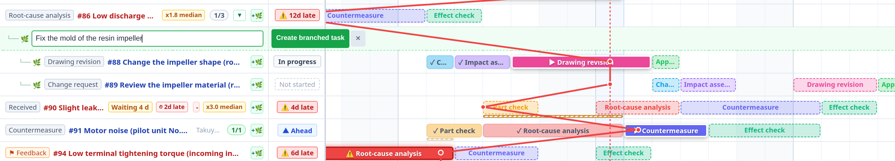
*Screen 4-1: Pressing "＋🌿" on the timeline opens the form for a branched task just below the parent*

---

### 4.3 Checking progress on the parent (the `[2/3]` done/total badge)

A parent with branched tasks shows a badge of their progress. It is only a display: it sets no condition for closing.

- **Badge (e.g. `[2/3]`)**:
  Shows "branched tasks done / all branched tasks", counted live.
- **Colors**:
  - `Green`: all branched tasks are done.
  - `Orange`: the parent itself is "Resolved/Closed", but some branched tasks are still open. Leftovers and missed checks are seen at a glance.

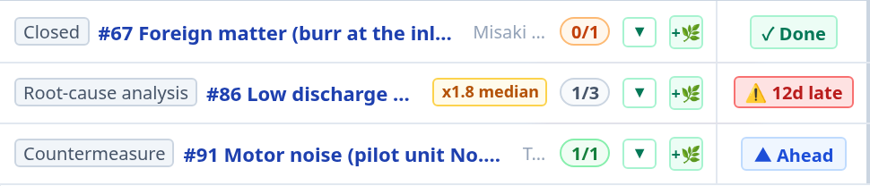
*Screen 4-3: Examples of the branch badge. From the top: the parent is closed but a branch is still open (orange 0/1), one of three is done (1/3), all done (green 1/1)*

---

### 4.4 "This issue and its branches" timeline on the issue page

Open the page of a parent that has branched tasks, and an accordion block **"This issue and its branches"** is shown below the description.

- Click to open it, and a small timeline of only that parent and its branched tasks (grandchildren included) is drawn.
- Without going to the project's large timeline, you can check, right on the issue page, the progress and delays of all the actions born from that case.

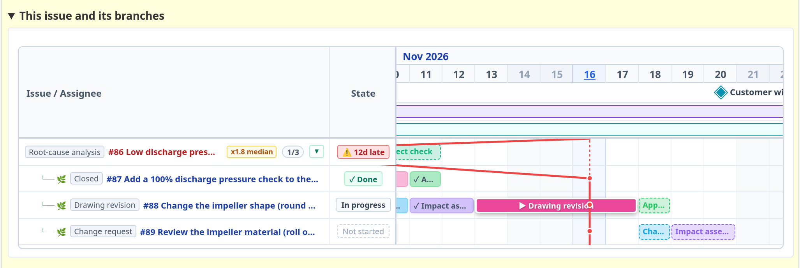
*Screen 4-2: "This issue and its branches" on the issue page. The parent and its branched tasks on a small timeline*

---

# Part 3: Progress and overall coordination of the project (for leaders and PMs)

## Chapter 5: The timeline (a Gantt-like calendar view)

### 5.1 Reading the screen and basic operations

Click the **"Bamboo chart"** tab in the project menu, and a timeline of all the sequential tasks in the project opens.

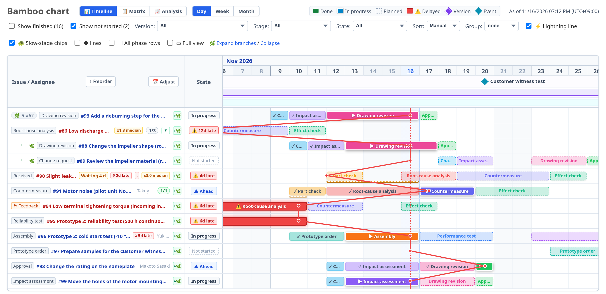
*Screen 5-1: The timeline. The toolbar, the milestone row and the phase bands at the top; the list of issues on the left; the stage bars and the lightning line on the right*

#### 5.1.1 The three main areas

The screen is divided into three areas.

1. **Toolbar at the top**:
   The control panel of the timeline: switching the period shown, the switches for showing finished and not-started issues, the filters, grouping, sorting, and the adjust mode.
2. **Left: the fixed issue columns**:
   The issue number, subject, assignee, the current "State" (Not started, In progress, Delayed, Ahead, Done) and the branch badge (`[2/3]`). They stay at the left edge when scrolling sideways (sticky), and their width can be changed by dragging the boundary.
3. **Right: the timeline area**:
   The date header (stays at the top when scrolling down), the milestone row, the stage bars (progress bars) of each issue, and the "⚡ lightning line" that shows how the whole project is doing against the plan.

---

#### 5.1.2 What the toolbar can do

The toolbar at the top of the timeline does the following with one click, depending on what you need.

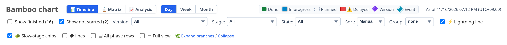
*Screen 5-1-2: The toolbar of the timeline*

| Item | Choices / buttons | What it does | Details |
|---|---|---|---|
| **Switch screens** | `Timeline` / `Matrix` / `Analysis` | Switches between the three screens. | Chapters 7 and 8 |
| **Scale** | `Day` / `Week` / `Month` | Switches the scale of the period shown, from the near schedule in detail (Day) to a roadmap of several months (Month). | 5.1.3 |
| **Show finished / not started** | `Show finished (N)` / `Show not started (N)` | Shows the finished issues, which are hidden by default, or hides the issues not yet started, to focus on the ones in progress. | 5.4.1 |
| **Filters** | `Version` / `Category` / `Stage` / `State` | Filters by target version, category, current stage and state (Delayed, Ahead, In progress, Release at risk, Slower than usual). | 5.4.2 |
| **Sort** | `Sort` | Chooses the order: "Manual", "Due date", "Delay", "Updated". | 5.4.4 |
| **Group** | `Group` | Groups by "Tracker", "Assignee", "Status", "Version" or "Category", with folding. | 5.4.3 |
| **Delay at a glance** | `⚡ Lightning line` | Draws a line from today to the stage each issue is in now, to see at a glance how far behind or ahead the whole project is. | 5.2 |
| **Stays too long** | `🐢 Slow-stage chips` | Shows or hides the "xN median" chips of the rows. | 8.3 |
| **Milestone lines** | `◆ lines` | Draws vertical dotted lines from milestones such as the due dates of versions, to make the deadlines stand out. | Chapter 6 |
| **Phases** | `▤ All phase rows` | Opens the phase bands from the default 2 rows to all of them (up to 5). | 6.2 |
| **Full view** | `▭ Full view` | Removes the scroll frame and lays all rows and the whole period out on one page, for screenshots and printing. | Chapter 9 |
| **Open / close branches** | `🌿 Expand branches / Collapse` | Opens or folds all branched tasks on the screen at once. | 5.6 |

Note: The header of the table (the "Issue / Assignee" column) has the **`↕ Reorder`** button (manual reorder mode) and the **`📅 Adjust`** button (adjust mode) (5.3, 5.4.4).

---

#### 5.1.3 Operations on the table

Besides the toolbar, the table of the timeline lets you do the following directly.

- **Switching Day, Week and Month**:
  Change the scale with the toggle in the toolbar. "Day" suits the near schedule in detail; "Week" or "Month" suits a roadmap of several months. At any scale the bars are drawn in exact proportion to the dates.
- **Checking and editing an issue**:
  Click the subject of an issue row (or its bar) and a **side panel** slides in from the right, where you can edit the issue on the spot without opening another tab (see 5.5).
- **Creating a branched task quickly**:
  Press the **"＋🌿"** button of a row, and a form opens just below it to create a branched task on the spot (see chapter 4, 4.2).
- **Changing the width of the issue column**:
  Drag the boundary between the issue column and the date area to a width that is easy to read.

---

### 5.2 ⚡ Seeing the project's tendency to fall behind with the lightning line (progress line)

On the timeline, a red polyline, the **"⚡ lightning line"**, is drawn from today's date (a vertical dashed line) to the stage each issue is in now.

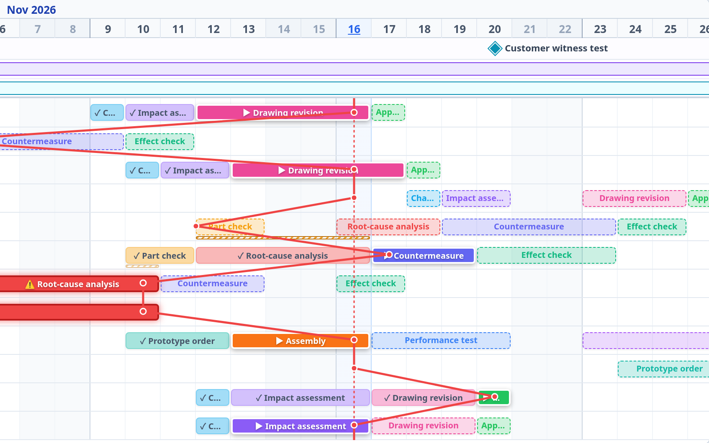
*Screen 5-2: The lightning line. It dents to the left for issues that are late and sticks out to the right for issues that are ahead*

#### 5.2.1 How it is worked out and how to read it
The lightning line brings into Redmine the idea of the progress line, widely used in schedule control in manufacturing and construction. By joining "where each issue should be as of today" with "where it actually is", it lets you judge the health of the whole project at a glance.

- **Dented to the left (late)**:
  An issue whose stage that should be finished by today is not finished yet. The further left the line is pulled, the more serious the delay.
- **Lined up vertically (on track)**:
  An issue that is getting through the stage it should be in today, as planned.
- **Sticking out to the right (ahead)**:
  An issue whose stages are moving ahead of the plan.

#### 5.2.2 Visual cues so that delays are not missed
Besides drawing the line, the following cues work with it, so that a leader can act right away at the morning meeting or the progress meeting.

- **Late rows in bold red**:
  The subject of a late issue turns bold red, and its badge of days late stands out.
- **"Unassigned" warning chip**:
  An issue with no assignee shows a red **"-"** chip in the assignee column. This prevents the accident of "nobody picked it up, and by the time we noticed it was late".
- **Finished issues left out**:
  Issues that have finished all their stages and are closed are left out of the lightning line, so that you can focus on the tasks still under way.
- **Switch it with one click**:
  The "⚡ Lightning line" checkbox in the toolbar shows or hides it at any time.

#### 5.2.3 What the lightning line is and what it assumes (judged by status only)
By its design, the plugin assumes the following in use.

- **Progress is judged by the "status" (stage), and by nothing else**:
  The plugin does away with typing a done ratio (%), which depends on how the assignee feels, and judges progress only by "which status the issue is in now". So if an issue has moved to "the status it should be in today", it is judged on schedule.
- **What a long stage cannot show**:
  This is shared with the usual Open / Closed issue management. If a stage such as "Implementing" is planned to last two weeks, the plugin cannot show whether, within those two weeks, the work is half done or nearly finished. It works best to design the stages with a good balance, in view of the actual work and the granularity at which progress is managed.
- **The basic assumption: it does not work if statuses are not updated**:
  It is only better than typing a done ratio as a number: if assignees do not move the status on when they finish their work, no amount of mechanism will show the real state. If statuses are left as they are, everything dents to the left as "Delayed", and the lightning line becomes an empty formality. Only with the simple, reliable team habit of "when a stage is done, send the status on to the next one" does the lightning line work as a strong antenna that detects delays in the project early.

---

### 5.3 📅 Adjust mode (rescheduling by dragging)

A mode is provided for rescheduling issues directly on the timeline with the mouse.


*Video 5-1 (animation): The adjust mode of the timeline. Pressing "📅 Adjust" shows a blue band. Dragging the right edge of a bar lengthens the stage by 2 days (with Due date first the next stage shrinks); it is saved when you let go, and a notice appears. Then dragging the middle of the bar shifts the whole plan 2 days later*

#### 5.3.1 Starting the adjust mode, and how it looks
1. Click the **"📅 Adjust"** button in the header of the table (the "Issue / Assignee" column).
2. **The adjust mode starts**:
   - The band of the toolbar turns bright blue and shows **"📅 Adjusting"**.
   - To avoid mistakes, the frame and the header of the timeline table turn blue too, so that it is clearly different from normal viewing.

#### 5.3.2 Dragging, and the two modes of calculation
When the mouse is over a stage bar, the cursor changes to show what it will do.

- **Drag the right edge of a bar (lengthen or shorten a stage)**:
  Stretches or shrinks the end (the planned days) of that stage. The days are recalculated in working days of the calendar, skipping non-working days (weekends, etc.) (with Due date first, the right edge of the last stage is locked and cannot be dragged, to keep the due date).
- **Drag the left edge of the first stage (change the start date)**:
  Only for issues where no stage has finished yet and the workflow allows changing the start date, the start date of the issue can be moved directly by dragging (for issues where it cannot be changed, the cursor shows "not allowed" and the tooltip gives the reason).
- **Drag the middle of a bar (shift the whole issue)**:
  Slides the start and end of the whole issue earlier or later, keeping the share of days of each stage as it is.
- **Choose one of the two modes of calculation**:
  The buttons in the toolbar switch at any time how a change of the plan is passed on.
  - **Due date first**:
    Moving the right edge of a bar trades days with **the next stage**, and the overall due date does not move. Moving the left edge of the first stage (the start date) stretches or shrinks **the first stage**. The right edge of the last stage (= the due date) cannot be grabbed.
  - **Days first**:
    Recalculates so that the later stages and the final due date of the issue are pushed later by as much as the stage was lengthened.
  - Note: Dragging the middle of a bar (shifting it all) moves the due date too, whatever the mode. With Due date first, the tooltip turns orange and says "the due date moves".

#### 5.3.3 Guards, and saving in the background
For safe and quick use, the following controls are built in.

- **Past stages are protected**:
  Stages whose status has already moved on and that are finished are locked and cannot be dragged. Dates settled as actual dates do not get broken.
- **Lower limit of days**:
  A stage cannot be shrunk to less than a day (negative days).
- **Saving in the background, with a notice next to the bar**:
  The moment you let go of the mouse, the issue is saved in the background (Ajax). When it is saved, a tooltip notice **"Updated the plan of #1234 subject"** pops up right next to the bar for about 2.5 seconds, and the table behind it is redrawn.
- **There is no undo**:
  It is saved when you let go, and one entry is added to the history. To undo it, drag it back.
- **A row being saved cannot be grabbed**:
  Until the saving and the redrawing are done, the row turns pale and cannot be dragged.
- **Nothing is saved when it does not fit**:
  With Due date first, if the stages do not fit by the due date, the tooltip turns red and says "Does not fit (due m/d)". If you let go there, nothing is saved and the bar goes back to where it was.
- **With the Week and Month scales**:
  A day is narrow, so dragging is harder (the mode is meant for the Day scale). So that a slight shake of the hand does not move anything, it reacts only after a move of about 60% of a day's width.
- **Off every time the page is opened**:
  The adjust mode is off again each time the page is opened (it stays on through the redraw after saving).
- **Cancelling a drag and leaving the mode**:
  Press `Esc` during a drag to put the row back where it was (nothing is saved). To leave the adjust mode, click the "📅 Adjust" button again.

---

### 5.4 Filtering, grouping and manual reordering

The toolbar at the top of the timeline lets you pick out "the issues to look at now" from hundreds of tasks in an instant.

#### 5.4.1 The "State" of issues, and the finished / not-started switches
The "State" column among the fixed columns on the left shows the progress and health of each issue as a badge.

- **The five badges of the State column**:

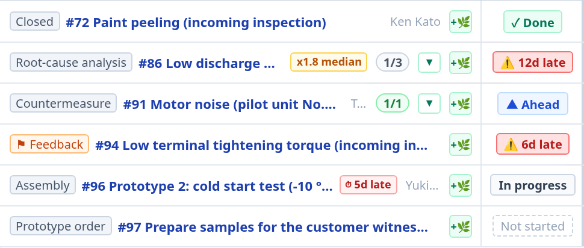
*Screen 5-4-1: The state badges. From the top: Done, Delayed, Ahead, Delayed (⚑ stuck in "Feedback", a status that is not a stage), In progress, Not started*

| Badge | Meaning |
|---|---|
| **`✓ Done`** (closed) | An issue that finished all its stages and is closed (Closed, Resolved) in Redmine. Even if all its stages are done, it is not treated as closed while its status is not a closed one. |
| **`⚠️ Nd late`** (delayed) | An issue behind the plan as of today (it is still in a stage before the one it should be in today, or the planned end of its current stage has passed). The number of days late (calendar days) is shown. |
| **`Not started`** (pending) | An issue whose first stage has its planned start after today (in the future), so its start date has not come yet. Until then, the first stage is shown as "Planned" too (the issue is in its first status from the moment it is filed, but no actual start is shown; the analysis also counts the stay from the planned start). An issue past its planned start is not "Not started" even if it is still in its first status: it comes up as "In progress" or "Delayed", so that it is not left alone. |
| **`▲ Ahead`** (ahead) | An issue that has moved on to a stage beyond the one planned for today. On days that fall in no stage's planned period, such as weekends, it is compared with the stage planned for the last working day before. |
| **`In progress`** (in_progress) | An issue neither late nor ahead, working on schedule on the stage it should be in today. |

  An issue in a status that is not defined as a stage shows **`⚑ status name`** under its badge, so that you can see at a glance that it is stopped outside the stages. Adjusting the plan (dragging or typing the days) usually covers the current stage and the later ones. An issue in a status that is not a stage (e.g. a "New" not used as a stage) before any stage has started can be adjusted from the first stage, start date included. An issue that went on to such a status after some stages started cannot be adjusted, since how far it got is not known.

- **The switches for finished and not-started issues**:
  Once the plugin is in regular use, finished issues and issues far in the future pile up, and the timeline grows long and hard to see through. The toolbar therefore has these switches.
  - **`Show finished (N)` switch**: shows or hides the finished issues (**hidden** by default, to focus on the tasks that are moving now).
  - **`Show not started (N)` switch**: shows or hides the issues not yet started (**shown** by default; switch it off to hide them when you want "only the tasks in progress that need work today").
  - Note: If hiding with the switches leaves no issue to show, the note "(hidden: X finished, Y not started. Use the switches above to show them.)" appears, so that nobody thinks the issues have disappeared.

#### 5.4.2 Pinpointing with the State filter
With the state of the issues in mind, the "State" drop-down of the toolbar picks out only the issues in a given condition, in an instant.

- **All**: shows all the issues currently in scope.
- **Delayed**: only the issues whose stages are behind the plan (the tasks where the lightning line dents to the left). Ideal for bringing out "the tasks that need help right now" at the morning or the regular meeting.
- **Ahead**: the issues going well, ahead of the plan.
- **In progress**: the issues being worked on purely on schedule, leaving out the delayed, ahead, not started and done ones.
- **Release at risk**: only the risky issues whose expected end (planned end + days late) goes past the release date of their version (see chapter 6).
- **Slower than usual**: the issues to watch (🐢) that have stayed in their current stage N times or more as long as the past finished stays (the median), to find what to review in the process (see chapter 8).

#### 5.4.3 Grouping
The unit of the timeline can be switched to suit the team's purpose.

- **What to group by**:
  "Tracker", "Assignee", "Status", "Version" or "Category".
- **Folding like an accordion**:
  Click the header of a group to fold or open all its issues at once. Use it to see the issues each assignee has, or to check the progress of each version.

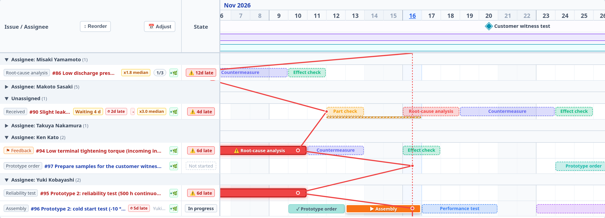
*Screen 5-4-3: Grouped by assignee, with the groups of "Makoto Sasaki" and "Takuya Nakamura" folded*

#### 5.4.4 Sort order and the manual reorder mode
The order of the issues can be chosen from these presets.

- **Due date**: the tasks with the nearest deadline at the top.
- **Delay**: the tasks with the most days late at the top.
- **Updated**: the tasks that moved most recently at the top.
- **Manual reordering**:
  Only while the **"↕ Reorder"** button in the header of the table is on, issue rows can be dragged into any order within the same level and group. This lets the team set its own priorities, such as "bring the key task to the top". To avoid an accidental drag, it locks itself again when the page is reloaded.

---

### 5.5 Checking and editing an issue in the side panel on the right

For when you "want to read the details of an issue while looking at the timeline" or "want to change the assignee or the status on the spot", a **side panel that slides in from the right** saves you the trouble of opening another browser tab.

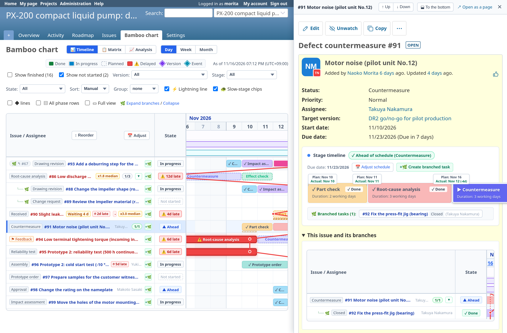
*Screen 5-4: Clicking the subject of an issue opens a side panel from the right, where you can check and edit the details while looking at the timeline*

#### 5.5.1 Viewing and editing without leaving the timeline
1. Click the **subject (or the stage bar)** of an issue row.
2. A panel slides in from the right edge of the screen, showing Redmine's own issue page and edit form as they are.
3. **The context is kept**:
   You can check everything about the issue (the description, the history of notes, custom fields, etc.) while the scroll position of the timeline, its scale (Day/Week/Month) and the filters in use stay as they are.

#### 5.5.2 Updating in the panel, and the timeline redrawn automatically
- **Edit and update on the spot**:
  In the side panel you can do exactly what you do on the usual issue page: change the status, change the assignee, post a note, and so on.
- **Follows without a reload**:
  Press "Submit" in the side panel, and the timeline behind it is told about the update and redraws the stage bars of that issue and the lightning line right away. There is no need to reload the whole page.
- **A small window with the schedule only (on trial)**:
  **Double-click** a bar of stages, and a small window floats over the table with the subject, status, priority, assignee, version, start date, due date, done ratio and estimated time of the issue, and its stage timeline (with adjusting the plan and creating a branch), then the description, the attachments, the subtasks and the related issues (the yellow box of the issue page, without the small timeline of "This issue and its branches"). **"↑ Up"** and **"↓ Down"** in its head change it to the issue one row up or down in the table. Drag its head to move it; the browser remembers where it stood. Drag its lower right corner to change its size, which is remembered too (a double click on the corner goes back to the size that fits the issue). Until you change the size, it opens tall enough for two or three lines of the description, and a long description scrolls in its own box. There is one window: while it is open, a single click on a subject or a bar shows that issue in it (the panel does not open). The window and the panel are one at a time; **"◨ Open in the panel"** in the window moves the issue to the panel. When the plan is saved in the window, the window stays and the table is read again. A single click on a bar waits a moment (0.25 s) before the panel opens, to tell it from a double click.
- **The issue above and below**:
  **"↑ Up"** and **"↓ Down"** in the head of the panel move to the issue one row up or down in the table. The order is the order of the rows on the screen (its sorting, filters, groups and folded branches; rows that are not shown are skipped), and when the row is out of view, the table scrolls by one row (up or down alike). Redmine's own "« Previous | Next »" on the issue page follow the issue numbers, so the panel does not show them.
- **The row of the open issue**:
  The row of the issue open in the panel gets a light blue background and a blue line at the left of its issue cell. When you move to another issue inside the panel, the mark moves to its row. Closing the panel takes it away.
- **Right or bottom**:
  Press **"⬓ To the bottom"** in the head of the panel, and the panel moves to the bottom of the screen, across the whole width (you can read the issue and keep the timeline as wide as it is). At the bottom, **"◨ To the right"** brings it back. The height of the panel at the bottom is changed by dragging its top edge (as far as the table keeps a least height). The position (right or bottom) and the height are remembered in this browser, so the panel opens the same way next time (other PCs and people are not affected).

  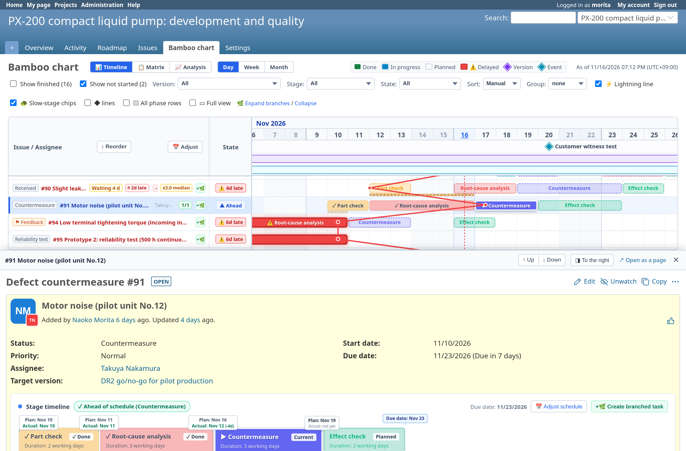
  *Screen 5-4-2: The panel at the bottom: the timeline above (the row of the open issue in light blue), the issue page below*

- **Opening and closing**:
  Close it with the "✕" button at the top right of the panel, by clicking outside the panel, or just by pressing `Esc`.

---

### 5.6 The tree of branched tasks, and folding it

Branched tasks created as "loose branches" are shown on the timeline right below their parent, as an indented tree with **`└─ 🌿`**.

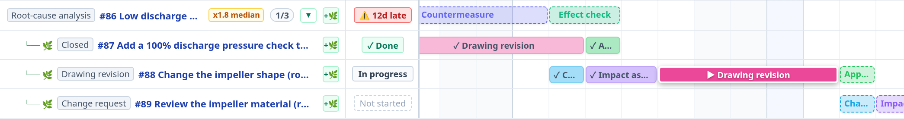
*Screen 5-6: Branched tasks listed one level down under their parent, with └─ 🌿*

#### 5.6.1 The parent-child relation on the screen, and how to work with it
- **Tree indent**:
  Branched tasks are shown one level down right below their parent, so you can see at once which task they came from.
- **Folding one by one**:
  Click the toggle icon (`▼` / `▶`) at the head of a parent row to fold only the branched tasks under that parent.
- **Opening and folding all at once**:
  Click the **"🌿 Expand branches / Collapse"** link in the toolbar to open all the branched tasks on the screen at once, or to fold them into a tidy view of the parents only. Fold them to grasp the outline of the whole project, open them all to follow the details.

---

## Chapter 6: Milestones, phases and sprint management

### 6.1 Milestones (◆) and event trackers

When planning a schedule, you want to see milestones such as "there is a design review (DR) on this day" or "this is the day of mass-production start / commercial release". For this, a **fixed milestone row** is placed right below the date header of the timeline.

- **Points (◆) for**:
  - the **due dates of Redmine "versions"**
  - the due dates of issues of the trackers chosen in "Trackers shown as milestones" in the plugin settings (for events, etc.)
- **Operations**:
  - Several milestones on the same day are merged into one point; clicking it shows those issues on Redmine's issue list.
  - Switch on **"◆ lines"** in the toolbar, and a vertical dotted line is drawn through all rows from the day of each milestone, to stress "this is the deadline, the peak".

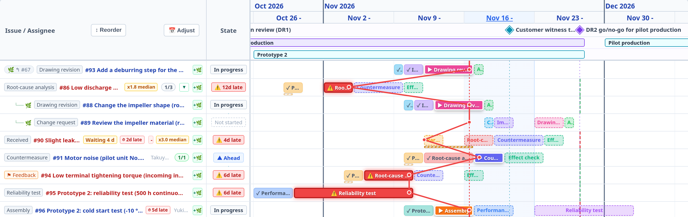
*Screen 6-1: The Week scale with "◆ lines" on. Milestones (◆) and vertical dotted lines, and the bands of a version and of phases (events)*

---

### 6.2 Phase bands (version bands and coarse FS phases)

Below the milestone row, bands of phases that have a period are drawn.

- **Version bands**:
  A version with a start date and a due date is drawn as a band, filled from the left according to the done ratio of its issues.
- **Coarse FS phases**:
  For the use where "daily tasks are managed as one sequential issue each, but only the phases (e.g. Design ➔ Prototype ➔ Pilot production ➔ Mass production, or Design ➔ Development ➔ Migration) are laid out with FS (finish-to-start)", event issues linked with the standard "precedes / follows" relation are laid out in steps in the phase band at the top.

---

### 6.3 Will the release be met? (the ⏱ chip)

So that you can judge "which issues will make the two-weekly sprint release", whether an issue will miss its release date is judged automatically.

- **How it is judged**:
  The planned end of the last stage of the issue plus its current days late is compared with the due date of its version, to see whether it goes past it.
- **On the screen**:
  - Each row shows a small mark at the release date (`green`: expected to make it, `red`: expected to miss it). Hovering shows "Release name (date): N days to spare" or "Release name (date): expected N days late".
  - An issue expected to miss it shows a `⏱ Nd late` chip in the issue column.
- **Totals in the group header**:
  When grouped by "Version", the header of each version shows the number of issues expected to miss it (`⏱ 2`, etc.).

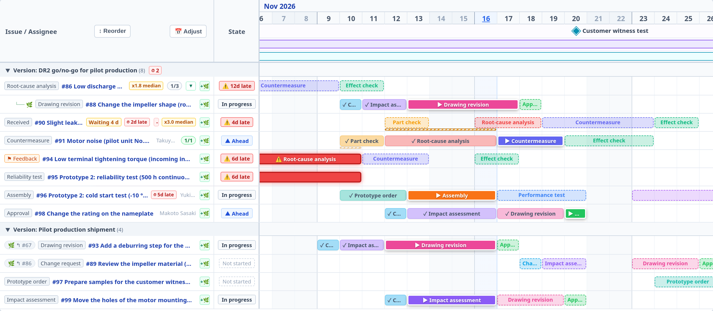
*Screen 6-3: Grouped by version. The ⏱ 2 in the header is the number of issues expected to miss the release; "⏱ Nd late" in the issue column marks those issues*

---

### 6.4 Moving issues to another version by dragging (sprint adjustment)

At sprint planning or the regular meeting, tasks that are about to overflow can be sent to the next sprint with a simple operation.

1. Group the timeline **by "Version"**.
2. Switch on the **"↕ Reorder"** mode (the button in the header of the table).
3. Drag the row of an issue expected to miss the release and **drop it into the group of the next version**.
4. The "Target version" of the issue is changed right away and recorded in Redmine's history.


*Video 6-4 (animation): Grouped by version, in the reorder mode, the issue "Prototype 2: cold start test", expected to miss the release (⏱ 5d late), is dragged into the group of the next version, "Pilot production shipment". The counts and the ⏱ number in the headers change, and the row moves to the next version*

---

## Chapter 7: The matrix view and CSV export

### 7.1 Reading the matrix

Open **"Matrix"** in the project submenu for a screen that lists the plan and the actual dates of all tasks in a grid, like a spreadsheet.

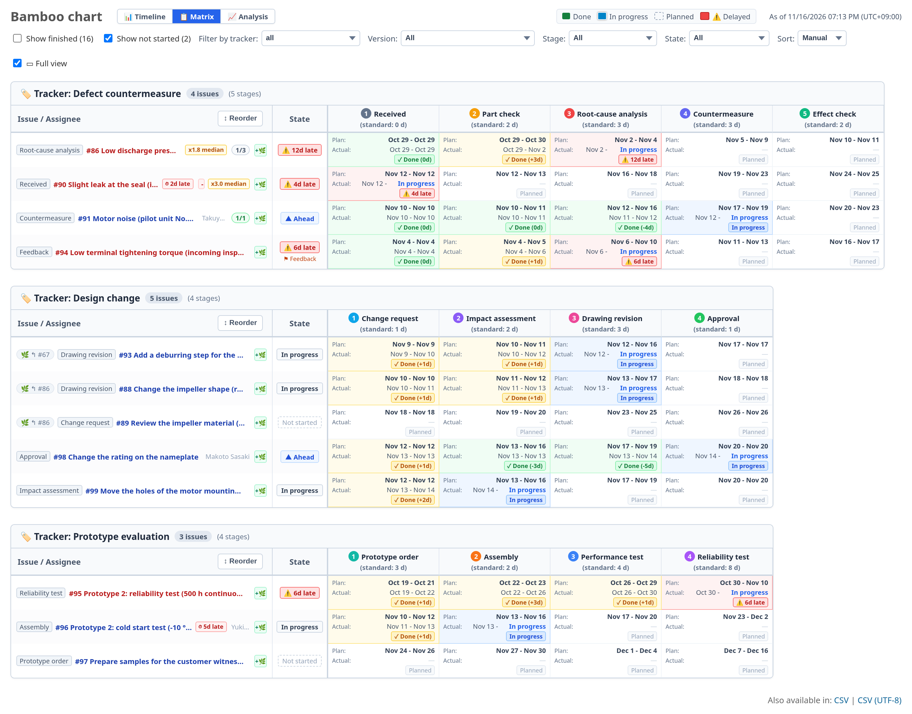
*Screen 7-1: The matrix. A table per tracker; each stage's cell has the plan, the actual dates and the days late*

- **A separate block per tracker**:
  Even when trackers with different numbers of stages are mixed (e.g. feature development with 6 stages, defect countermeasure with 4), each tracker gets its own table, one under the other, so that no column is stretched needlessly.
- **Plan vs. actual in each cell**:
  Each stage's cell shows "planned period", "actual period" and "difference in days" compactly.
  - `✓ Done (+2d)`: done 2 days **later** than planned (`-1d` means a day early)
  - `⚠️ 3d late`: a stage in progress is 3 days past its planned end

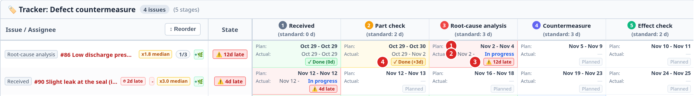
*Screen 7-2: How to read a cell of the matrix, filtered to the tracker "Defect countermeasure"*

1. **Plan**: the planned period of the stage (planned start to planned end)
2. **Actual**: the day it entered to the day it left. While it is still in the stage, "entered - in progress"
3. **State**: the state of the stage. "⚠️ Nd late" if it is in progress and past its planned end; otherwise "Planned"
4. **Difference**: how many days later (`+3d`) or earlier (`-1d`) than its planned end a finished stage ended. `0d` if on plan

---

### 7.2 CSV export

For meeting materials or for totals and processing in other tools, the data of the matrix can be written out as a CSV file as they are.

1. Click the **"Also available in: CSV"** or **"CSV (UTF-8)"** link at the bottom of the matrix screen.
2. **What is written out**:
   - The filters and the sort order on the screen are applied as they are.
   - Per tracker, each stage gets **5 columns**: "planned start", "planned end", "actual start", "actual end" and "state".
3. **Garbled text in Excel and formulas**:
   - Like Redmine's own CSV, the "CSV" link writes in the encoding of the user's language (for Japanese, **CP932 (Shift_JIS)**, so that it opens with a double-click in Excel on Japanese Windows). When that encoding is not UTF-8, a second link "CSV (UTF-8)" is shown too (e.g. for Mac and Linux, or for text the language's encoding cannot hold).
   - To keep values starting with `=+-@` from being run as formulas in Excel, **formula injection protection** (escaping) is built in.

---

## Chapter 8: Bottleneck analysis (continuous improvement of the process)

### 8.1 Time spent in each stage, and the median lead time

Open **"Analysis"** in the project submenu, and the lead time through each stage is totaled from the actual data of all issues handled so far.

- **Time spent, strictly in working days**:
  How many days an issue stayed in each stage is counted in working days, leaving out non-working days such as weekends.
- **The median is used**:
  So that the average is not dragged by special issues left alone for extremely long (outliers), the **median**, which statistically best shows the real picture, is used as the main measure.

---

### 8.2 🚧 Finding the stage that is most stuck

The table at the top of the screen sets "the standard days defined" and "the actual median" of each stage side by side.

- **The worst stage is detected automatically**:
  The stage whose actual median exceeds its standard days the most gets the **"🚧" icon** as a warning.
- **How to use it**:
  You can see at a glance the structural bottlenecks of the whole team, such as "we thought implementation was late, but in fact waiting for review wasted the most time", "QA testing is stuck because there are not enough slots", or "it was waiting for the test equipment to be free rather than for the root-cause analysis".

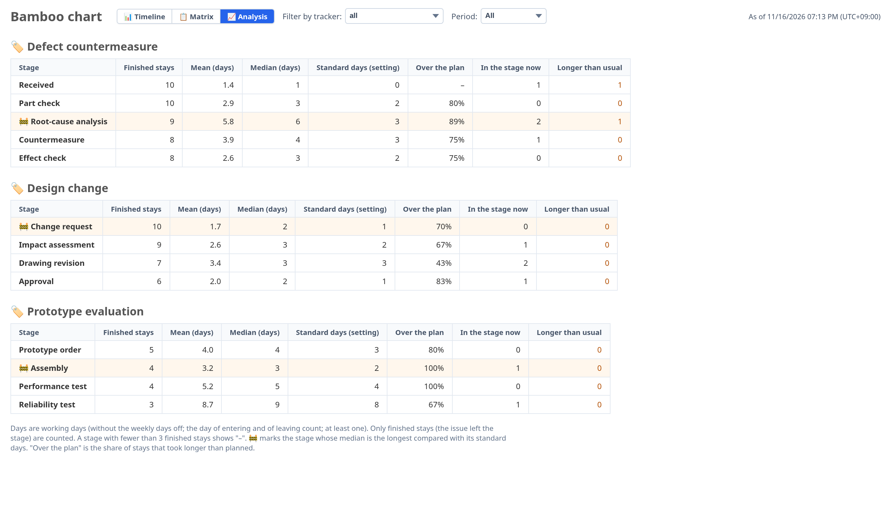
*Screen 8-1: Analysis. The time spent in each stage (mean, median) compared with the standard days. 🚧 marks the stage whose median is the longest compared with its standard*

---

### 8.3 The "xN median" chip for issues stuck for long

Besides the tendency of the whole team, a chip warns early about **"issues that are stuck abnormally long in a stage right now"**.

- **When it appears**:
  Issues that have stayed in their current stage "**1.5 times** the past median **or more**, and **2 days or more**" are picked out automatically.
- **How it looks**:
  The issue row shows a ratio badge such as **"x2.2 median"** or **"x3.0 median"** in a color that stands out.
- **Why it helps**:
  Others can spot right away a hard task that the assignee is struggling with alone, or a task stopped while waiting for an answer from outside, and step in to help early.
- Note: The chips can be shown or hidden with one click in the toolbar.

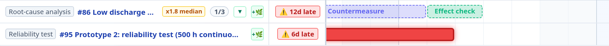
*Screen 8-3: The "x1.8 median" chip. The upper issue has stayed in root-cause analysis 1.8 times as long as the median so far. The lower one is late, but has not reached the condition of the chip (1.5 times the median or more)*

---

### 8.4 Using it in retrospectives

At the end of a sprint or at a monthly improvement meeting (KPT, retrospective), it supports data-driven improvement such as the following.

1. **Reviewing the standard days of the stages**:
   If the median of a stage is always over its standard days, the standard days set may be unrealistic. Adjust the setting to the reality.
2. **Analyzing rework (sending back)**:
   The history of sending back (the record of entering and leaving the stages, `issue_stage_visits`) is kept in the database. The analysis screen does not show the number of reworks, so totaling them needs a query to the database (SQL, etc.). Once you know between which stages work is sent back most, you can take measures such as a stronger checklist in the earlier stage.

---

## Chapter 9: Customizing per project

### 9.1 Overriding the standard days per project

The standard stages and days of each tracker are shared across the company (set by the system administrator), but the nature of a project may call for differences such as these:

- "This project launches a new service, so we want twice the usual days for requirements definition and basic design."
- "This is the launch of a new model, so we want longer than usual for prototype evaluation and reliability testing."
- "This is a defect countermeasure for a mass-produced product, so we want to shorten the check of the part and the interim countermeasure, and act early."
- "This project is in its maintenance phase, so we want to shorten review and release verification to respond faster."

For such cases, the standard days can be overridden per project, without creating new trackers.

1. Open the **Settings ➔ "Sequential tasks"** tab of the project (this needs the permission "Adjust the standard days". It is not given to any role by default, so an administrator gives it to, e.g., the project manager role).
2. The stages are listed for each tracker that has sequential tasks switched on.
3. Enter a number (1-365; the first stage may also be 0) in the days field of the stages you want to change for this project. Leave it empty to use the days of the tracker setting.
4. Click **"Save"**.
5. From then on, issues **created from now on** in that project have all their stages worked out from the overridden days (the plans of issues already created do not change). The "standard days" of the analysis and the matrix also become this project's days.

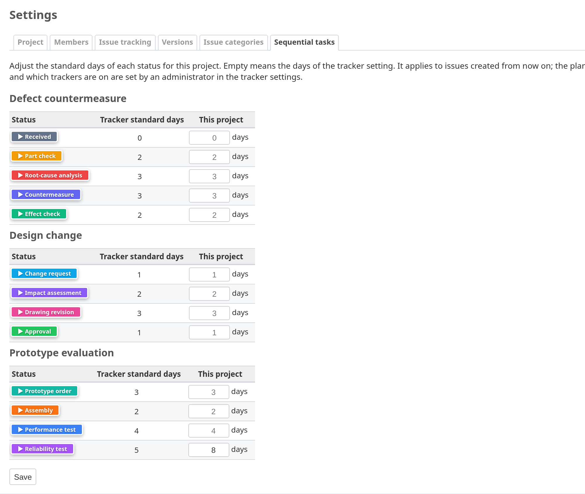
*Screen 9-1: The "Sequential tasks" tab in the project settings. The tracker's standard days and this project's standard days (only the reliability test of prototype evaluation, 5→8 days)*

---

### 9.2 Full view and print layout

For report materials and paper handouts, two display modes are provided.

At the top right of the timeline, matrix and analysis screens (right of the legend), the moment the page was opened is shown, like "As of 11/21/2026 02:05 PM (UTC+09:00)", so that a screenshot or a print tells which moment it shows. The date and time follow Redmine's date and time formats and the time zone of your preferences. It stays at the moment the page was opened, even if the page is left open (so do the bars and the lightning line).

- **Full view**:
  Tick **"▭ Full view"** in the timeline toolbar, and the scroll frame of the table (the fixed frame) is removed so that all rows and the whole period are laid out on one page. Together with the browser's zoom (zooming out), it lets you take a clean panoramic screenshot of the whole project.
- **Print layout**:
  When you print from the browser (`Ctrl+P` / `Cmd+P`), a print stylesheet hides Redmine's header, side menu and extra buttons, and the timeline is printed across the whole sheet, in landscape and in color.

---

# Part 4: Architecture, integration and reference

## Chapter 10: Internal architecture and data structure (technical notes)

### 10.1 ER diagram and table design (non-intrusive design)

The plugin adds no column to Redmine's own database structure (`issues`, `trackers`, etc.); everything is kept in separate extension tables. It sticks to a **non-intrusive design**, so that uninstalling the plugin does not break the integrity of Redmine's own data.

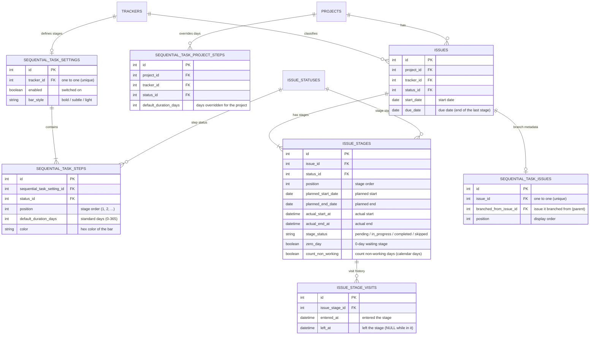

The tables are split, on purpose, into two groups.

1. **Settings and templates (master data)**:
   - `sequential_task_settings`: per tracker, whether the plugin is on, and the bar style.
   - `sequential_task_steps`: the order, standard days and colors of the stages of a tracker.
   - `sequential_task_project_steps`: standard days overridden per project.
2. **Runs and plan vs. actual (transactions)**:
   - `issue_stages`: for each issue, each stage's planned start and end dates, actual start and end date and time, and state.
   - `issue_stage_visits`: the history of stays in each stage, for rework (sending back).
   - `sequential_task_issues`: the loose branch relation (the parent issue's ID) and the display order.

---

### 10.2 The working-day calculation

The logic that skips weekends (non-working days) when laying out the plan or rescheduling by dragging is implemented to the same rules on both the server (Ruby) and the browser (JavaScript).

- **Ruby**: `lib/redmine_sequential_tasks/working_day_calculator.rb`
- **JavaScript**: `assets/javascripts/sequential_dates.js` (with automated unit tests on Node.js)
- **The shared rules**:
  - If `start_date` is a non-working day, it is moved to the next working day.
  - `A stage of N days`: the end date is the day reached by counting N working days, the start date included.
  - `Start of the next stage`: the working day after the end of the previous stage.
  - `Count non-working days (count_non_working: true)`: counted in calendar days.

---

### 10.3 The visit history for rework (issue_stage_visits)

When the status goes "Implementation ➔ Review ➔ Implementation (sent back)", a single column would overwrite and lose the time spent in "the first implementation".

The plugin records `issue_stage_visits` with the following life cycle, triggered by status changes (`IssuePatch#update_sequential_stages_on_status_change`).

1. **On entering a stage**: a new record is created, with the current date and time in `entered_at`.
2. **On leaving a stage**: the current date and time are set in the record's `left_at`, closing it.
3. **When work is sent back**:
   - The actual dates of the later stages are cleared and they go back to unfinished.
   - A new visit record (the second visit) is created for the stage it went back to.
4. **Use in the analysis**:
   - The true total time spent in each stage is worked out accurately as the sum of all the visit records in `issue_stage_visits`.

---

### 10.4 Drawing performance (plain table + SVG overlay + vanilla JS)

The timeline becomes a large matrix of hundreds of rows by dozens of days, so its drawing performance has been tuned to keep it pleasant to use (in a measurement with about 650 rows, the server response was about 140 ms and drawing the lightning line about 5 ms; a rough figure measured during development).

- **No heavy libraries**:
  To avoid the bloat of library dependencies and the risk of keeping up with their versions, Vis.js, FullCalendar, D3 and the like are not used at all, on purpose.
- **A plain HTML table + sticky CSS**:
  The headers and the issue columns are fixed with the browser's own `position: sticky`, making the most of GPU hardware acceleration.
- **The lightning line drawn as SVG in one pass**:
  When drawing the lightning line, the positions in the DOM (`getBoundingClientRect`) are measured for all rows at once, first and only once; from the results a single `<polyline>` path is made and put into an `<svg>` overlay. This avoids repeated relayouts (reflows) by the browser.

---

## Chapter 11: Integration with external systems (REST API)

### 11.1 The plan of the stages for issues created through the REST API

Issues created through Redmine's own REST API (`POST /issues.json`) get the plan of their stages laid out exactly as when they are created on the web screen.

- **Example request**:
  ```json
  POST /issues.json
  {
    "issue": {
      "project_id": "core-pay",
      "tracker_id": 2,
      "subject": "Alert filed automatically by an external monitoring system",
      "start_date": "2026-11-16"
    }
  }
  ```
- **What is done automatically**:
  - All stages (`issue_stages`) are worked out from `start_date` with the tracker's standard days and saved in the database.
  - The end of the last stage is also set as the issue's `due_date`, and returned in the response.
  - With a tracker whose first stage is set to "0 days (waiting to be picked up)", the issue is pooled in the 0-day waiting state.

---

### 11.2 Use cases with a defect database or monitoring alerts

As a way of working with an external quality database, inspection equipment, monitoring alerts or a CI/CD pipeline, a flow like the following is assumed (creating issues through the REST API has been checked, but not with an external system actually connected).

1. A defect database or a monitoring system creates an issue (a defect report or an incident) in Redmine automatically.
2. Until someone starts on it, the days it sat without being picked up are shown as "Waiting N d" (screen 3-3).
3. The plan of the later stages is laid out with the standard days from the day it was filed. A late pick-up shows up as a delay and a dent in the lightning line.

---

## Chapter 12: FAQ, troubleshooting and maintenance

### 12.1 Working days and holidays (how other plugins fit in)

- **Q. Are public holidays (such as Japanese national holidays) or long company holidays skipped automatically?**
  - **A**: No. The plugin reads only Redmine's own "non-working days" (the weekday setting, such as Saturday and Sunday), and by policy keeps no list of public holidays or company days off.
  - Note: Installing another plugin that handles holidays does not change the plugin's calculation (not checked). For a stage that spans a holiday, add days with "Adjust schedule", or adjust it with "Count non-working days".
- **Q. What if I want only a given stage to count weekends as days?**
  - **A**: In "Adjust schedule" on the issue page, tick **"Count non-working days"** for that stage and save (see chapter 3, 3.5).

---

### 12.2 Checkpoints when the plan is off or cannot be saved

- **Q. In "Adjust schedule" on the issue page, lengthening a stage says "Does not fit". The save button cannot be pressed.**
  - **A**: With Due date first, the stages do not fit by the due date (the later stages have no days left to give). Reduce the days, or switch the mode to "Days first" to move the due date later along with them. Days are handled in the range 1 to 365 (values out of the range are brought into it automatically).
- **Q. In "Adjust schedule", the start date field is gray and cannot be changed.**
  - **A**: The start date can be changed only when no stage has finished, no stage was skipped, and the current stage is the first one. It also cannot be changed when the workflow makes the start date read-only. The reason is shown next to the field. When the start date cannot be changed, adjust with the days of each stage (3.3.3).
- **Q. I saved in "Adjust schedule", but the issue's due date did not change.**
  - **A**: Saving with Due date first does not move the due date. To extend the due date too, save with "Days first".
- **Q. Dragging on the timeline does not save (an error appears).**
  - **Check 1**: Do the workflow settings make the "Start date" or the "Due date" read-only for the role of the logged-in user?
  - **Check 2**: Are you trying to move the start date of a past stage that is already finished? (To protect the credibility of the data, the start date of finished stages cannot be moved on the timeline.)
  - **Check 3**: With Due date first, does the adjustment not fit by the due date? (The tooltip turns red and says "Does not fit".)
  - **Check 4**: Are the start or due date outside 10 years before or after today? (So that the plan and the screens do not get heavy, dates outside that range are not saved. Days are 1 to 365 per stage.)
  - **Check 5**: Did someone else save the same issue at the same time? (If it says that another user has updated it, reload the screen and try again.)
- **Q. Saving an issue gave the error "No working day was found, so the plan cannot be built".**
  - **Check**: Make sure that not all seven weekdays are ticked in Redmine's "Non-working days" setting, and that no external calendar plugin makes every day of the next half year a non-working day (the protection in 2.5).

---

### 12.3 Updating to a new version

The steps for updating the plugin to a new version (e.g. v0.10.0 ➔ v0.11.0). Run the migrations to bring the table definitions up to date.

```bash
cd /path/to/redmine

# 1. Take a database backup, just in case
pg_dump -U <user> <dbname> > backup_before_update.sql

# 2. Move the old plugin folder aside, then unpack the zip of the new version
#    (unpacking over it would leave files that the new version removed)
cd plugins
mv redmine_sequential_tasks /tmp/redmine_sequential_tasks.old
unzip redmine_sequential_tasks-0.11.0.zip
#    If you installed with git clone, switch to the tag of the new version instead of the two lines above
#    cd redmine_sequential_tasks && git fetch --tags && git checkout v0.11.0 && cd ..

# 3. Run the plugin migrations (when the database changes)
cd /path/to/redmine
bundle exec rake redmine:plugins:migrate RAILS_ENV=production

# 4. Restart Redmine
sudo systemctl restart redmine
```

---

### 12.4 Uninstalling

Remove the plugin's tables first, then delete the plugin folder. No column was added to Redmine's own tables, so its own data stay as they are (the plans and actual dates of the stages and the branch relations are removed).

```bash
cd /path/to/redmine

# 1. Take a database backup, just in case
pg_dump -U <user> <dbname> > backup_before_uninstall.sql

# 2. Remove the plugin's tables (roll the migrations back)
bundle exec rake redmine:plugins:migrate NAME=redmine_sequential_tasks VERSION=0 RAILS_ENV=production

# 3. Delete the plugin folder and restart Redmine
rm -rf plugins/redmine_sequential_tasks
sudo systemctl restart redmine
```

---

### 12.5 Known limitations

- **Where it has been checked**:
  - With stable use at work in mind, it is developed and checked mainly on **Redmine 6.1.5 / PostgreSQL 17 / Chromium-based browsers**.
  - Redmine 7.0.2 passes the full automated tests in a test container, and the author is trying it in their own work (not every screen and feature has been checked thoroughly).
- **Known limitations**:
  - Public holidays and company days off are not supported (only Redmine's weekly non-working days are used).
  - Manual reordering is by mouse drag only (it cannot be done with the keyboard).
  - The adjust mode of the timeline cannot be used with the keyboard (the same can be done in the days fields of "Adjust schedule" on the issue page).
  - In the analysis, the planned days of a stage with "Count non-working days" are still counted in working days.

---

*(End of the manual)*
