# Redmine Sequential Tasks 運用・利用マニュアル

本書は、Redmineプラグイン **`redmine_sequential_tasks`（シーケンシャルタスク）** の運用・利用マニュアルです。  
日常のチケット起票・進捗管理を行う担当者（ソフトウェアの開発者のほか、設計・品質保証・生産技術などの担当者）から、複数案件を束ねるプロジェクト管理者（PM / スクラムマスター）、および環境の構築・運用を担うシステム管理者までを対象としています。

画面の画像は、架空のデータ（小型送液ポンプ PX-200 の開発・品質。製品・人物・不良はすべて架空）で撮っています。配布用の zip には画像と動画を入れていません。画像つきで読むときは、GitHub の [docs/MANUAL.md](https://github.com/yoohey/redmine_sequential_tasks/blob/main/docs/MANUAL.md) を開いてください。

---

## 全体目次

- **【第1部：コンセプトと導入】**
  - [第1章：プラグインの概要と基本機能](#第1章プラグインの概要と基本機能)
    - [1.1 背景と目的](#11-背景と目的)
    - [1.2 コアコンセプト](#12-コアコンセプト)
    - [1.3 提供する主な画面と役割](#13-提供する主な画面と役割)
  - [第2章：システム管理者向けセットアップ](#第2章システム管理者向けセットアップ)
    - [2.1 動作環境要件](#21-動作環境要件)
    - [2.2 インストール手順とDBマイグレーション](#22-インストール手順とdbマイグレーション)
    - [2.3 管理画面でのトラッカー設定](#23-管理画面でのトラッカー設定)
    - [2.4 ワークフロー設定（権限）との整合](#24-ワークフロー設定権限との整合)
    - [2.5 Redmine標準「休業日」設定との連動](#25-redmine標準休業日設定との連動)
    - [2.6 プロジェクトでの有効化・権限・プラグイン設定](#26-プロジェクトでの有効化権限プラグイン設定)
- **【第2部：日常のチケット管理（エンジニア・担当者編）】**
  - [第3章：チケット詳細画面での工程管理](#第3章チケット詳細画面での工程管理)
    - [3.1 チケット起票と工程パイプラインの自動生成](#31-チケット起票と工程パイプラインの自動生成)
    - [3.2 帯グラフの見方（ステータス・発色のルール）](#32-帯グラフの見方ステータス発色のルール)
    - [3.3 個別工程の日程調整（仕様と挙動の詳細）](#33-個別工程の日程調整仕様と挙動の詳細)
    - [3.4 「0日の待ち（受付待ち）」ステージの活用法](#34-0日の待ち受付待ちステージの活用法)
    - [3.5 「休業日も数える（暦日）」工程の切り替え](#35-休業日も数える暦日工程の切り替え)
    - [3.6 トラッカー変更時の自動追従機能](#36-トラッカー変更時の自動追従機能)
    - [3.7 誤操作防止機能（UIアクセシビリティ）](#37-誤操作防止機能uiアクセシビリティ)
  - [第4章：「ゆるいブランチ（派生タスク）」機能](#第4章ゆるいブランチ派生タスク機能)
    - [4.1 従来の親子チケットとの違い](#41-従来の親子チケットとの違い)
    - [4.2 派生タスクのクイック起票（`＋🌿` ボタン）](#42-派生タスクのクイック起票ボタン)
    - [4.3 親チケットでの進捗確認（`[2/3]` 完了/全体バッジ）](#43-親チケットでの進捗確認23-完了全体バッジ)
    - [4.4 チケット詳細での「このチケットと派生」タイムライン表示](#44-チケット詳細でのこのチケットと派生タイムライン表示)
- **【第3部：プロジェクトの進捗・全体調整（リーダー・PM編）】**
  - [第5章：専用タイムライン（ガント風カレンダービュー）](#第5章専用タイムラインガント風カレンダービュー)
    - [5.1 画面の見方と基本操作](#51-画面の見方と基本操作)
    - [5.2 ⚡ 稲妻線（進捗線）によるプロジェクト遅延傾向の把握](#52--稲妻線進捗線によるプロジェクト遅延傾向の把握)
    - [5.3 📅 日程調整モード（ドラッグリスケジュール）](#53--日程調整モードドラッグリスケジュール)
    - [5.4 絞り込み・グループ化・手動並び替え](#54-絞り込みグループ化手動並び替え)
    - [5.5 右サイドパネルでのチケット確認・インライン編集](#55-右サイドパネルでのチケット確認インライン編集)
    - [5.6 派生タスクのツリー階層表示と折りたたみ](#56-派生タスクのツリー階層表示と折りたたみ)
  - [第6章：マイルストーン・大日程・スプリント管理](#第6章マイルストーン大日程スプリント管理)
    - [6.1 マイルストーン（◆印）とイベントトラッカー連携](#61-マイルストーン印とイベントトラッカー連携)
    - [6.2 大日程の帯（バージョン帯・大粒度FSフェーズ）](#62-大日程の帯バージョン帯大粒度fsフェーズ)
    - [6.3 リリース期日超過見込み判定（⏱ 札表示）](#63-リリース期日超過見込み判定-札表示)
    - [6.4 バージョンのドラッグ付け替え（スプリント調整）](#64-バージョンのドラッグ付け替えスプリント調整)
  - [第7章：マトリックスビュー ＆ CSVエクスポート](#第7章マトリックスビュー--csvエクスポート)
    - [7.1 マトリックス表の見方](#71-マトリックス表の見方)
    - [7.2 CSVエクスポート](#72-csvエクスポート)
  - [第8章：ボトルネック分析（プロセスの継続的改善）](#第8章ボトルネック分析プロセスの継続的改善)
    - [8.1 工程別の滞留日数・リードタイム中央値の集計](#81-工程別の滞留日数リードタイム中央値の集計)
    - [8.2 🚧 最も詰まっているワースト工程の検出](#82--最も詰まっているワースト工程の検出)
    - [8.3 「中央値×N倍」長期停滞チケットのアラート札](#83-中央値n倍長期停滞チケットのアラート札)
    - [8.4 レトロスペクティブ（ふりかえり）での活用パターン](#84-レトロスペクティブふりかえりでの活用パターン)
  - [第9章：プロジェクト固有のカスタマイズ](#第9章プロジェクト固有のカスタマイズ)
    - [9.1 プロジェクト固有の標準日数の上書き](#91-プロジェクト固有の標準日数の上書き)
    - [9.2 全体表示と印刷レイアウト](#92-全体表示と印刷レイアウト)
- **【第4部：アーキテクチャ・外部連携・逆引き】**
  - [第10章：内部アーキテクチャとデータ構造（技術解説）](#第10章内部アーキテクチャとデータ構造技術解説)
    - [10.1 ER図とテーブル設計（非侵入的設計思想）](#101-er図とテーブル設計非侵入的設計思想)
    - [10.2 稼働日計算アルゴリズム](#102-稼働日計算アルゴリズム)
    - [10.3 差し戻しに対応する訪問履歴（issue_stage_visits）の仕組み](#103-差し戻しに対応する訪問履歴issue_stage_visitsの仕組み)
    - [10.4 描画パフォーマンス（純粋Table + SVGオーバーレイ + Vanilla JS）](#104-描画パフォーマンス純粋table--svgオーバーレイ--vanilla-js)
  - [第11章：外部システム連携（REST API）](#第11章外部システム連携rest-api)
    - [11.1 REST API 経由での自動起票時のパイプライン生成](#111-rest-api-経由での自動起票時のパイプライン生成)
    - [11.2 不良管理DBや監視アラートとの連携ユースケース](#112-不良管理dbや監視アラートとの連携ユースケース)
  - [第12章：FAQ・トラブルシューティング・運用保守](#第12章faqトラブルシューティング運用保守)
    - [12.1 稼働日・祝日の扱い（プラグイン連携の考え方）](#121-稼働日祝日の扱いプラグイン連携の考え方)
    - [12.2 日程がズレた・保存できないときのチェックポイント](#122-日程がズレた保存できないときのチェックポイント)
    - [12.3 バージョンアップ手順](#123-バージョンアップ手順)
    - [12.4 アンインストール手順](#124-アンインストール手順)
    - [12.5 既知の制約](#125-既知の制約)

---

# 【第1部：コンセプトと導入】

### 第1章：プラグインの概要と基本機能

### 1.1 背景と目的

不良対策や設計変更、障害対応や機能開発など、直列（シーケンシャル）に進むタスクを管理する際、ガントチャートやFS（先行-後行）リレーションによる子チケット分割管理では、起票や更新の手間が重くなりがちです。

そこで本プラグインでは、**チケットを分割せず1枚のチケットのまま、ステータスを活用して工程ごとの予定・実績・遅延を軽量に可視化・管理できる機能** を用意しています。現場の管理負担を最小限に抑えながら、中間工程の遅れを早期に検知できる仕組みを目指しています。

たとえば製造業の不良対策（受付 ➔ 現品確認 ➔ 原因解析 ➔ 対策 ➔ 効果確認）や、設計変更・試作評価の流れも、1件の中で工程が直列に進む仕事です。IT の開発だけでなく、こうしたものづくりの仕事にこそ使ってもらえることを想定しています。

---

### 1.2 コアコンセプト

「Open/Closeの2択では大雑把すぎるが、ガントチャートでのWBS管理は重すぎる。カンバンではカードがあっても期日が見えない」というジレンマを解消するため、本プラグインでは **「チケットは1枚（線も1本）で管理し、進捗はステータスで多段階管理する」** というアプローチを採っています。具体的には、以下の4つの方針で設計・実装しています。

1. **ステータス ＝ 工程パイプライン**:
   新しい独自の概念を持ち込まず、Redmine標準の「ステータス」をそのまま直列の「工程」として扱えるようにしています。Redmine標準の進捗率（%）は入力ルールが曖昧で個人差が出やすいため、「ステータス遷移そのものが進捗である」と考える設計です。
2. **予定の自動展開と実績の自動記録（予実管理の自動化）**:
   チケット起票時に開始日を入れるだけで、あらかじめ設定した標準日数（土日スキップ）から各工程の予定開始日・終了日と全体期日を自動展開します。あとは作業に合わせてステータスを動かすだけで、各工程の実績日時も自動で打刻・記録します。
   ここでいう日数は、「この工程はこの日までに終わっているべき」という予定の期間です。作業にかかる時間（工数）を見積もったり、工数から日程を割り出したりはしません。
3. **相互非干渉の「ゆるいブランチ」**:
   1つのチケットから派生タスクが生まれた際、親チケットのクローズを縛らない相互非干渉のブランチ関係にしています。「親としての役目は終わったのに、制約のせいでクローズできない」といった運用の形骸化を防いでいます。
4. **ガントチャート風の一覧管理画面**:
   Open/Closeや進捗率だけの一覧では、着手状態に見えても実は初期工程で止まっている「サイレント遅延」に気づけません。そこで、各チケットのステータス進み具合を一目で俯瞰でき、プロジェクト全体の遅れ傾向を早期検知できる専用タイムライン画面を用意しています。

---

### 1.3 提供する主な画面と役割

本プラグインでは、利用シーンに合わせて以下の4つの画面を作成しています。

| 画面 / コンポーネント | 提供場所 | 主な役割・用途 |
|---|---|---|
| **マルチステージ帯グラフ** | チケット詳細画面（説明欄直下） | 各工程の予定・実績・遅延を視覚化。工程ごとの日数調整、受付待ちの表示を行います。 |
| **専用タイムライン** | プロジェクトメニュー「Sequential Tasks」タブ | 全チケットの工程を1行カレンダーで俯瞰。⚡稲妻線による遅延検知や、📅ドラッグでの日程調整を行います。 |
| **マトリックスビュー** | プロジェクトメニュー ➔ サブメニュー「マトリックス」 | トラッカー別の予実対比表。セル内での予実差異の確認や、CSVエクスポートを行います。 |
| **ボトルネック分析** | プロジェクトメニュー ➔ サブメニュー「分析」 | 工程ごとの滞留日数中央値を集計し、🚧ワースト工程の特定や長期滞留アラートを出します。 |

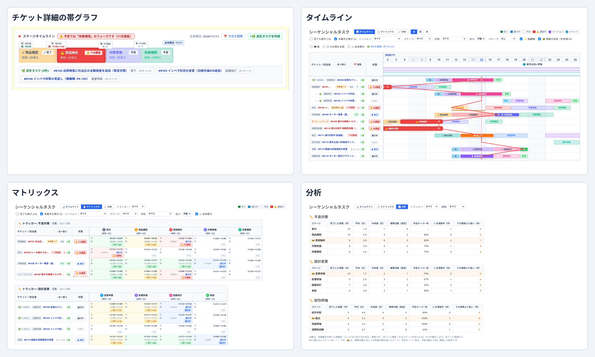
*画面1-1: 4つの主な画面（チケット詳細の帯グラフ、タイムライン、マトリックス、分析）*

---

## 第2章：システム管理者向けセットアップ

### 2.1 動作環境要件

本プラグインは、以下の環境で全自動テストを通し、動作を確認しています。

- **Redmine**: 6.0.0 以上を対象としています。
  - 確認済み: Redmine 6.1.5（PostgreSQL 17）で全自動テストと画面、Redmine 7.0.2 で全自動テスト。作者は Redmine 7.0.2 で日々使っています（すべての機能を網羅的に確かめたわけではありません）。
  - 未確認: Redmine 6.0 系、Redmine 7.0 の画面。
- **データベース**: PostgreSQL（17 で確認）。MySQL / SQLite3 は、標準のマイグレーションだけを使っていますが未確認です。
- **ブラウザ**: Chromium系（Google Chrome, Edge 等）で確認。Firefox / Safari は未確認です。
- **外部依存関係**: **なし**（巨大な外部JS/CSSライブラリを一切使わず、標準HTML/CSS/Vanilla JS/SVGだけで軽量に動作するように作っています）

---

### 2.2 インストール手順とDBマイグレーション

Redmineが稼働しているサーバーで、以下の手順を実施します。

#### ① プラグインディレクトリの配置
Redmineの `plugins/` ディレクトリに、`redmine_sequential_tasks` という名前で置きます。zip と git clone のどちらでも構いません。

**zip で置く**: GitHub の [Releases](https://github.com/yoohey/redmine_sequential_tasks/releases) から最新版（`redmine_sequential_tasks-X.X.X.zip`）を取得して展開します。

```bash
cd /path/to/redmine/plugins
# リリースzipを展開（ディレクトリ名が redmine_sequential_tasks になることを確認）
unzip redmine_sequential_tasks-0.9.0.zip
ls -la redmine_sequential_tasks
```

**git clone で置く**: 公開用のリポジトリの main は、リリースのときだけ更新しています。版を決めて入れるなら、タグ（`v0.9.0` など）を指定します。マニュアルの画像と git の履歴も入るので、20MB ほどになります（zip は 256KB）。

```bash
cd /path/to/redmine/plugins
git clone --branch v0.9.0 https://github.com/yoohey/redmine_sequential_tasks.git
ls -la redmine_sequential_tasks
```

**Docker（公式の `redmine` イメージ）の場合**（参考）: プラグインを手元のフォルダに置き、`compose.yaml` で `/usr/src/redmine/plugins/redmine_sequential_tasks` に見せます。環境変数 `REDMINE_PLUGINS_MIGRATE` を付けると、起動のときにイメージが `redmine:plugins:migrate` を流すので、下の②・③は `docker compose up -d`（コンテナの作り直し）で済みます。

```bash
mkdir -p plugins
git clone --branch v0.9.0 https://github.com/yoohey/redmine_sequential_tasks.git plugins/redmine_sequential_tasks
```

```yaml
services:
  redmine:
    image: redmine:6.1.5
    environment:
      REDMINE_PLUGINS_MIGRATE: "1"
    volumes:
      - ./plugins/redmine_sequential_tasks:/usr/src/redmine/plugins/redmine_sequential_tasks
```

自前の Dockerfile でプラグインを `COPY` している場合は、`docker compose build` してから作り直します。

#### ② データベースマイグレーションの実行
プラグインが使用するテーブル（計6テーブル）を作成します。Redmine本体のテーブルには一切カラムを追加しない設計にしています（詳細なテーブル構造は第10章を参照してください）。

```bash
cd /path/to/redmine
bundle exec rake redmine:plugins:migrate RAILS_ENV=production
```

#### ③ Webサーバーの再起動
Redmineプロセス（Puma, Unicorn, Passenger等）を再起動します。

```bash
# 例: systemd を使用している場合
sudo systemctl restart redmine
```

#### ④ インストールの確認
Redmineに管理者アカウントでログインし、**「管理」➔「プラグイン」** 画面に **`Redmine Sequential Tasks Plugin`** が表示されていれば導入完了です。

> [!NOTE]
> 導入後のバージョンアップ（アップデート）手順については、**第12章（12.3節）** を参照してください。

---

### 2.3 管理画面でのトラッカー設定

プラグインを有効にするトラッカーと、そのトラッカーが通過する工程パイプラインを定義します。

1. **「管理」➔「シーケンシャルタスク設定」**（またはプラグイン一覧の設定リンク）を開きます。
2. 設定したいトラッカーを選択します。
3. **「シーケンシャルタスクを有効にする」** チェックボックスをONにします。
4. **バーの表示スタイル（Bar style）** を選択します（好みや現場に合わせて3種類から選べるようにしています）：
   - `濃い（Bold）`: 標準。工程の色で塗り、白い文字。進捗や遅延が最もはっきり目立ちます。
   - `控えめ（Subtle）`: 淡い塗りに、工程の色の枠と左端の線。落ち着いたUIを好む現場向け。
   - `ライト（Light）`: ほぼ白に灰色の枠と、左端に工程の色の線。背景に馴染ませたい場合向け。
5. **工程パイプラインの構築**:
   - トラッカーで使用可能なステータス一覧を展開します。
   - パイプラインに含めるステータスにチェックを入れます。
   - **ドラッグ＆ドロップ** で工程の通過順序（左から右への流れ）を並べ替えます。
   - 各工程の **標準日数（0〜365日）** を入力します。（最初の工程のみ０日設定が可能）
   - 各工程の **バー表示色（カラー）** を12色のプリセットまたはカラーピッカーで指定します。
6. **「保存」** をクリックします。

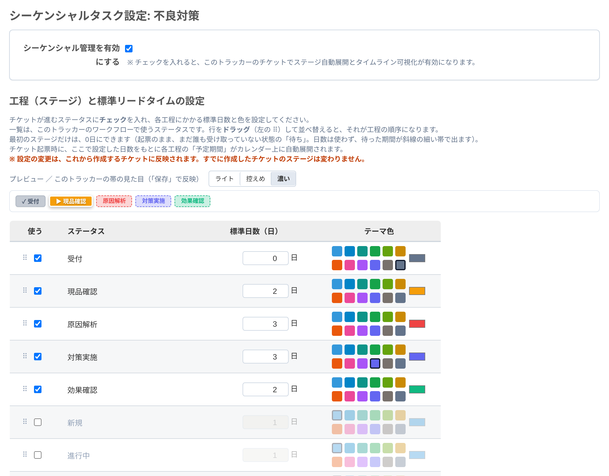
*画面2-1: トラッカーの設定画面（不良対策）。上に帯の見た目のプレビュー、下に工程にするステータス・標準日数・色*

> [!TIP]
> **最初の工程を「0日（受付待ち）」にする設定**:  
> 起票後、誰かがアサイン・作業着手して作業スタートするような作業向けに先頭のステータス（例:「新規」「受付」）のみ０日設定可能としています。 `0` 日に設定すると、その工程を「起票されてから誰かが拾うまでのプール期間」として扱えるようにしています。予定期間の帯は消費せず、誰かが着手した時点で待機日数を自動計算する仕組みです。

---

### 2.4 ワークフロー設定（権限）との整合

本プラグインは、Redmine標準のステータス遷移（ワークフロー）に従う作りにしています。

- **遷移権限の確認**:  
  **「管理」➔「ワークフロー」** で、各ロールが定義したパイプラインのステータス間を正しく遷移できるように設定してください。
- **差し戻し遷移の許可**:  
  「レビュー ➔ 実装」や「効果確認 ➔ 原因解析」などの差し戻し（手戻り）が発生する運用の場合、そのステータス間の逆方向遷移もワークフローで許可しておく必要があります。
- **開始日・期日の編集権限**:  
  本プラグインはRedmine標準の「開始日」と「期日」をそのまま利用します。そのため、ワークフロー設定の「フィールドに対する権限」で、特定ロールに対して「開始日」や「期日」が「読み取り専用」になっている場合は、権限を素通りさせず、保存を拒否します。
  - 期日が読み取り専用: 「予定を調整」もタイムラインの調整モードも、どちらのモードでも保存を断ります。
  - 開始日が読み取り専用: 開始日の欄が灰色になり（「ワークフローで変更不可」）、開始日のドラッグも保存を断ります。
  - ※タイムラインの調整モードは事前にはチェックせず、帯を離して保存するときに理由を表示します。

---

### 2.5 Redmine標準「休業日」設定との連動

土日や休業日に作業予定が組まれないよう、Redmine本体の休業日設定と自動同期する設計にしています。

1. **「管理」➔「設定」➔「チケットトラッキング」タブ** を開きます。
2. **「休業日」** 項目で、土曜日・日曜日など現場の休業曜日にチェックが入っていることを確認します。
3. **連動動作**:
   - チケット起票時や日程変更時、休業日を自動的にスキップして予定を組みます（例: 金曜開始で3日間の工程なら、金・月・火と数えて火曜日を終了日とします）。
   - タイムライン上でも、休業日の列に薄い網掛けを自動描画します（この設定に従います）。
   - ※特定チケット・工程で土日も作業したい場合は、チケット詳細で「休業日も数える」をONにできるようにしています（第3章参照）。

> [!IMPORTANT]
> **稼働日ゼロ時の安全保護機能**:  
> チケット作成時に自動で予定を引く仕組み上、万が一7曜日すべてを休業日に設定した場合や、外部カレンダープラグインの影響などで半年先まで稼働日が1日も存在しない状態になった場合は、無限ループ防止のため処理を安全に止める（エラーを表示する）ようにしています。止まるのは、シーケンシャルタスクのトラッカーのチケットの起票（REST API も）、開始日・期日の変更、予定の調整です。ほかのトラッカーのチケットには影響しません。

---

### 2.6 プロジェクトでの有効化・権限・プラグイン設定

#### ① プロジェクトでモジュールを有効にする
トラッカーの設定だけでは、画面に出ません。使うプロジェクトごとに、**「設定」➔「モジュール」** で **「シーケンシャルタスク」** にチェックを入れて保存します。有効にすると、プロジェクトのメニューに「シーケンシャルタスク」タブが出て、チケット詳細に帯グラフを表示します。

#### ② 権限
| 権限 | できること | 備考 |
|---|---|---|
| シーケンシャルタスクの表示（`view_sequential_tasks`） | タイムライン・マトリックス・分析を見る | 既定で全員（公開） |
| チケットの編集（Redmine 標準の `edit_issues`） | 予定の調整、タイムラインの調整モード、手動の並べ替え、バージョンの付け替え | |
| チケットの追加（Redmine 標準の `add_issues`） | 派生タスクの起票 | |
| 標準日数を調整する（`manage_sequential_tasks`） | プロジェクトごとの標準日数（9.1） | 既定ではどの役割にも付いていない |

#### ③ プラグインの設定（「管理」➔「プラグイン」➔ シーケンシャルタスクの「設定」）
- **タブの名前**: プロジェクトのメニューのタブと、タイムライン・マトリックス・分析の画面の見出しの名前です。空のときは「シーケンシャルタスク」です。「工程」など、自分たちの現場の言葉にできます（30文字まで。すべての言語で同じ名前になります）。
- **担当者名の並び順**: Redmine の設定に従う／姓 名／名 姓。
- **マイルストーンにするトラッカー**: ここで選んだトラッカー（イベント用など）のチケットを、タイムラインの見出しの下に点（◆）や大日程の帯として表示します（第6章）。

---

# 【第2部：日常のチケット管理（担当者編）】

## 第3章：チケット詳細画面での工程管理

### 3.1 チケット起票と工程パイプラインの自動生成

シーケンシャルタスクが有効なトラッカーを選択してチケットを起票すると、特別な初期設定なく、工程パイプラインを自動生成する作りにしています。

1. **通常通りチケットを起票**:
   - プロジェクトを選択し、シーケンシャルタスクが有効なトラッカー（例:「不良対策」「設計変更」「障害」）を選びます。
   - 題名、説明、担当者を入力します。
   - **開始日** を入力します（未入力の場合は、本日の日付または直後の稼働日を自動設定するように実装しています）。
   - ※期日は空欄のままで構いません。
2. **自動計算と保存**:
   - チケットを保存すると、管理画面で定義した標準日数に基づき、土日（休業日）を自動的にスキップしながら全工程の予定開始日・予定終了日を数珠繋ぎに自動計算します。
   - **最終工程の予定終了日を、チケット全体の「期日」として自動設定** するようにしています。
3. **ステータス進行による実績の自動記録**:
   - チケットのステータスを進めると（例:「新規」➔「調査中」）、前工程に完了日時が、新しい工程に開始日時を自動で打刻します。
   - 担当者は進捗率（%）を手入力する必要はなく、日々の作業に合わせてステータスを変更するだけで、正確な実績ログが積み上がっていきます。

> [!TIP]
> **期日をあらかじめ決めて起票した場合**:  
> 開始日と期日の両方を手動入力して起票した場合、期日は入力したまま残り、各工程は標準日数で組みます（日数を按分することはしません）。そのため、最後の工程の終わりと期日がずれることがあります。期日に合わせたいときは、起票後に「予定を調整」で日数を直すか、期日をいったん空にして起票してください。

---

### 3.2 帯グラフの見方（ステータス・発色のルール）

起票されたチケットを開くと、説明欄の直下に直列の帯グラフ（プログレスバー）を描画します。

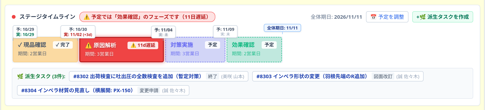
*画面3-1: チケット詳細の帯グラフ。終わった工程（✓）、遅れている現在の工程（赤）、これからの工程（破線）。下に派生タスク*

帯グラフの各ブロックは、現在の状態に応じて以下のように意図を持って視覚的に差別化しています。

| 状態               | 見た目・表現                               | 設計意図と意味                                 |
| ---------------- | ------------------------------------ | ---------------------------------------- |
| **✓ 完了（Done）**   | **薄い色** ＋ チェックマーク                    | すでに完了した工程。視覚的なノイズにならないよう、薄い色で控えめに抑えて描画します。 |
| **進行中（Current）** | **鮮やかな発色** ＋ 白枠リング（「濃い」の場合） | 現在作業中の工程。画面の中で最も目立つよう鮮やかに発色させ、誰にボールがあるかを一目で示します。 |
| **遅延（Delayed）**  | **鮮烈な赤（#ef4444）** ＋ 太い赤枠 ＋ `⚠️ Nd遅延` | 予定終了日を過ぎても完了していない工程。赤枠とバッジで遅延日数を強力に目立たせます。 |
| **未着手（Future）**  | **淡い半透明** ＋ 破線枠                      | これから着手する未来の工程。予定期間と通過工程を淡い破線枠で薄く予告するデザインにしています。 |
| **スキップ（Skipped）** | **灰色の破線** ＋ 取り消し線                    | 通らずに飛ばした工程。予定を動かさないまま、飛ばしたことが分かるようにしています。 |

※工程として設定していないステータス（例:「フィードバック」）にいるときは、帯の上に「⚑ ステータス名」の注意が出ます。工程の予定・実績はそのまま残り、工程のステータスに戻ると続きから記録します。

※表の見た目は、トラッカーの設定で選んだ見た目（濃い・控えめ・ライト）によって変わります。状態の見分け方（記号・枠）はどの見た目でも同じです。

---

### 3.3 個別工程の日程調整（仕様と挙動の詳細）

「原因調査に想定より時間がかかりそう」「試作品の評価を急ぎで前倒ししたい」といった場合、画面上で直感的に工程の日程をリスケジュールできます。

日程調整を行う際は、**「期日優先」** と **「日数優先」** の2つのモードを選択でき、それぞれ挙動を変えています。

---

#### 3.3.1 基本的な操作フロー

1. 帯グラフの右側にある **「📅 予定を調整」** ボタンをクリックします。
2. 帯グラフがインライン編集モードに切り替わり、モード切り替えラジオボタン（期日優先／日数優先）と、各工程の日数入力欄を展開します。
3. 調整したい工程の日数をキーボードで入力するか、工程の境界線をマウスで左右にドラッグします。
4. リアルタイムに再計算した各工程の予定日付と全体期日を確認し、**「保存」** をクリックします。

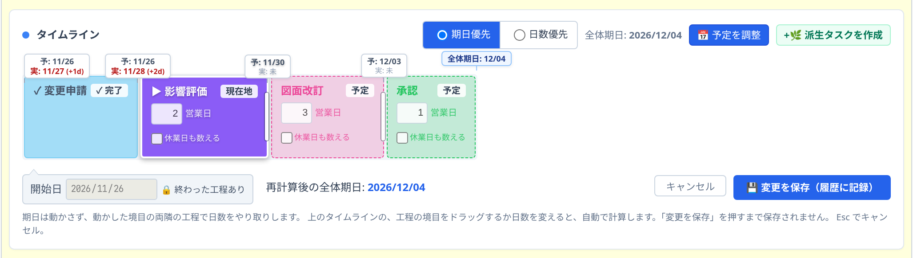
*画面3-2: 「予定を調整」を開いたところ。モード（期日優先／日数優先）、工程ごとの日数と「休業日も数える」、開始日、再計算後の期日*

---

#### 3.3.2 2つの調整モード：「期日優先」と「日数優先」

システム上での日程再計算は、選択したモードによって以下のように動作します。

| 項目              | ① 期日優先（`fixed_due`）             | ② 日数優先（`push`）                    |
| --------------- | ------------------------------- | --------------------------------- |
| **優先するもの**      | **計画の終わり（最後の工程の終わり＝帯の右端）** を守る | **各工程の日数（予定の期間）** を保つ             |
| **全体の期日**       | **動かない**（保存すると、チケットの期日を計画の終わりに合わせます） | 後ろへずらして **自動延長（スライド）** する       |
| **工程を伸ばした時の動き** | 動かした境目の **次の工程** が縮んで吸収する   | 後続の全工程の日数が変わらずに **そのまま後ろへずらす** |
| **主な利用シーン**     | 納期やリリース日が動かせない確定案件              | 各工程の期間を削らず、その結果いつ終わるかを見たい案件    |

##### ① 期日優先の具体的な動き
- **動作**: 途中の工程（例: 実装）を `3日 ➔ 5日`（+2日）に増やした場合、全体の期日は変えずに、**後ろの工程（例: テスト）を `4日 ➔ 2日`（-2日）へと自動的に縮小させる設計** にしています。境界線の両隣で日数をやり取りするイメージです。
- **その他の操作で差を受け持つ工程**（原則「動かした境目の隣だけが変わる」）:
  - 境目のドラッグ: 次の工程が1日になったところで止まります。
  - 日数の入力: 次の工程が受け持ちます。次の工程が1日を切る分は、期日の直前の工程が吸収します。
  - 最後の工程の日数の入力: 1つ前の工程が受け持ちます。
  - 開始日の変更: 最初の工程が伸び縮みします（その終わりは動きません）。
  - 「休業日も数える」の切り替え: その工程の始まりと終わりはそのままで、日数を数え直します（ほかの工程は動きません）。
- **限界とエラー（収まりません）**:
  それでも期日までに収まらないときは、画面上に赤字で **「この期日には収まりません」** と表示して保存ボタンを無効化します。期日を突き破って不正な予定が組まれるのを防ぐためのガードです。

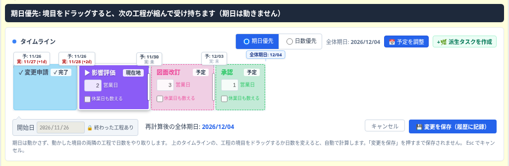
*動画3-1a（アニメーション）: 期日優先。影響評価を2日から4日に伸ばすと、次の図面改訂が3日から1日に縮み、期日（11/20）は動かない（この動画では保存していない）*

##### ② 日数優先の具体的な動き
- **動作**: ある工程（例: 調査）を `2日 ➔ 5日`（+3日）に増やした場合、後続工程の日数は削らず、**すべての後続工程を3稼働日分そのまま後ろへスライド** させます。
- **期日の連動**: 最終工程を後ろへずらした分だけ、**チケット全体の期日（`due_date`）も自動的に再計算して延長** するようにしています。

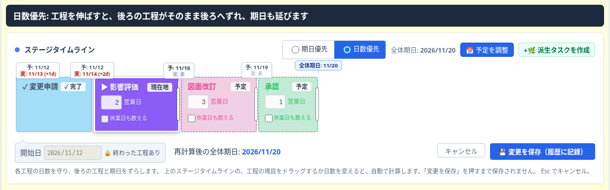
*動画3-1b（アニメーション）: 日数優先。同じく影響評価を2日から4日に伸ばすと、図面改訂は3日のまま後ろへずれ、期日が11/20から11/24に延びる（この動画では保存していない）*

---

#### 3.3.3 本システムで「できる動き」と「できない動き（仕様と制約）」

日程調整において、「こういう調整をしたいのにシステムが言うことを聞いてくれない」という混乱を防ぐため、本プラグインでは明確な意図を持って以下の安全ガード・仕様ルールを実装しています。

##### ⭕ できる動き
- **未完了工程の日数の変更**: 整数（1日〜365日）の範囲で自由に変更できます。
- **工程境界線のドラッグ伸縮**: マウスドラッグで直感的に日数を伸縮できます。
- **暦日（休業日カウント）の併用**: 特定の工程だけ「休業日も数える」を有効にしてカレンダー通りに進めることができます（3.5節参照）。既定は稼働日で数えるので、金曜に終わる工程を1日延ばすと、土日を飛ばして月曜に終わります。
- **開始日の変更**: まだどの工程も**終わっていない**チケットに限り、開始日を前後にずらすことができます（最初の工程が進行中でも変えられます）。

##### ❌ できない動き（システムが意図して制限していること）
1. **1日未満（半日、0.5日、数時間単位）の指定はあえてできません**:
   - 本プラグインは最小を日単位（Date）としています。「0.5日」などの小数はあえて入力できない作りとしています。（※先頭の0日受付待ちステージを除く）。
2. **すでに「完了」した過去工程の日程・日数は変更できないようにロックしています**:
   - 「基本設計」「現品確認」など、ステータスが通過して実績が確定している工程は編集できないようにしています。過去の実績記録を正確に取れるようにするための設計です。
3. **工程が終わったチケットの「開始日」は変更できないように塞いでいます**:
   - 1つでも工程が終わっている場合（受付待ちを受け取ったあとも含む）、工程を飛ばしている場合、現在の工程が最初の工程でない場合は、開始日の入力欄をロックします（画面上に「終わった工程あり」などの理由を表示します）。終わった工程の予実があとから変わらないようにするためです。
   - ※Redmine標準のチケット編集画面からは開始日を変えられますが、その場合も工程の予定は動きません（チケットの開始日と計画がずれます）。
4. **ワークフロー権限に反する期日変更は保存を拒否します**:
   - ログインユーザーのロールにおいて、Redmineのワークフロー設定で「期日」が読み取り専用になっている場合、予定の調整そのものを（どちらのモードでも）保存しないようにしています。開始日が読み取り専用なら、開始日の欄は灰色になります（「ワークフローで変更不可」）。

> [!IMPORTANT]
> **活動履歴（Journal）への自動明細記録**:  
> 日程を調整して保存すると、Redmine標準の活動履歴に **「どの工程が何日から何日に変わったか」**、および **「連動して期日がいつからいつへ移動したか」** を自動的に明細として記録するようにしています。

---

#### 3.3.4 チケットの編集画面で開始日・期日を直接変えたとき

「予定を調整」を使わずに、Redmine 標準のチケット編集画面（REST API や、先行・後続の関連による自動のずらしを含む）で開始日・期日を変えた場合も、工程の予定が連動します。

| 変えたもの | どの工程も終わっていないとき | 終わった工程があるとき |
|---|---|---|
| 開始日だけ | 新しい開始日（休業日なら次の稼働日）から、各工程の日数を保って並べ直し、期日も計画の終わりに合わせる | 工程は動かない（チケットの開始日だけが変わり、計画とずれる） |
| 期日だけ | 期日の直前の工程（工程が1つなら、その工程）の終わりを新しい期日に合わせる（休業日なら直前の稼働日） | 同じ |
| 両方 | 新しい開始日から並べ、期日の直前の工程が新しい期日までを受け持つ | 期日だけと同じ |

- 連動して変わった期日も、チケットの変更として活動履歴に残ります。
- 期日までに工程が収まらない場合は、保存を拒否します。
- ワークフローで期日を変えられない人が開始日を変えて、期日が動くことになる場合も、保存を拒否します。

---

### 3.4 「0日の待ち（受付待ち）」ステージの活用法

通常はチケット起票と同時に第1工程の予定期間がスタートしますが、たとえば次のような使い方では、「起票即スタート」だと実態と合わない場面があります。

- **問い合わせや不具合のディスパッチ待ち**: 「チケットが起票されたあと、リーダーが内容を確認して担当者にディスパッチ（割り当て）するまでプールしておきたい」
- **不良報告・クレームの受付待ち**: 「工場や客先から届いた不良報告を、品質保証の担当が受け取って現品確認に入るまで、何日寝ていたかを見たい」
- **外部監視システムやAPIからの自動起票**: 「アラート検知で自動起票されたチケットが、当番エンジニアに拾われて初動対応が始まるまでの放置時間を正確に可視化したい」
- **着手前遅延の防止**: 「起票しただけでまだ誰も手を付けていないのに、予定期間の帯が勝手に消費されて『着手前から遅延している』ように見えてしまうのを防ぎたい」

こうした使い方を想定して、先頭工程の標準日数を `0` 日に設定したトラッカーでは、**「受付待ち」** の特殊表示をしています。

- **起票直後**:
  チケットが起票された時点では、まだ作業担当者が着手していないため、予定期間の帯は消費させません。代わりに、タイムラインで、誰かが着手するまでの経過日数を **斜線の細い帯と「受付待ち N日」の札** で表示するように作っています。
  - ※チケット詳細の帯グラフには、0日の工程の箱は出ません（タイムラインと同じ扱い）。
  - ※待っている間に、次の工程の予定開始日を過ぎると、翌日から「遅延」と判定します。
- **着手後（ステータス進行時）**:
  ステータスを「受付」から次の工程（「調査中」など）へ進めても、**予定は自動では動かしません**。予定は起票の日から組んだままで、受け取りが遅れた分は、遅延（赤）と稲妻線の凹みとして表れます。予定を引き直したいときは、「予定を調整」で人が直します。待機していた期間は、過去の実績記録として薄い斜線帯に残ります。

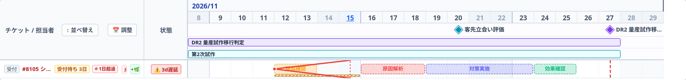
*画面3-3: 先頭が0日の工程のチケット（タイムライン）。「受付待ち 3日」の札と、待った期間の斜線の細い帯*

---

### 3.5 「休業日も数える（暦日）」工程の切り替え

通常は土日をスキップして稼働日ベースで予定を計算しますが、以下のようなケースでは暦日（土日を含む連続日数）で数えたい場面があります。

- 「土日に休日出勤して作業を行い、遅れを取り戻した工程」
- 「外部機関の審査やバッチ処理など、週末も関係なく日数が経過する工程」

このような場合、「予定を調整」フォームで該当工程の **「休業日も数える」** チェックボックスをONにできるようにしています。その工程のみ土日を含めた暦日で日数を計算するので、全体のスケジュールを柔軟に再調整できます。

- **期日優先のとき**: その工程の始まりと終わりはそのままで、日数を数え直します（例: 5営業日 → 7日）。ほかの工程は動きません。
- **日数優先のとき**: 日数を保ったまま暦日で数え直し、後ろの工程と期日がずれます。
- オンにした工程は、日数の単位が「営業日」から「日」に変わり、調整していないときは「期間: N日（休業日も数える）」と表示します。
- 切り替えは活動履歴に残ります。切り替えられるのは、チケット詳細の「予定を調整」だけです（タイムラインの調整モードには出ません）。

---

### 3.6 トラッカー変更時の自動追従機能

運用中にチケットのトラッカーを変更した場合でも、本プラグインは自動的に新しいトラッカーの工程定義に合わせて追従・再構築する仕組みを入れています。

- **通常トラッカー ➔ シーケンシャルタスク対応トラッカー**:
  通常のチケットを工程管理トラッカーに変更した場合、変更後のトラッカーの標準日数から工程パイプラインを自動生成し、期日も自動再計算します。
- **シーケンシャルタスク対応トラッカー間の変更**:
  工程定義（ステージ数や標準日数）を変更先トラッカーのものへ自動的に再生成・置換します。
- **シーケンシャルタスク対応トラッカー ➔ 通常トラッカー**:
  既存の工程データはDB内に安全に保持したまま、画面上の帯グラフのみ非表示にします。

---

### 3.7 誤操作防止機能（UIアクセシビリティ）

日常の運用でストレスなく安全に操作できるよう、以下の工夫や実装を組み込んでいます。

- **Escキーでの安全キャンセル**: 日程調整フォームを開いている際、`Esc` キーを押すだけでキャンセルできるようにしています。数値を変更していた場合は、誤操作を防ぐため確認ダイアログを出します。
- **キーボードフレンドリーな入力**: 日数入力欄は押し間違えやすいスピンボタン（▲▼）をあえて廃止し、テンキーやキーボードから直接打ち込みやすいシンプルな数値ボックスにしています。
- **Enter キーでは保存しない**: 日数や開始日の欄で Enter を押しても、再計算するだけで保存はしません。保存は「変更を保存」ボタンで行います。
- **保存していない変更の確認**: 予定を変えたまま別のページへ移ろうとすると、ブラウザが確認を出します。
- **収まらないときは保存できない**: 期日優先で期日までに収まらない間は、保存ボタンを押せず、横に理由を表示します。
- **モードの説明を画面に表示**: 選んでいるモード（期日優先／日数優先）の説明を、マウスを乗せなくても画面に表示します。
- **タッチ・読み上げへの配慮**: 境目のつまみは指でもつかめる幅にしています。日数の欄やチェックには、工程名つきの読み上げ用の名前を付けています。
- **開始日が動かせない理由の明示**: すでに完了した工程がある場合や、ワークフロー権限で開始日の変更が禁止されている場合、なぜ開始日が変更できないのか（例:「終わった工程あり」「ワークフローで変更不可」）を画面上に理由付きで分かりやすく示しています。

---

## 第4章：「ゆるいブランチ（派生タスク）」機能

### 4.1 従来の親子チケットとの違い

Redmine標準の親子チケット機能は、「子チケットがすべて終了しないと親チケットを終了できない」「親の期日や進捗率が子チケットに拘束される」といった厳格な制約を持ちます。そのため、たとえば次のような場面では、この制約が運用を難しくしています。

- 「障害解析の結果、複数の恒久対策アクションが生まれたが、親の障害調査自体は完了として閉じたい」
- 「不良の原因解析から、設計変更・工程改善・他機種への横展開といった対策が派生したが、元の不良報告は原因を特定した時点でいったん閉じたい」
- 「仕様検討から改善タスクが派生したが、親チケットとしては役割を終えたので先にクローズしたい」

本プラグインが提供する **「ゆるいブランチ」** とは、**「どこから派生したか（出所）」というルーツ情報だけを保持し、お互いのライフサイクルには一切干渉しない相互独立モデル** です。

- **単独のチケットとして動作**:
  派生した子タスクも親チケットも、システム上はそれぞれ独立した通常の1枚のチケットとして動きます。親のステータスに引きずられることはなく、親がクローズしても子は作業を続けられますし、逆に子が未完了であっても親チケットを自由にクローズできます。期日や担当者、工程スケジュールも完全に独立しています。
- **関係性（出所）だけを可視化**:
  お互いを制約で縛り付けない代わりに、「どの親から生まれたか」「親から生まれた派生タスクが今どのくらい終わっているか」という情報だけを持ち、タイムライン上のツリーインデント（`└─ 🌿`）や進捗バッジ（`[2/3]`）としてスマートに可視化します。

---

### 4.2 派生タスクのクイック起票（`＋🌿` ボタン）

タイムラインやチケット詳細から、1クリックで即座に派生タスクを起票できます。

1. タイムラインの各チケット行にある **「＋🌿」** ボタンをクリックします。
2. 行の直下にインライン入力行が現れます。
3. 題名（入力の手間を省くため、デフォルトで `親チケット名_1` などを自動サジェストします）を確認・編集します。
4. **「起票」** を押すと、その場で親チケットに関連付けた派生タスクを作成します。

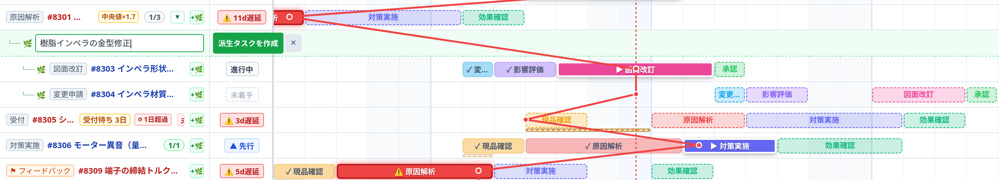
*画面4-1: タイムラインで「＋🌿」を押し、親チケットのすぐ下に派生タスクの起票欄が開いたところ*

---

### 4.3 親チケットでの進捗確認（`[2/3]` 完了/全体バッジ）

派生タスクを持つ親チケットには、進捗度を示すバッジを表示します。表示のみでクローズ条件などの制約はありません。

- **バッジ表示（例: `[2/3]`）**:
  「完了した派生タスク数 / 全派生タスク数」をリアルタイムに集計して表示します。
- **カラーリング**:
  - `緑色`: すべての派生タスクが完了している状態。
  - `橙色`: 親チケット自身は「解決/終了」になっているが、未完了の派生タスクが残っている状態。やり残しや確認漏れをひと目で検知できるようにしています。

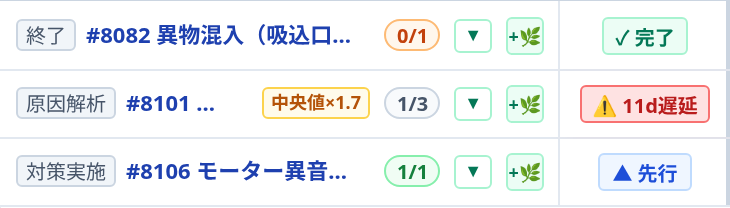
*画面4-3: 派生バッジの例。上から、親は終了したが派生が残っている（橙 0/1）、3件中1件が完了（1/3）、すべて完了（緑 1/1）*

---

### 4.4 チケット詳細での「このチケットと派生」タイムライン表示

派生タスクを持つ親チケットの詳細画面を開くと、説明欄の下に **「このチケットと派生」** というアコーディオンブロックを追加表示します。

- クリックして展開すると、その親チケットと派生した子タスク（孫タスクも含む）だけのミニタイムラインを描画するようにしています。
- プロジェクト全体の巨大なタイムラインを見に行かなくても、チケット詳細画面の中でその案件から生まれた全アクションの進捗・遅れをピンポイントで確認できるようにしています。

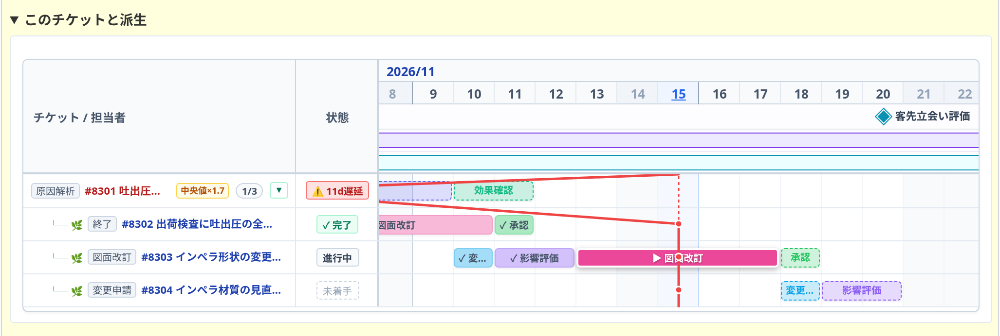
*画面4-2: チケット詳細の「このチケットと派生」。親と派生タスクが小さなタイムラインに並ぶ*

---

# 【第3部：プロジェクトの進捗・全体調整（リーダー・PM編）】

## 第5章：専用タイムライン（ガント風カレンダービュー）

### 5.1 画面の見方と基本操作（画面構成と操作一覧）

プロジェクトメニューの **「Sequential Tasks」** タブをクリックすると、プロジェクト内の全直列タスクが一堂に会する専用タイムラインを展開します。

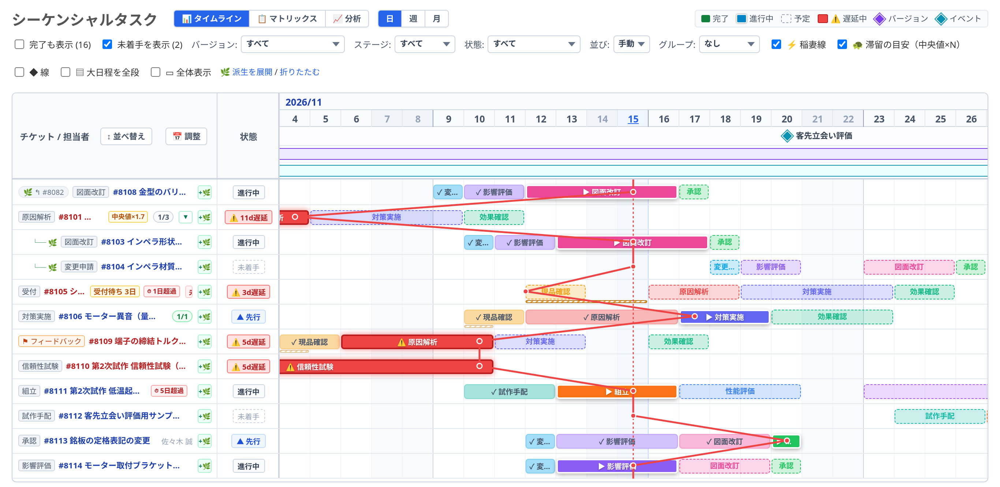
*画面5-1: タイムライン。上にツールバー、マイルストーン行と大日程の帯、左にチケットの一覧、右に工程の帯と稲妻線*

#### 5.1.1 画面の3つの主要エリア

画面は大きく以下の3つの領域に分けています。

1. **上部ツールバー**:
   表示期間の切り替え、完了・未着手チケットの表示切替スイッチ、各種フィルタ、グループ化、並び替え、日程調整モードの起動など、タイムラインを自在に操作するためのコントロールパネルです。
2. **左側：チケット固定列**:
   チケット番号、題名、担当者、現在の「状態」（未着手・進行中・遅延・先行・完了）、派生バッジ（`[2/3]`）を表示します。横スクロールしても画面左端に固定し（Sticky表示）、境界線をドラッグして列幅を自由に伸縮できます。
3. **右側：タイムライン領域**:
   日付見出し（縦スクロールしても上部に固定）、マイルストーン行、各チケットの工程帯（プログレスバー）、およびプロジェクト全体の遅れ傾向を示す「⚡ 稲妻線」を表示します。

---

#### 5.1.2 ツールバーで操作できること一覧

タイムライン上部のツールバーでは、目的に応じて以下の操作をワンクリックで行えます。

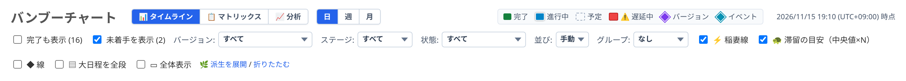
*画面5-1-2: タイムラインのツールバー*

| 操作項目 | 選択肢・ボタン | できること・用途 | 詳細 |
|---|---|---|---|
| **画面の切り替え** | `タイムライン` / `マトリックス` / `分析` | 3つの画面を切り替えます。 | 第7章・第8章 |
| **表示粒度の変更** | `日` / `週` / `月` | 直近の日程を細かく見る（日）から、数ヶ月のロードマップを俯瞰する（月）まで表示期間の尺度を切り替えます。 | 5.1.3 |
| **完了・未着手の表示切替** | `完了も表示 (N)` / `未着手を表示 (N)` | デフォルトで非表示の完了チケットを表示したり、開始前の未着手チケットを隠して進行中タスクに集中したりします。 | 5.4.1 |
| **絞り込み** | `バージョン` / `カテゴリ` / `ステージ` / `状態` | 対象バージョン・カテゴリ・いまのステージ・状態（遅延・先行・進行中・リリース超過見込み・標準より遅い）で絞り込みます。 | 5.4.2 |
| **並び替え** | `並び` | 「手動」「期日」「遅延」「更新」の並び順を選びます。 | 5.4.4 |
| **グループ化** | `グループ` | 「トラッカー」「担当者」「ステータス」「バージョン」「カテゴリ」ごとに折りたたみ表示します。 | 5.4.3 |
| **遅延の可視化** | `⚡ 稲妻線` | 今日の日付から現在進行中工程へ折れ線を引き、プロジェクト全体の遅れ・進みを一目で把握します。 | 5.2 |
| **滞留の目安** | `🐢 滞留の目安（中央値×N）` | 行の札「中央値×N」の表示・非表示を切り替えます。 | 8.3 |
| **マイルストーン強調** | `◆ 線` | バージョン期日などのマイルストーンから垂直点線を引き、締め切りの山場を強調します。 | 第6章 |
| **大日程** | `▤ 大日程を全段` | 大日程の帯を、既定の2段から全段（最大5段）に広げます。 | 6.2 |
| **全体表示** | `▭ 全体表示` | スクロール枠を解除して全行・全期間を1ページに展開し、キャプチャや印刷に適したレイアウトにします。 | 第9章 |
| **派生タスクの開閉** | `🌿 派生を展開 / 折りたたむ` | 画面上のすべての派生タスクを一括で展開・収納します。 | 5.6 |

※表の見出し（「チケット / 担当者」の欄）には、**`↕ 並べ替え`**（手動の並べ替えモード）と **`📅 調整`**（日程調整モード）のボタンがあります（5.3・5.4.4）。
---

#### 5.1.3 画面内での基本操作

ツールバーの操作に加えて、タイムラインの表内でも以下の直接操作が可能です。

- **日・週・月の表示切り替え**:
  ツールバーの切り替えボタンで表示粒度を変更できます。直近の日程を細かく見る場合は「日」、数ヶ月のロードマップを見渡す場合は「週」や「月」が適しています。どの粒度を選んでも、日付に合わせた正確な比率で帯を描画するよう計算しています。
- **チケットの詳細確認・編集**:
  チケット行の題名（または帯バー）をクリックすると、画面右側から **スライドパネル（右サイドパネル）** がスッと現れ、別タブを開くことなくその場でチケットを編集できます（5.5節参照）。
- **派生タスクのクイック起票**:
  各行の **「＋🌿」** ボタンを押すと、行の直下にインライン起票フォームが展開し、その場で派生タスクを作成できます（第4章 4.2節参照）。
- **チケット列幅の伸縮**:
  チケット列と日付領域の境目をマウスドラッグして、見やすい幅に調整できます。

---

### 5.2 ⚡ 稲妻線（進捗線）によるプロジェクト遅延傾向の把握

タイムライン上には、本日の日付（縦破線）を起点として、各チケットの現在進行中工程に向かって赤い折れ線 **「⚡ 稲妻線」** を自動描画します。

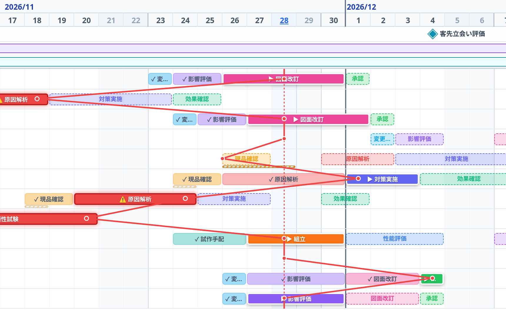
*画面5-2: 稲妻線。遅れているチケットで左に凹み、先行しているチケットで右に出る*

#### 5.2.1 稲妻線の計算と直感的な見方
稲妻線は製造業や建設業の工程管理で広く使われる進捗線（Progress Line）の考え方をRedmineに持ち込んだものです。「今日という日において、各チケットが本来いるべき位置」と「実際の進捗位置」を結ぶことで、プロジェクト全体の健康状態を直感的に判定できます。

- **左へ凹んでいる（遅延）**:
  今日終わっているはずの工程がまだ終わっていないチケットです。線が大きく左に引っ張られているほど、深刻な遅れが生じていることを示します。
- **垂直に整列している（オントラック）**:
  予定通り順調に今日やるべき工程を消化できているチケットです。
- **右へ突き出ている（先行）**:
  予定よりも前倒しで工程が進んでいるチケットです。

#### 5.2.2 現場の遅れを見落とさないための視覚強調
単に線を引くだけでなく、リーダーが朝会や進捗会で即座に対処できるよう、以下の視覚強調を連動させています。

- **遅延行の赤太字化**:
  遅れているチケットは題名が赤い太字になり、遅延日数バッジが際立つようになります。
- **未アサインの「未」札アラート**:
  担当者が決まっていないチケットには、担当者列に赤い **「未」** の札を表示します。「誰にも拾われずに放置され、気づいたら遅れていた」という事故を未然に防ぐための工夫です。
- **完了チケットの除外**:
  すでにすべての工程を終えてクローズしたチケットは稲妻線の対象から外し、現在進行形のタスクだけに集中できるようにしています。
- **ワンクリックでの表示切り替え**:
  ツールバーの「⚡ 稲妻線」チェックボックスで、いつでも表示・非表示を切り替えられます。

#### 5.2.3 稲妻線の特性と運用の大前提（ステータス基準の割り切り）
本プラグインの設計上、以下が運用前提となります。

- **進捗の基準はあくまで「ステータス（工程）」**:
  本プラグインは、担当者の主観に頼る「進捗率（％）」の手入力を廃止し、「今どのステータスにいるか」だけを基準に進捗を判定します。そのため、チケットが「今日あるべきステータス」に遷移していれば、オンスケジュールと判定します。
- **長期間ステートにおける内部進捗の限界**:
  これは従来の Open / Close のチケット管理と共通する特性です。たとえば「実装中」という工程が2週間続くようなスケジュールを組んだ場合、その2週間の内部で「半分進んでいるのか、終盤なのか」までは表現しきれません。実際の作業内容や進捗管理の粒度などからバランスの良い工程設計することが効果的です。
- **運用の大前提：ステータス更新が滞ると機能しない**:
  進捗率を数字でいれるよりはマシというだけで、担当者が作業を終えてもステータスを進めてくれなければ、どれだけ仕組みを作っても実態は把握できません。ステータスが放置されればすべて「遅延」として左に凹み、稲妻線は形骸化してしまいます。「工程が終わったらステータスを次へ送る」というシンプルで確実なチーム運用があってこそ、稲妻線はプロジェクトの遅れを早期検知する強力なアンテナとして機能します。

---

### 5.3 📅 日程調整モード（ドラッグリスケジュール）

タイムライン上でマウスを使って直接チケットのリスケジュールを行えるモードを用意しています。

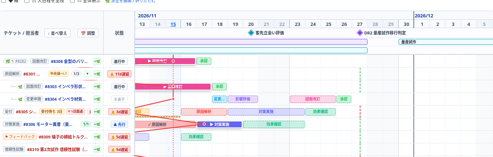
*動画5-1（アニメーション）: タイムラインの調整モード。「📅 調整」を押すと青い帯が出る。帯の右端をドラッグして工程を2日伸ばす（期日優先なので次の工程が縮む）と、離した時点で保存し、通知が出る。続けて帯の中ほどをドラッグして、計画全体を2日後ろへずらす*

#### 5.3.1 調整モードの起動と視覚フィードバック
1. 表の見出し（「チケット / 担当者」の欄）の **「📅 調整」** ボタンをクリックします。
2. **調整モードの起動**:
   - ツールバーの帯が鮮やかな青地に変わり、**「📅 調整モード中」** という表示に切り替わります。
   - 誤操作防止のため、タイムライン表の枠線やヘッダーも青色に変化し、通常閲覧と明確に区別できるようにしています。

#### 5.3.2 直感的なドラッグ操作と2つの計算モード
工程帯の上にマウスを乗せると、操作に応じたカーソルに変化します。

- **帯の右端をドラッグ（工程の伸縮）**:
  その工程の終了日（予定の日数）をマウスで伸ばしたり縮めたりできます。休業日（土日など）を自動的にスキップしながら、カレンダーの稼働日ベースで日数を再計算します（※期日優先の場合、期日を守るため最終工程の右端はドラッグできないようロックしています）。
- **先頭工程の左端をドラッグ（開始日の変更）**:
  まだどの工程も完了しておらず、ワークフロー権限で開始日の変更が許可されているチケットに限り、チケットの着手開始日をマウスドラッグで直接動かせます（変更できないチケットでは禁止カーソルになり、ツールチップに理由を表示します）。
- **帯の中央をドラッグ（チケット全体のシフト）**:
  工程ごとの日数配分やバランスをそのまま保った状態で、チケットの開始日・終了日全体を前後にまるごとスライド移動します。
- **2つの計算モードの選択**:
  ツールバーのラジオボタンで、日程変更時の伝播方法をいつでも切り替えられます。
  - **期日優先**:
    帯の右端を動かすと、**その次の工程**と日数をやり取りし、全体の期日は動かしません。先頭工程の左端（開始日）を動かすと、**最初の工程**が伸び縮みします。最後の工程の右端（＝期日）はつかめません。
  - **日数優先**:
    工程を伸ばした分だけ、後続の工程とチケットの最終期日をそのまま後ろへ押し出すように再計算します。
  - ※帯の中ほどのドラッグ（全体のシフト）は、モードによらず期日も一緒に動きます。期日優先のときは、吹き出しが橙になり「期日が動きます」と表示します。

#### 5.3.3 安全ガード機能と非同期自動保存
安全かつ軽快に運用できるよう、以下の制御を組み込んでいます。

- **過去工程の保護**:
  すでにステータスが進んで完了した過去の工程は、ドラッグで動かせないようにロックしています。実績として確定した日程が崩れる心配はありません。
- **日数下限ガード**:
  工程の日数が1日未満（マイナス日数）になるような無理な縮小操作はできないようにしています。
- **非同期自動保存とバー直近への通知表示**:
  マウスを離した瞬間にバックグラウンド（Ajax）でチケットを非同期保存します。保存が完了すると、操作したバーのすぐ脇に **「#1234 題名 の予定期間を更新しました」** というツールチップ通知が約2.5秒間ポップアップ表示し、背後の表を自動再描画します。
- **元に戻す機能はありません**:
  離した時点で保存し、活動履歴に1件残します。戻したいときは、もう一度ドラッグして戻します。
- **保存中の行はつかめない**:
  保存と画面の再描画が終わるまで、その行は薄くなり、ドラッグできません。
- **収まらないときは保存しない**:
  期日優先で期日までに収まらないと、吹き出しが赤くなり「収まりません（期日 m/d）」と表示します。そのまま離しても保存せず、元の位置に戻します。
- **週・月の表示での注意**:
  1日の幅が狭いため、ドラッグしにくくなります（日の表示で使う想定です）。わずかな手ぶれで動かないよう、1日の幅の6割ほど動かしてから反応します。
- **ページを開くたびにオフ**:
  調整モードは、ページを開くたびにオフに戻ります（保存後の再描画ではオンのまま）。
- **ドラッグの取り消しと終了**:
  ドラッグの途中で `Esc` キーを押すと、その行を元の位置に戻します（保存しません）。調整モードを抜けるときは、「📅 調整」ボタンをもう一度クリックします。

---

### 5.4 絞り込み・グループ化・手動並び替え

タイムライン上部に用意したツールバーにより、数百件のタスクの中から「今見るべきチケット」を瞬時に切り出せるようにしています。

#### 5.4.1 チケットの「状態」一覧と表示切り替え（完了・未着手スイッチ）
タイムラインの左側固定列にある「状態」列には、各チケットの進捗状況や健康状態をバッジで表示します。


- **状態列に表示する5つのバッジ**:

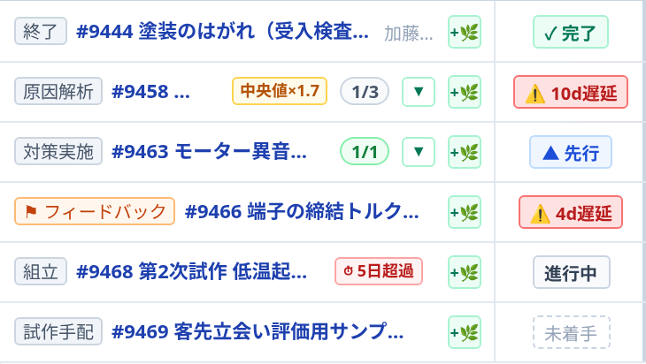
*画面5-4-1: 状態のバッジ。上から 完了・遅延・先行・遅延（⚑ 工程にないステータス「フィードバック」で止まっている）・進行中・未着手*

| バッジ | 意味 |
|---|---|
| **`✓ 完了`**（closed） | すべての工程を終えて、Redmine上でクローズ（終了・解決）したチケットです。全工程を消化していても、ステータスが未完了であればクローズ扱いにはなりません。 |
| **`⚠️ Nd遅延`**（delayed） | 今日の時点で予定より遅れているチケットです（今日あるべき想定工程より手前の工程に留まっている、または現在工程の予定終了日を過ぎている状態）。遅れている日数（暦日）を数字で表示します。 |
| **`未着手`**（pending） | 最初の工程の予定開始日が今日より先（未来）にあり、まだ開始日を迎えていないチケットです。開始日を迎えるまでは、最初の工程も「予定」として表示します（起票した時点で最初のステータスにいますが、実績の開始は出しません。分析の滞留も、予定の開始日から数えます）。予定開始日を過ぎたチケットは、初期ステータスのままでも「未着手」にせず、「進行中」か「遅延」として浮かび上がらせて、放置を防ぎます。 |
| **`▲ 先行`**（ahead） | 今日の時点で予定していた想定工程よりも、先の工程へ前倒しで進んでいるチケットです。土日など、今日がどの工程の予定期間にも入らない日は、直前の稼働日に予定していた工程と比べます。 |
| **`進行中`**（in_progress） | 遅延も先行もしておらず、今日やるべき工程をオンスケジュールで進めているチケットです。 |

  工程として定義されていないステータスにいるチケットには、バッジの下に **`⚑ ステータス名`** を併記し、工程外で止まっていることが一目でわかるようにしています。

- **完了・未着手チケットの表示切り替えスイッチ**:
  運用が軌道に乗ると、完了したチケットや着手前の先々のチケットが増え、タイムラインが縦に長くなって見通しが悪くなりがちです。そのため、ツールバーに以下の切り替えスイッチを配置しています。
  - **`完了 (N件)` スイッチ**: 完了済みチケットの表示 / 非表示を切り替えます（デフォルトは **非表示** にし、現在動いているタスクに集中できるようにしています）。
  - **`未着手 (N件)` スイッチ**: 着手前のチケットの表示 / 非表示を切り替えます（デフォルトは **表示** です。「今日やるべき進行中タスクだけに絞り込みたい」ときはOFFにして隠すことができます）。
  - ※スイッチで隠した結果、表示するチケットが1件も無くなったときは、「非表示: 完了 X件、未着手 Y件。上のスイッチで表示できます」と案内が出るため、チケットが消えてしまったと誤解しない配慮をしています。

#### 5.4.2 状態フィルタによるピンポイント絞り込み
チケットの状態を踏まえた上で、ツールバーの「状態」ドロップダウンを使うと、特定のコンディションにあるチケットだけを瞬時に抽出できます。

- **すべて**: 現在の表示対象チケットをすべて表示します。
- **遅延**: 予定よりも工程が遅れているチケットだけを抽出します（稲妻線が左に凹んでいるタスク）。朝会や定例会で「今まさに支援が必要なタスク」をあぶり出すのに最適です。
- **先行**: 予定よりも前倒しで進んでいる順調なチケットを抽出します。
- **進行中**: 遅延・先行・未着手・完了を除外した、純粋にオンスケジュールで作業中のチケットを抽出します。
- **リリース超過見込み**: 割り当てられたバージョンのリリース期日に対して、予測完了日（予定終了日＋遅延日数）がオーバーしているリスクの高いチケットだけを抽出します（第6章参照）。
- **標準より遅い**: 過去の完了実績（滞留日数の中央値）に対してN倍以上長く現在の工程に停滞している要注意チケット（🐢マーク）を抽出し、プロセスの見直し対象を特定します（第8章参照）。

#### 5.4.3 柔軟なグループ化（グルーピング表示）
タイムラインの表示単位をチームの目的に合わせて切り替えられます。

- **グループ化の軸**:
  「トラッカー」「担当者」「ステータス」「バージョン」「カテゴリ」から選択できます。
- **アコーディオン折りたたみ**:
  各グループのヘッダーをクリックすると、そのグループに属するチケット群を一括で折りたたんだり展開したりできます。担当者ごとに抱えているチケットの確認や、バージョンごとの進行状況のチェックに使えます。

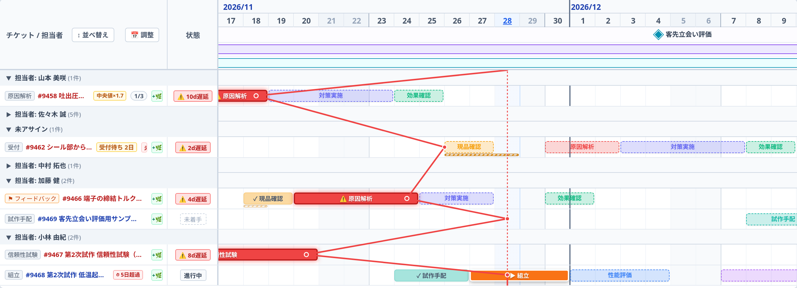
*画面5-4-3: 担当者でグループ化し、「佐々木 誠」と「中村 拓也」のグループを折りたたんだところ*

#### 5.4.4 ソート順と手動並び替えモード
チケットの並び順は、以下のプリセットから選べます。

- **期日順**: 締め切りが近いタスクを上位に表示。
- **遅延順**: 遅れ日数の大きいタスクを上位に集約。
- **更新日時順**: 直近で動きのあったタスクを上位に表示。
- **手動並び替え**:
  表の見出しの **「↕ 並べ替え」** ボタンを押している間だけ、同じ階層内・グループ内でチケット行をマウスドラッグして自由な順序に並べ替えられます。「重点タスクを一番上に持ってくる」といったチーム内での優先順位付けが可能です。不意の誤ドラッグを防ぐため、ページをリロードすると自動でロックする設計にしています。

---

### 5.5 右サイドパネルでのチケット確認・インライン編集

「タイムラインを見ながらチケットの細かい説明を読みたい」「担当者やステータスをその場で変えたい」という場面で、別のブラウザタブを開くストレスをなくすため、画面内に **スライド式の右サイドパネル** を用意しています。

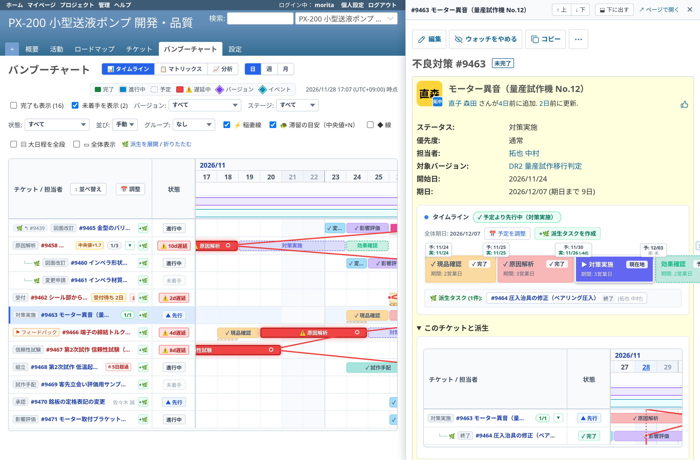
*画面5-4: チケットの題名を押すと、右からサイドパネルが開き、タイムラインを見ながら詳細を確かめ・編集できる*

#### 5.5.1 シームレスな閲覧と編集
1. チケット行の **題名（または工程帯）** をクリックします。
2. 画面右端からスライドパネルがスッと現れ、Redmine標準のチケット詳細・編集フォームをそのまま表示します。
3. **コンテキストの維持**:
   タイムラインのスクロール位置、拡大粒度（日/週/月）、適用中のフィルタを保ったまま、チケットの全情報（説明文、注記履歴、カスタムフィールドなど）を確認できます。

#### 5.5.2 パネル内での更新とタイムラインの自動再描画
- **その場で編集・更新**:
  サイドパネル内でステータスの変更、担当者の付け替え、作業コメント（注記）の投稿など、通常のチケット詳細画面とまったく同じ操作を行えます。
- **リロードなしの自動連動**:
  サイドパネルで「送信（保存）」を押すと、背後にあるタイムライン側へ自動的に更新イベントを送り、該当チケットの工程帯や稲妻線を即座に最新状態へ再描画します。ページ全体をリロードし直す必要はありません。
- **スムーズな開閉**:
  パネル右上の「✕」ボタンを押すか、パネル外の領域をクリック、あるいはキーボードの `Esc` キーを押すだけでサッと閉じられます。

---

### 5.6 派生タスクのツリー階層表示と折りたたみ

「ゆるいブランチ」で起票された派生タスクは、タイムライン上で親チケットの直下に **`└─ 🌿`** のインデントツリー形式で美しく整理して表示しています。

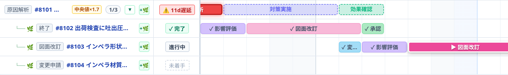
*画面5-6: 親チケットの下に、派生タスクが └─ 🌿 で一段下がって並ぶ*

#### 5.6.1 視覚的な親子関係と操作
- **ツリーインデント表示**:
  派生タスクは親チケットのすぐ下に一段下げて表示するため、どのタスクから派生したかが直感的に把握できます。
- **個別の折りたたみ**:
  親チケットの行頭にあるトグルアイコン（`▼` / `▶`）をクリックすることで、その親にぶら下がる派生タスク群だけをピンポイントで折りたためます。
- **一括展開・収納**:
  ツールバーの **「🌿 派生を展開 / 折りたたむ」** リンクをクリックすると、画面上に存在するすべての派生タスクを一括で展開したり、親チケットのみのすっきりしたビューに折りたたんだりできます。プロジェクト全体の概要を掴みたいときは折りたたみ、詳細を追いたいときは一括展開といった使い分けがスムーズに行えます。

---

## 第6章：マイルストーン・大日程・スプリント管理

### 6.1 マイルストーン（◆印）とイベントトラッカー連携

スケジュールを検討する際、「この日にデザインレビュー（DR）がある」「この日が量産開始・商用リリース」といった節目を示すため、タイムラインの日付見出し直下に **固定のマイルストーン行** を配置しています。

- **点（◆）の表示**:
  - Redmineの **「バージョン」の期日**
  - プラグイン設定で指定した「イベント用トラッカー」の期日
- **操作**:
  - 同じ日に複数のマイルストーンがある場合は1つの点にまとめ、クリックするとそれらのチケットを Redmine のチケット一覧の画面で表示します。
  - ツールバーで **「◆線」** をONにすると、マイルストーンの日から全行を貫く垂直点線を描画し、「ここが締め切り・山場」であることを強調できるようにしています。

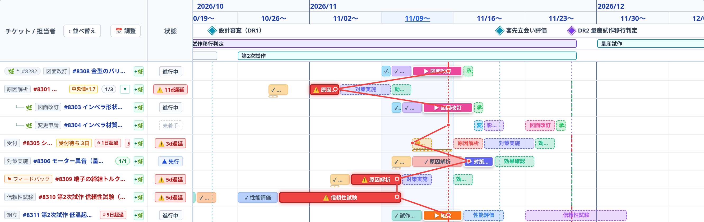
*画面6-1: 週の表示で「◆線」をONにしたところ。マイルストーン（◆）と縦の点線、バージョンと大日程（イベント）の帯*

---

### 6.2 大日程の帯（バージョン帯・大粒度FSフェーズ）

マイルストーン行の下には、期間を持った大日程の帯を描画するようにしています。

- **バージョン帯**:
  開始日と期日を持つバージョンを帯として描画し、チケットの進捗率に応じて左から塗りつぶしています。
- **大粒度FSフェーズ連携**:
  「日々のタスクは直列チケット1枚で管理するが、フェーズ単位（例: 設計 ➔ 試作 ➔ 量産試作 ➔ 量産、設計 ➔ 開発 ➔ 移行）の大日程だけはFS（先行-後行）で並べたい」という使い方も想定して、イベント用チケットを標準の関連（先行-後行）で結ぶと、上部の大日程帯に階段状に自動配置する連携を組み込んでいます。

---

### 6.3 リリース期日超過見込み判定（⏱ 札表示）

「2週間ごとのスプリントリリースに、どのチケットが間に合うか」を直感的に判断できるよう、リリース期日超過見込みの自動判定を組み込んでいます。

- **見込み判定ロジック**:
  チケットの最終工程予定終了日と現在の遅延日数を足し合わせ、割り当てられているバージョンの期日を超過していないかを自動判定します。
- **視覚表示**:
  - 各行の、リリース期日の位置に小さな目印を出します（`緑色`: 間に合う見込み、`赤色`: 超過の見込み）。マウスを乗せると「リリース（名前・日付）まで、余裕 N 日の見込み」「N 日超過の見込み」と出します。
  - 超過の見込みのチケットには、チケットの列に `⏱ N日超過` の札を出します。
- **グループ見出しでの集約**:
  「バージョン別」でグループ化すると、各バージョンの見出しに、超過見込みの件数（`⏱ 2` など）を表示しています。

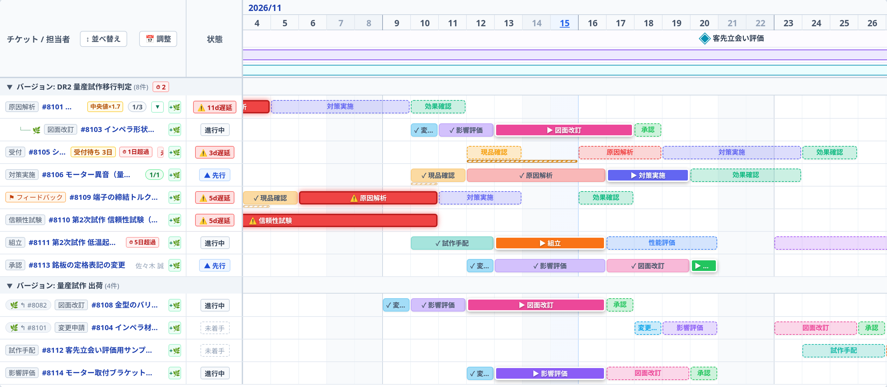
*画面6-3: バージョンでグループ化したところ。見出しの ⏱ 2 が超過見込みの件数、チケットの列の「⏱ N日超過」が超過見込みのチケット*

---

### 6.4 バージョンのドラッグ付け替え（スプリント調整）

スプリント計画や定例会で、溢れそうなタスクを次のスプリントへ送る操作が直感的に行えるようにしています。

1. タイムラインを **「バージョン別」** でグループ化します。
2. 「手動並び替え」モードをONにします。
3. 超過見込みのチケット行をドラッグし、**次のバージョンのグループ内へドロップ** します。
4. チケットの「対象バージョン」が即座に付け替わり、Redmineの活動履歴に自動記録するように連携させています。

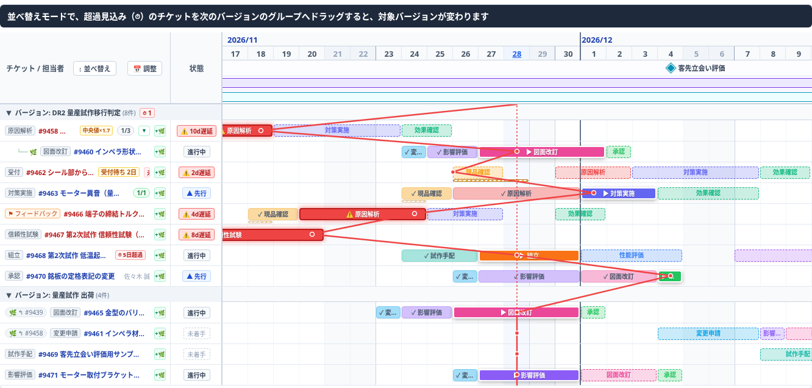
*動画6-4（アニメーション）: バージョンでグループ化して並べ替えモードにし、超過見込み（⏱ 5日超過）の「第2次試作 低温起動性評価」を、次のバージョン「量産試作 出荷」のグループへドラッグする。見出しの件数と ⏱ の数が変わり、行が次のバージョンへ移る*

---

## 第7章：マトリックスビュー ＆ CSVエクスポート

### 7.1 マトリックス表の見方

プロジェクトサブメニューの **「マトリックス」** を開くと、全タスクの予実をExcelライクなグリッド表形式で一覧表示する画面を用意しています。

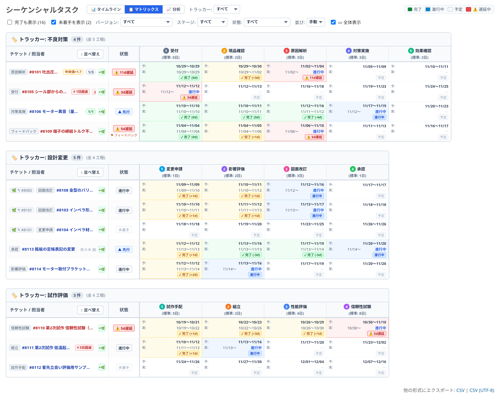
*画面7-1: マトリックス。トラッカーごとに表が分かれ、工程ごとのセルに予定・実績・遅れの日数*

- **トラッカーごとの独立ブロック**:
  工程数が異なるトラッカー（例: 機能開発6工程、不良対策4工程）が混在していても、列を無駄に引き伸ばさないよう、トラッカーごとに別々の表として縦に分離配置するレイアウトにしています。
- **予実対比セル**:
  各工程のセル内に「予定期間」「実績期間」「予実差異日数」をコンパクトにまとめて表示するように作っています。
  - `✓ 完了 (+2d)`: 予定より2日**遅れて**完了（`-1d` なら1日前倒し）
  - `⚠️ 3d遅延`: 進行中の工程が、予定の終わりを3日過ぎている

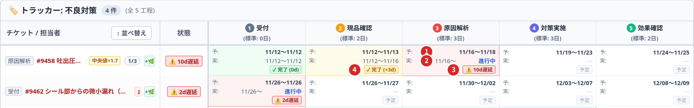
*画面7-2: トラッカー「不良対策」に絞ったマトリックスの、セルの見方*

1. **予定**: その工程の予定期間（予定開始日〜予定終了日）
2. **実績**: 実際に入った日〜出た日。まだその工程にいるときは「入った日〜 進行中」
3. **状態**: 工程の状態。進行中で予定の終わりを過ぎていれば「⚠️ N日遅延」、まだなら「予定」
4. **予実の差**: 終わった工程が、予定の終わりより何日遅く（`+3d`）・早く（`-1d`）終わったか。予定どおりなら `0d`

---

### 7.2 CSVエクスポート

定例会資料の作成や、他ツールでの集計・加工のために、マトリックス表のデータをそのままCSVファイルとして書き出せるようにしています。

1. マトリックス画面の下部にある **「他の形式にエクスポート: CSV」** または **「CSV (UTF-8)」** リンクをクリックします。
2. **出力内容**:
   - 画面で適用している絞り込みや並び順をそのまま反映して出力します。
   - トラッカーごとに、各工程につき「予定開始日」「予定終了日」「実績開始日時」「実績終了日時」「状態」の **5列** を展開します。
3. **Excel文字化け・数式対策**:
   - 日本語WindowsのExcelでそのままダブルクリックして開けるよう、標準CSVは **CP932（Shift_JIS）** で出力しています（MacやLinux環境向けに UTF-8 も選べます）。
   - セル値が `=+-@` で始まる場合にExcelで数式として誤認実行されるのを防ぐため、**数式無害化エスケープ処理（Formula Injection対策）** を組み込んでいます。

---

## 第8章：ボトルネック分析（プロセスの継続的改善）

### 8.1 工程別の滞留日数・リードタイム中央値の集計

プロジェクトサブメニューの **「分析」** を開くと、これまでに処理された全チケットの実績データから、各工程の通過リードタイムを自動集計して可視化します。

- **稼働日ベースの厳密な滞留時間集計**:
  土日などの休業日を除外した実稼働日ベースで、各工程に何日滞留したかを計算します。
- **中央値（Median）の採用**:
  極端に放置された特殊なチケット（外れ値）に平均値が引きずられるのを防ぐため、統計的に実態を最もよく表す **「中央値」** を基準指標として採用しています。

---

### 8.2 🚧 最も詰まっているワースト工程の検出

画面上部の集計表では、各工程の「定義された標準日数」と「実際の中央値」を分かりやすく対比表示します。

- **ワースト工程の自動検知**:
  標準日数に対して実際の中央値が最も大きく乖離（超過）している工程に、自動的に **「🚧 アイコン」** を点灯させて警告する仕組みを入れています。
- **活用方法**:
  「実装が遅れていると思っていたが、実はレビュー待ちに最も時間を浪費していた」「QAテストの枠が足りずに詰まっている」「原因解析より、試験設備の空き待ちで止まっていた」など、チーム全体の構造的なボトルネックを一目で把握できます。

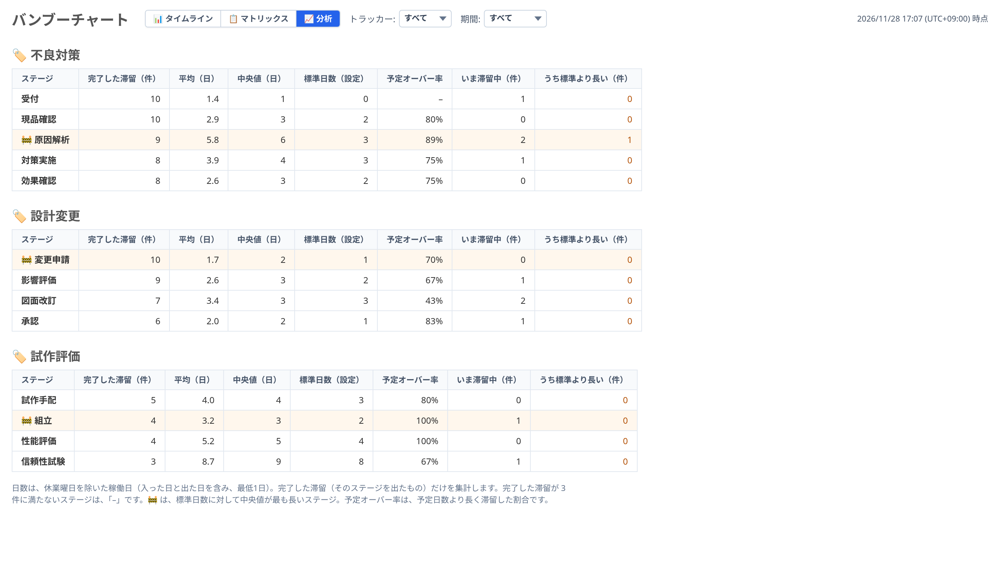
*画面8-1: 分析。工程ごとの滞留日数（平均・中央値）と標準日数の比較。🚧 が、標準に対して中央値が最も長い工程*

---

### 8.3 「中央値×N倍」長期停滞チケットのアラート札

チーム全体の傾向だけでなく、**「いま現在、特定の工程で異常に詰まっているチケット」** を早期に検知するアラート札機能を用意しています。

- **アラート発生条件**:
  現在進行中の工程において、「過去の中央値の **1.5倍以上**、かつ **2日以上**」その工程に留まり続けているチケットを自動抽出します。
- **表示表現**:
  チケット行に **「中央値×2.2」** や **「中央値×3.0」** といった倍率バッジを目立つ色で表示するように作っています。
- **運用上のメリット**:
  担当者が一人で抱え込んで悩んでいる難航タスクや、外部の回答待ちで止まっているタスクを周囲が即座に発見し、早期にフォローへ入れます。
- ※必要に応じてツールバーから札の表示/非表示をワンクリックで切り替えられます。

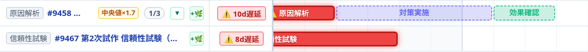
*画面8-3: 「中央値×1.7」の札。上のチケットは、原因解析にこれまでの中央値の1.7倍とどまっている。下は遅れてはいるが、札の条件（中央値の1.5倍以上）に届いていない*

---

### 8.4 レトロスペクティブ（ふりかえり）での活用パターン

スプリント終了時や月末の改善ミーティング（KPT・ふりかえり）において、以下のようなデータドリブンな改善活動を推進できます。

1. **工程の標準日数の見直し**:
   中央値が常に標準日数をオーバーしている工程がある場合、設定されている標準日数が非現実的である可能性があります。実態に合わせて設定を調整します。
2. **手戻り（差し戻し）の傾向分析**:
   差し戻しの履歴（工程への入退場の記録 `issue_stage_visits`）はデータベースに残っています。分析画面には手戻りの回数は出ないため、集計するにはデータベースへの問い合わせ（SQL など）が必要です。どの工程間で差し戻しが多いかが分かれば、前工程でのチェックリスト強化などの対策を打てます。

---

## 第9章：プロジェクト固有のカスタマイズ

### 9.1 プロジェクト固有の標準日数の上書き

トラッカーごとの標準工程や日数は全社共通（システム管理者が設定）ですが、プロジェクトの性質によって以下のような差が出ることも考えられます。

- 「新規サービスの立ち上げプロジェクトなので、要件定義と基本設計に通常の2倍の日数をかけたい」
- 「新機種の立ち上げなので、試作評価と信頼性試験に通常より長い日数をかけたい」
- 「量産品の不良対策なので、現品確認と暫定対策を短くして、早く手を打ちたい」
- 「保守フェーズのプロジェクトなので、レビューとリリース検証を短縮して即応性を高めたい」

こうした場合を想定して、トラッカーを新設することなく、プロジェクト独自に標準日数を上書きできる仕組みを用意しています。

1. 対象プロジェクトの **「設定」➔「シーケンシャルタスク」** タブを開きます（権限「標準日数を調整する」が必要です。既定ではどの役割にも付いていないので、管理者がプロジェクト管理者の役割などに付けます）。
2. シーケンシャルタスクが有効なトラッカーごとに、工程の一覧が並びます。
3. プロジェクト独自に変更したい工程の日数の欄に数値（1〜365。最初の工程は0も可）を入力します。空にすると、トラッカーの設定の日数になります。
4. **「保存」** をクリックします。
5. 以降、そのプロジェクトで**これから起票する**チケットは、上書きした日数を基準として全工程を自動計算します（作成済みのチケットの予定は変わりません）。分析画面とマトリックスの「標準日数」も、このプロジェクトの日数になります。

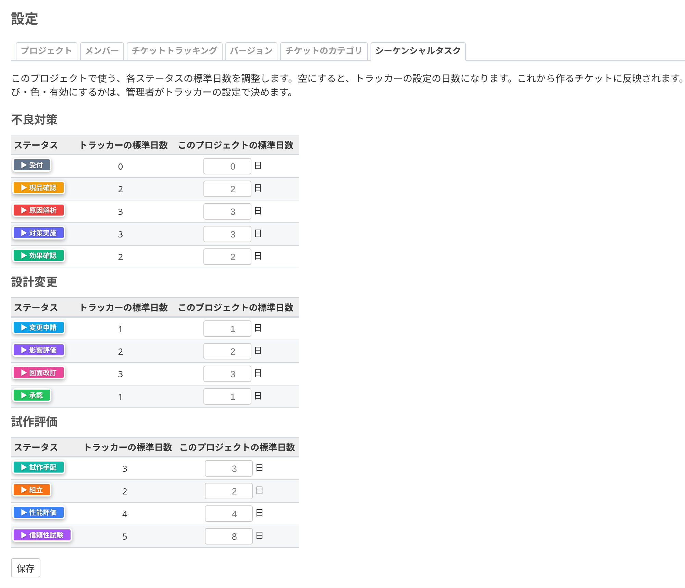
*画面9-1: プロジェクトの設定の「シーケンシャルタスク」タブ。トラッカーの標準日数と、このプロジェクトの標準日数（試作評価の信頼性試験だけ 5→8日）*

---

### 9.2 全体表示と印刷レイアウト

関係者への報告資料作成や紙での配布に配慮し、2つの表示最適化モードを用意しています。

- **全体表示モード**:
  タイムラインツールバーの **「▭ 全体表示」** にチェックを入れると、表のスクロール枠（固定枠）を解除し、全行・全期間を1ページ内に一括展開できるようにしています。ブラウザのズーム機能（縮小）と組み合わせることで、プロジェクト全体のパノラマスクリーンショットを綺麗にキャプチャできます。
- **印刷レイアウト**:
  ブラウザの印刷機能（`Ctrl+P` / `Cmd+P`）を実行した際、Redmineのヘッダー・サイドメニュー・余分な操作ボタンを印刷用CSSで自動的に非表示化し、タイムラインを用紙いっぱいに横向き・カラーで美しく出力できるようにスタイルを調整しています。

---

# 【第4部：アーキテクチャ・外部連携・逆引き】

## 第10章：内部アーキテクチャとデータ構造（技術解説）

### 10.1 ER図とテーブル設計（非侵入的設計思想）

本プラグインは、Redmine本体のデータベース構造（`issues` や `trackers` など）にカラムを追加せず、すべて独立した拡張テーブルに持たせています。プラグインをアンインストールした場合でもRedmine本体のデータ整合性を損なわないよう、**非侵入的（Non-intrusive）設計** を徹底しています。

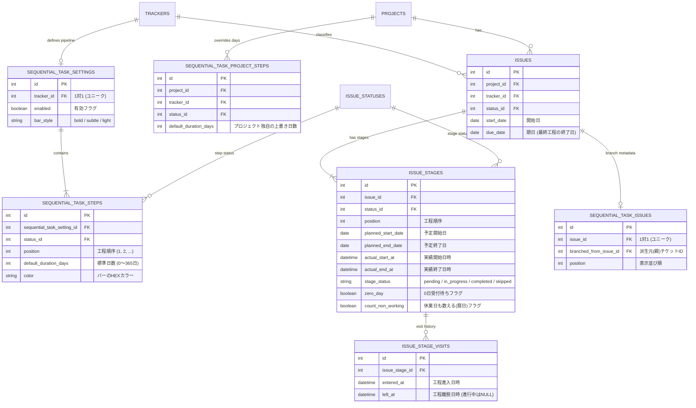

テーブル構成は、明確な意図を持って以下の2系統に分離しています。

1. **設定・テンプレート系（マスタ）**:
   - `sequential_task_settings`: トラッカーごとのプラグイン有効無効およびバー種別。
   - `sequential_task_steps`: トラッカーに属する工程の順序・標準日数・色定義。
   - `sequential_task_project_steps`: プロジェクト単位で標準日数を上書きする設定。
2. **実行・予実インスタンス系（トランザクション）**:
   - `issue_stages`: チケットごとの各工程の予定開始・終了日、実績開始・終了日時、状態。
   - `issue_stage_visits`: 手戻り（差し戻し）に対応する工程滞留履歴。
   - `sequential_task_issues`: ゆるいブランチ関係（親チケットID）および表示順序。

---

### 10.2 稼働日計算アルゴリズム

予定の自動展開やドラッグリスケジュールにおいて、土日（休業日）を飛び越える稼働日計算ロジックは、サーバーサイド（Ruby）とフロントエンド（JavaScript）の両方に同じ仕様で実装しています。

- **Ruby側**: `lib/redmine_sequential_tasks/working_day_calculator.rb`
- **JavaScript側**: `assets/javascripts/sequential_dates.js`（Node.js での自動単体テスト付き）
- **同期ロジック**:
  - `start_date` が休業日の場合、直後の稼働日へ補正。
  - `N日間の工程` の計算: 開始日を含めて稼働日をN日カウントした日が終了日となる。
  - `次工程の開始日`: 前工程の終了日の翌稼働日。
  - `休業日も数える（count_non_working: true）`: カレンダー通りの暦日で計算。

---

### 10.3 差し戻しに対応する訪問履歴（issue_stage_visits）の仕組み

ステータスが「実装 ➔ レビュー ➔ 実装（差し戻し）」と遷移した場合、単一のカラムでは「1回目の実装」の滞留時間が上書きされて消えてしまいます。

本プラグインでは、ステータス変更トリガー（`IssuePatch#update_sequential_stages_on_status_change`）により、以下のライフサイクルで `issue_stage_visits` を自動記録しています。

1. **工程進入時**: 新しいレコードを作成し、`entered_at` に現在日時をセット。
2. **工程離脱時**: レコードの `left_at` に現在日時をセットしてクローズ。
3. **差し戻し発生時**:
   - 後続ステージの実績をクリアして未完了に戻す。
   - 戻り先のステージで新しい訪問レコード（Visit 2回目）を作成。
4. **分析画面への活用**:
   - 各工程の真の総滞留時間は、`issue_stage_visits` の全訪問レコードの合計値として正確に算出するようにしています。

---

### 10.4 描画パフォーマンス（純粋Table + SVGオーバーレイ + Vanilla JS）

タイムライン画面は数百行×数十日の巨大なマトリックスになりますが、快適な操作性を実現するため描画パフォーマンスをチューニングしています（650行ほどの計測でサーバー応答約140ms、稲妻線の描画約5ms。開発時の計測による目安です）。

- **重量級ライブラリの不採用**:
  ライブラリ依存による肥大化やバージョン追従リスクを避けるため、Vis.js や FullCalendar、D3 等はあえて一切使用していません。
- **純粋なHTML Table ＋ Sticky CSS**:
  見出しやチケット列の固定は、ブラウザ標準の `position: sticky` を採用し、GPUハードウェアアクセラレーションを最大限活用させています。
- **1パスでのSVG稲妻線描画**:
  稲妻線の描画時、DOMの位置計測（`getBoundingClientRect`）を全行まとめて先に1度だけ実行し、その結果から1本の `<polyline>` パスを生成して `<svg>` オーバーレイに流し込みます。これにより、ブラウザの再レイアウト（リフロー）の多発を防いでいます。

---

## 第11章：外部システム連携（REST API）

### 11.1 REST API 経由での自動起票時のパイプライン生成

Redmine標準の REST API（`POST /issues.json`）経由でチケットを作成した場合でも、Web画面からの起票とまったく同様に工程パイプラインを自動生成するようにしています。

- **APIリクエスト例**:
  ```json
  POST /issues.json
  {
    "issue": {
      "project_id": "core-pay",
      "tracker_id": 2,
      "subject": "外部監視システムからのアラート自動起票",
      "start_date": "2026-11-16"
    }
  }
  ```
- **自動処理**:
  - `start_date` を起点として、トラッカーの標準日数から全工程（`issue_stages`）を自動計算してDBに保存します。
  - チケットの `due_date`（期日）にも最終工程の終了日を自動設定してレスポンスを返します。
  - 先頭が「0日（受付待ち）」設定のトラッカーの場合、0日待機状態でプールします。

---

### 11.2 不良管理DBや監視アラートとの連携ユースケース

外部の品質管理データベースや検査装置、監視アラート、CI/CD パイプラインと連携させる使い方として、たとえば次のような流れを想定しています（REST API での起票は確かめていますが、外部のシステムとつないでの確認はしていません）。

1. 不良管理DBや監視システムが、自動で Redmine にチケット（不良報告・インシデント）を起票します。
2. 担当者が着手するまでの間は、「受付待ち N日」として、受け取られずに置かれていた日数を見えるようにします（画面3-3）。
3. 後続の工程の予定は、起票の日から標準日数で組みます。受け取りが遅れた分は、遅延と稲妻線の凹みで見えます。

---

## 第12章：FAQ・トラブルシューティング・運用保守

### 12.1 稼働日・祝日の扱い（プラグイン連携の考え方）

- **Q. 日本の祝日（国民の祝日）や会社の長期休暇は自動でスキップしますか？**
  - **A**: しません。本プラグインは、Redmine標準の「休業日」（曜日の設定。土日など）だけを読み、祝日・会社の休みの一覧は持たない方針です。
  - ※祝日を扱う他のプラグインを入れても、本プラグインの計算には反映しません（未確認）。祝日をまたぐ工程は、「予定を調整」で日数を足すか、「休業日も数える」で調整してください。
- **Q. 特定の工程だけ土日も日数として数えたい場合は？**
  - **A**: チケット詳細の「予定を調整」画面で、該当工程の **「休業日も数える」** にチェックを入れて保存してください（第3章 3.5節 参照）。

---

### 12.2 日程がズレた・保存できないときのチェックポイント

- **Q. チケット詳細の「予定を調整」で、工程を伸ばすと「収まりません」と出る。保存ボタンが押せない。**
  - **A**: 期日優先で、工程が期日までに収まっていません（後ろの工程に削れる日数が残っていません）。日数を減らすか、モードを「日数優先」に切り替えて、期日ごと後ろへずらしてください。日数は1〜365日の範囲で扱います（範囲外の値は自動的に範囲内に収めます）。
- **Q. 「予定を調整」で、開始日の欄が灰色になっていて変えられない。**
  - **A**: 開始日を変えられるのは、どの工程も終わっておらず、工程を飛ばしておらず、現在の工程が最初の工程のときだけです。ワークフローで開始日が読み取り専用のときも変えられません。欄の横に理由を表示します。開始日を変えられないときは、各工程の日数で調整してください（3.3.3）。
- **Q. 「予定を調整」で保存したのに、チケットの期日が変わらない。**
  - **A**: 期日優先で保存すると、期日は動かしません。期日ごと延ばしたいときは、「日数優先」で保存してください。
- **Q. タイムライン上でドラッグしても保存できない（エラーになる）。**
  - **チェック1**: ログインユーザーのロールにおいて、ワークフロー設定で「開始日」や「期日」が「読み取り専用」になっていませんか？
  - **チェック2**: すでに完了している過去の工程の開始日を動かそうとしていませんか？（データの信憑性を守るため、完了工程の開始日はタイムライン上では動かせない安全制限を入れています）
  - **チェック3**: 期日優先で、期日までに収まらない調整になっていませんか？（吹き出しが赤く「収まりません」と出ます）
  - **チェック4**: 開始日・期日が、今日から前後10年の範囲の外になっていませんか？（予定の計算と画面が重くならないよう、範囲外は保存しません。日数は1工程1〜365日）
  - **チェック5**: ほかの人が同じチケットを同時に保存していませんか？（「別のユーザーが更新しました」と出たら、画面を読み直してからやり直します）
- **Q. チケットを保存しようとしたら「稼働日が見つからないため、予定を組めません」というエラーが出た。**
  - **チェック**: Redmineの「休業日」設定で7曜日すべてにチェックが入っていないか、または外部カレンダープラグインで半年先まで全日が休業日になっていないか確認してください（2.5節の安全保護機能）。

---

### 12.3 バージョンアップ手順

プラグインを新しいバージョン（例: v0.9.0 ➔ v0.10.0）へ更新する手順です。マイグレーションを実行してテーブル定義を最新化します。

```bash
cd /path/to/redmine

# 1. 念のためDBバックアップを取得
pg_dump -U <user> <dbname> > backup_before_update.sql

# 2. 古いプラグインのフォルダを退避してから、新しいバージョンのzipを展開
#    （上書きで展開すると、新しい版で消えたファイルが残るため）
cd plugins
mv redmine_sequential_tasks /tmp/redmine_sequential_tasks.old
unzip redmine_sequential_tasks-0.10.0.zip
#    git clone で入れた場合は、上の2行の代わりに、新しい版のタグに切り替える
#    cd redmine_sequential_tasks && git fetch --tags && git checkout v0.10.0 && cd ..

# 3. プラグインのマイグレーションを実行（DB変更がある場合）
cd /path/to/redmine
bundle exec rake redmine:plugins:migrate RAILS_ENV=production

# 4. Redmine を再起動
sudo systemctl restart redmine
```

---

### 12.4 アンインストール手順

プラグインのテーブルを消してから、プラグインのフォルダを削除します。Redmine 本体のテーブルにはカラムを足していないので、本体のデータはそのまま残ります（工程の予定・実績・派生の関係は消えます）。

```bash
cd /path/to/redmine

# 1. 念のためDBバックアップを取得
pg_dump -U <user> <dbname> > backup_before_uninstall.sql

# 2. プラグインのテーブルを削除（マイグレーションを戻す）
bundle exec rake redmine:plugins:migrate NAME=redmine_sequential_tasks VERSION=0 RAILS_ENV=production

# 3. プラグインのフォルダを削除して、Redmine を再起動
rm -rf plugins/redmine_sequential_tasks
sudo systemctl restart redmine
```

---

### 12.5 既知の制約

- **動作検証環境**:
  - 実務での安定稼働を重視し、**Redmine 6.1.5 / PostgreSQL 17 / Chromium系ブラウザ** を主軸として開発・検証を行っています。
  - Redmine 7.0.2 は、テストコンテナで全自動テストが通ることを確認し、作者が日々の仕事で使っています（すべての画面・機能を網羅的に確かめたわけではありません）。
- **既知の制約**:
  - 祝日・会社の休みには対応しません（Redmine の休業曜日だけを使います）。
  - 手動の並べ替えは、マウスのドラッグだけです（キーボードでは操作できません）。
  - タイムラインの調整モードは、キーボードでは操作できません（同じことは、チケット詳細の「予定を調整」の日数の欄でできます）。
  - 分析の計画日数は、「休業日も数える」にした工程でも営業日で数えます。

---

*(マニュアル 本文完)*


